# 📊 Basic Statistics for Data Science

> A plain guide to statistics for data science. Each idea comes with a picture from daily life, a real use, the formula, and short Python you can run.


**~26,000 words**  ·  **8 parts + 5 appendices**  ·  **32 Python examples**  ·  **Beginner → Interview-ready**

---

## 📑 Table of Contents

- [🚀 Getting Started](#-getting-started)
- [🎯 PART 0, Orientation: What Statistics Is, and Why](#-part-0-orientation-what-statistics-is-and-why)
  - [0.1 Statistics = Decision-Making Under Uncertainty](#01-statistics-decision-making-under-uncertainty)
  - [0.2 Why a Data Science Student Cannot Escape It](#02-why-a-data-science-student-cannot-escape-it)
  - [0.3 The Two Branches](#03-the-two-branches)
  - [0.4 Key Vocabulary (Learn These Words First)](#04-key-vocabulary-learn-these-words-first)
  - [0.5 Types of Variables](#05-types-of-variables)
  - [0.6 Measurement Scales (4 levels)](#06-measurement-scales-4-levels)
- [📊 PART 1, Descriptive Statistics](#-part-1-descriptive-statistics)
  - [1.1 What is a typical value?](#11-what-is-a-typical-value)
    - [Mean](#mean)
    - [Median](#median)
    - [Mode](#mode)
    - [Which one to use](#which-one-to-use)
  - [1.2 How spread out is it?](#12-how-spread-out-is-it)
    - [Range](#range)
    - [Variance](#variance)
    - [Standard deviation](#standard-deviation)
    - [Percentiles and quartiles](#percentiles-and-quartiles)
    - [Skew: which way is the tail?](#skew-which-way-is-the-tail)
  - [1.3 Box plot in 30 seconds](#13-box-plot-in-30-seconds)
  - [1.4 Z-score: how unusual is this point?](#14-z-score-how-unusual-is-this-point)
  - [1.5 Do two things move together?](#15-do-two-things-move-together)
  - [1.6 Part 1 Cheat Sheet](#16-part-1-cheat-sheet)
- [🎲 PART 2, Probability](#-part-2-probability)
  - [2.1 The Three Axioms (the rules everything must obey)](#21-the-three-axioms-the-rules-everything-must-obey)
    - [Axiom 1, every probability is between 0 and 1](#axiom-1-every-probability-is-between-0-and-1)
    - [Axiom 2, the certain event](#axiom-2-the-certain-event)
    - [Axiom 3, add mutually exclusive events](#axiom-3-add-mutually-exclusive-events)
    - [The subtraction rule (complement)](#the-subtraction-rule-complement)
    - [General addition rule (overlapping events)](#general-addition-rule-overlapping-events)
  - [2.2 Sample Space, Events, and Diagrams](#22-sample-space-events-and-diagrams)
  - [2.3 Counting: Permutations and Combinations](#23-counting-permutations-and-combinations)
    - [Permutations (order MATTERS)](#permutations-order-matters)
    - [Combinations (order does NOT matter)](#combinations-order-does-not-matter)
    - [Real data science uses](#real-data-science-uses)
  - [2.4 Conditional Probability](#24-conditional-probability)
    - [Law of Total Probability](#law-of-total-probability)
  - [2.5 Bayes' Theorem, Thinking Backwards](#25-bayes-theorem-thinking-backwards)
    - [The Medical Test Problem (understand this and you understand Bayes)](#the-medical-test-problem-understand-this-and-you-understand-bayes)
    - [Bayes in machine learning](#bayes-in-machine-learning)
  - [2.6 Independence](#26-independence)
  - [2.7 Common Probability Mistakes](#27-common-probability-mistakes)
- [📉 PART 3, Probability Distributions](#-part-3-probability-distributions)
  - [3.1 What Is a Distribution?](#31-what-is-a-distribution)
    - [Notation](#notation)
  - [3.2 Discrete Distributions](#32-discrete-distributions)
    - [Bernoulli, one trial, success or failure](#bernoulli-one-trial-success-or-failure)
    - [Binomial, n independent Bernoulli trials, count the successes](#binomial-n-independent-bernoulli-trials-count-the-successes)
    - [Poisson, counting rare events in a fixed interval](#poisson-counting-rare-events-in-a-fixed-interval)
    - [Geometric, trials until the first success](#geometric-trials-until-the-first-success)
    - [Hypergeometric, sampling without replacement](#hypergeometric-sampling-without-replacement)
    - [Discrete Cheat Sheet](#discrete-cheat-sheet)
  - [3.3 Continuous Distributions](#33-continuous-distributions)
    - [Uniform, everything equally likely (the beginner's friend)](#uniform-everything-equally-likely-the-beginners-friend)
    - [Normal (Gaussian), the king of distributions](#normal-gaussian-the-king-of-distributions)
    - [Standard Normal and Z-scores](#standard-normal-and-z-scores)
    - [Exponential, "waiting time" distribution](#exponential-waiting-time-distribution)
    - [Beta, the distribution of a probability (used in A/B tests and optimisation)](#beta-the-distribution-of-a-probability-used-in-ab-tests-and-optimisation)
    - [Poisson vs Exponential, do not confuse them](#poisson-vs-exponential-do-not-confuse-them)
  - [3.4 Continuous Cheat Sheet](#34-continuous-cheat-sheet)
  - [3.5 Choosing a Distribution (a decision flow)](#35-choosing-a-distribution-a-decision-flow)
- [🔍 PART 4, Sampling and Estimation](#-part-4-sampling-and-estimation)
  - [4.1 Population vs Sample, The Core Idea](#41-population-vs-sample-the-core-idea)
  - [4.2 Sampling Methods](#42-sampling-methods)
    - [1. Simple Random Sampling (SRS)](#1-simple-random-sampling-srs)
    - [2. Systematic Sampling](#2-systematic-sampling)
    - [3. Stratified Sampling](#3-stratified-sampling)
    - [4. Cluster Sampling](#4-cluster-sampling)
    - [5. Convenience and Voluntary Response, the biased ones](#5-convenience-and-voluntary-response-the-biased-ones)
  - [4.3 Bias, The Silent Killer](#43-bias-the-silent-killer)
    - [Types of bias you must know](#types-of-bias-you-must-know)
    - [Missing data matters too](#missing-data-matters-too)
  - [4.4 The Central Limit Theorem (CLT)](#44-the-central-limit-theorem-clt)
  - [4.5 Point Estimate vs Interval Estimate](#45-point-estimate-vs-interval-estimate)
    - [Finding point estimates: maximum likelihood in five minutes](#finding-point-estimates-maximum-likelihood-in-five-minutes)
  - [4.6 Confidence Intervals](#46-confidence-intervals)
    - [Confident intervals for other quantities](#confident-intervals-for-other-quantities)
- [🧪 PART 5, Hypothesis Testing](#-part-5-hypothesis-testing)
  - [5.1 The Core Logic](#51-the-core-logic)
  - [5.2 The Hypotheses](#52-the-hypotheses)
    - [Significance level and the two errors](#significance-level-and-the-two-errors)
  - [5.3 The p-value, Explained Properly](#53-the-p-value-explained-properly)
    - [A concrete example](#a-concrete-example)
    - [The four biggest p-value misconceptions](#the-four-biggest-p-value-misconceptions)
  - [5.4 The 5-Step Procedure (any hypothesis test)](#54-the-5-step-procedure-any-hypothesis-test)
  - [5.5 t-Tests](#55-t-tests)
    - [The general form of a t-statistic](#the-general-form-of-a-t-statistic)
    - [5.5.1 One-sample t-test](#551-one-sample-t-test)
    - [5.5.2 Two-sample (independent) t-test](#552-two-sample-independent-t-test)
  - [5.6 Chi-Square Test of Independence](#56-chi-square-test-of-independence)
  - [5.7 ANOVA (Comparing More Than Two Groups)](#57-anova-comparing-more-than-two-groups)
  - [5.8 Testing a Correlation](#58-testing-a-correlation)
  - [5.9 Multiple Testing and p-hacking](#59-multiple-testing-and-p-hacking)
  - [5.10 Part 5 Cheat Sheet](#510-part-5-cheat-sheet)
- [🧮 PART 6, Regression Analysis](#-part-6-regression-analysis)
  - [6.1 The Idea](#61-the-idea)
  - [6.2 Least Squares, Why "Best Fit" Means What It Does](#62-least-squares-why-best-fit-means-what-it-does)
  - [6.3 Understanding R-Squared](#63-understanding-r-squared)
  - [6.4 Residuals: did the model miss a pattern?](#64-residuals-did-the-model-miss-a-pattern)
  - [6.5 The Four Regression Assumptions](#65-the-four-regression-assumptions)
  - [6.6 Correlation Is Not Causation (and Why Not)](#66-correlation-is-not-causation-and-why-not)
    - [Simpson's paradox: the winner flips when you split](#simpsons-paradox-the-winner-flips-when-you-split)
  - [6.7 Multiple Linear Regression](#67-multiple-linear-regression)
  - [6.8 Overfitting and Underfitting](#68-overfitting-and-underfitting)
- [🛠️ PART 7, Non-Parametric Methods and Practical Data Science Topics](#-part-7-non-parametric-methods-and-practical-data-science-topics)
  - [7.1 When the Normal Assumption Fails](#71-when-the-normal-assumption-fails)
  - [7.2 Non-Parametric (Rank-Based) Tests](#72-non-parametric-rank-based-tests)
    - [The main tests](#the-main-tests)
    - [The permutation test: what would chance do?](#the-permutation-test-what-would-chance-do)
  - [7.3 Robust Statistics, Describing Data That Misbehaves](#73-robust-statistics-describing-data-that-misbehaves)
    - [The breakdown point, the key idea](#the-breakdown-point-the-key-idea)
    - [The robust toolkit](#the-robust-toolkit)
  - [7.4 Categorical Data: Proportions, Odds and Ratios](#74-categorical-data-proportions-odds-and-ratios)
    - [Proportion](#proportion)
    - [The three risk measures](#the-three-risk-measures)
    - [What a chi-square test cannot tell you](#what-a-chi-square-test-cannot-tell-you)
  - [7.5 Time Series, A Brief, Honest Introduction](#75-time-series-a-brief-honest-introduction)
    - [The three ingredients of any time series](#the-three-ingredients-of-any-time-series)
    - [Why time series break ordinary statistics](#why-time-series-break-ordinary-statistics)
    - [Stationarity, in plain words](#stationarity-in-plain-words)
    - [Autocorrelation (ACF), "does today predict tomorrow?"](#autocorrelation-acf-does-today-predict-tomorrow)
  - [7.6 A Complete Worked Example: Customer Churn](#76-a-complete-worked-example-customer-churn)
    - [The business question](#the-business-question)
    - [The bootstrap, the universal escape hatch](#the-bootstrap-the-universal-escape-hatch)
    - [Step 1, Load and inspect](#step-1-load-and-inspect)
    - [Step 2, Descriptive statistics FIRST (Part 1)](#step-2-descriptive-statistics-first-part-1)
    - [Step 3, Is the difference real? (Part 5)](#step-3-is-the-difference-real-part-5)
    - [Step 4, Logistic regression (Part 6 logic, for a binary outcome)](#step-4-logistic-regression-part-6-logic-for-a-binary-outcome)
    - [Step 5, Decision, with uncertainty attached](#step-5-decision-with-uncertainty-attached)
    - [How to defend this analysis in an interview](#how-to-defend-this-analysis-in-an-interview)
- [📎 Appendices](#-appendices)
  - [🧾 APPENDIX A, Formula Sheet](#-appendix-a-formula-sheet)
    - [A.1 Descriptive](#a1-descriptive)
    - [A.2 Correlation and Regression](#a2-correlation-and-regression)
    - [A.3 Probability](#a3-probability)
    - [A.4 Distributions](#a4-distributions)
    - [A.5 Sampling and Estimation](#a5-sampling-and-estimation)
    - [A.6 Hypothesis Testing](#a6-hypothesis-testing)
    - [A.7 Robust Statistics](#a7-robust-statistics)
    - [A.8 Effect Sizes](#a8-effect-sizes)
  - [📋 APPENDIX B, Distribution and Test Cheat Tables](#-appendix-b-distribution-and-test-cheat-tables)
    - [B.1 Discrete distributions at a glance](#b1-discrete-distributions-at-a-glance)
    - [B.2 Continuous distributions at a glance](#b2-continuous-distributions-at-a-glance)
    - [B.3 Which test? (the decision tree)](#b3-which-test-the-decision-tree)
    - [B.4 Choosing a significance level](#b4-choosing-a-significance-level)
    - [B.5 Effect size reference](#b5-effect-size-reference)
  - [✍️ APPENDIX C, Practice Questions with Worked Answers](#-appendix-c-practice-questions-with-worked-answers)
    - [C.1 Descriptive Statistics](#c1-descriptive-statistics)
    - [C.2 Probability](#c2-probability)
    - [C.3 Distributions](#c3-distributions)
    - [C.4 Estimation and Testing](#c4-estimation-and-testing)
    - [C.5 Correlation and Regression](#c5-correlation-and-regression)
    - [C.6 Exam-style Short Answers (write these out in full)](#c6-exam-style-short-answers-write-these-out-in-full)
  - [📖 APPENDIX D, Glossary](#-appendix-d-glossary)
  - [🚨 APPENDIX E, Top 20 Statistical Mistakes in Data Science](#-appendix-e-top-20-statistical-mistakes-in-data-science)
- [🙌 Closing Note](#-closing-note)

## 🚀 Getting Started

This book is written for a student who can code but feels uneasy about
statistics. Every idea is presented the same way:

1. What it says, in one or two lines
2. A picture from daily life
3. Where you meet it in real work
4. The formula
5. Short Python

> **Tip:** Read [Part 1](#-part-1-descriptive-statistics) and
> [Part 2](#-part-2-probability) first. Everything else builds on them.

---

## 🎯 PART 0, Orientation: What Statistics Is, and Why

### 0.1 Statistics = Decision-Making Under Uncertainty

Imagine a medicine that "works" for 8 out of 10 patients. Sounds great, right?
But what if it works for 90 out of 100 people, and works for 9 out of 10 for a
harmless sugar pill? Is the medicine doing anything, or did the patients get
better by luck?

That question is statistics.

> Statistics means collecting and reading data so we can decide even when we are not fully sure.

Real data is always messy and noisy. Statistics gives us a principled way to say
*"I am 95% confident"* instead of *"I think so"*.

### 0.2 Why a Data Science Student Cannot Escape It

The data science workflow already contains statistics at every stage:

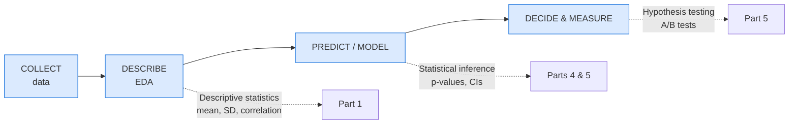

- **Describing your data** -> descriptive statistics (Part 1)
- **Quantifying the chance of chance** -> probability (Part 2, 3)
- **Generalising from a sample** -> inference (Part 4, 5)
- **Relating variables and predicting** -> regression (Part 6)

Every time someone says *"our model is 94% accurate, so it is great"*, a
statistician asks: accurate **on what**? How big was the test set? Is that better
than guessing? Statistics is the reality check on machine learning.

### 0.3 The Two Branches

| Branch | Question it answers | Tools |
|---|---|---|
| **Descriptive** | What does my data look like? | mean, median, SD, charts, correlation |
| **Inferential** | What can I conclude about the *world* from this data? | t-test, confidence interval, p-value |

Think of it this way: descriptive is the nurse noting your temperature. Inferential is the doctor judging whether you are sick or it is just a one day blip.

### 0.4 Key Vocabulary (Learn These Words First)

| Term | Meaning | Everyday example |
|---|---|---|
| **Population** | The *entire* group you care about | All 1.4 billion people in India |
| **Sample** | The small piece you actually measured | 1,000 people you surveyed |
| **Variable** | A characteristic you measure | Height, age, salary |
| **Data point (observation)** | One row / one measurement | "Rahul is 172 cm" |
| **Parameter** | A *number about the population* (mu, sigma, p) | India's true average height |
| **Statistic** | A *number computed from a sample* (x-bar, s, p-hat) | Average height of your 1,000 people |
| **Unit of analysis** | What one row represents | One student, one transaction, one day |

> **Classic trap:** Greek letters (mu, sigma, p) = population.
> Latin letters (x-bar, s, p-hat) = sample.
> You estimate parameters with statistics. People often say
> "mean" for both.

### 0.5 Types of Variables

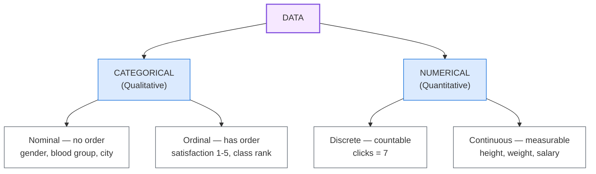

The statistical method you use depends on the variable type. Averaging *heights*
gives a mean that means something. Averaging *blood groups* does not, because the
mean of A, B, AB and O is nonsense.

### 0.6 Measurement Scales (4 levels)

| Scale | Examples | Can you add? | Can you average? |
|---|---|---|---|
| **Nominal** | gender, city, eye colour | No | No |
| **Ordinal** | satisfaction rating, class rank | Yes, but gaps are not equal | Risky |
| **Interval** | temperature in C, calendar year | Yes | Yes |
| **Ratio** | height, weight, income, time | Yes | Yes, meaningful zero |

Only *interval* and *ratio* data support means and standard deviations. An
average satisfaction score of 4.1 is acceptable; an average of "which car brand"
is nonsense.

---
## 📊 PART 1, Descriptive Statistics

*Descriptive statistics answers: what shape is my data?*

### 1.1 What is a typical value?

A teacher collects 5 marks. A company looks at 5 salaries. Both ask the same thing: what is normal here?

Three answers work in different cases: mean, median and mode.

#### Mean

Add everything, divide by how many there are.

```text
marks: 70, 80, 75, 90, 85
sum = 400
mean = 400 / 5 = 80
```

Think of it as the balance point. If the marks sat on a seesaw, 80 is where it balances.

The mean uses every value, so maths built on top of it works well. Regression, t-tests and the average error in machine learning all start from the mean.

The problem is one odd value can pull it far away.

Say 5 people earn (in thousands):

```text
30, 35, 40, 45, 2000
```

Four people earn around 30 to 45 thousand. One person earns 2000 thousand. The mean is 430 thousand. Nobody earns near that.


> **In words:** one extreme value drags the mean to 430, while the median stays at 40 with the group.

In code:

```python
marks = [70, 80, 75, 90, 85]
print(sum(marks) / len(marks))  # 80.0
```

In symbols, for a sample:

```text
x-bar = (1/n) * SUM xi, i = 1 to n
```

Use the mean when the data is roughly symmetric and has no wild outliers.

#### Median

Sort the data, pick the middle.

```text
marks sorted: 70, 75, 80, 85, 90
median = 80
```

If there are 4 values, take the middle two and average them:

```text
data: 10, 12, 15, 20 -> median = (12 + 15) / 2 = 13.5
```

The median only cares about order, so a huge outlier cannot move it much. That is why salary reports, house prices, delivery times and app response times use the median. It is also called the 50th percentile: half the data sits below it.

```python
import statistics
print(statistics.median([30, 35, 40, 45, 2000]))  # 40
```

#### Mode

The value that shows up most.

```text
sizes: S, M, M, L, M, S, M
mode = M
```

It is the only one of the three that works for categories. Example:

| Blood group | A | B | O |
|---|---|---|---|
| Count | 5 | 2 | 1 |

Mode is A.

Sometimes there are two peaks. That usually means two groups got mixed. Put men and women in one height column and you get two peaks. Split them before you analyse further.

#### Which one to use

|  | Mean | Median | Mode |
|---|---|---|---|
| Works on numbers | yes | yes | yes, and on categories |
| Uses every value | yes | no | no |
| Moves a lot with outliers | yes | no | no |
| Good for skewed data | no | yes | yes |
| Always exists | yes | yes | sometimes there is no clear winner |
| Stays inside min to max | yes | yes | yes |

Exam rule that helps: if the shape is symmetric, all three sit together. If the tail stretches right, as with income, mean comes first, then median, then mode. If the tail stretches left, the order flips.

---

### 1.2 How spread out is it?

Mean alone can mislead. These two groups share the same mean:

```text
Group A: 10  10  10  10  10   mean = 10
Group B:  2  10  10  10  18   mean = 10
```

A is identical every time. B jumps around. Always report a centre with a spread.

#### Range

Max minus min.

```text
range = max - min
```

A has range 0. B has range 16. It is a fast check, but it uses only two values, so one odd point can change it fully. Do not rely on it alone.

#### Variance

How far do values sit from the mean, on average?

Steps with data 2, 4, 4, 4, 5, 5, 7, 9. Mean is 5.

```text
take each value minus mean: -3 -1 -1 -1 0 0 2 4
square each: 9 1 1 1 0 0 4 16, sum = 32
divide: 32 / 7 = 4.571
```

We square because minus and plus would cancel to zero otherwise. Squaring also gives large gaps extra weight, which matches how we feel about them.

If you have the full population, divide by n. If you have a sample and want to guess the population, divide by n-1. That small fix is called Bessel's correction. For large n it hardly matters. For n under 40 it does.

```text
population: sigma^2 = (1/n) * SUM (xi - mu)^2
sample: s^2 = (1/(n-1)) * SUM (xi - x-bar)^2
```

#### Standard deviation

Square root of variance. It brings the unit back to normal.

```text
s = sqrt(4.571) = 2.14
```

Read it as: a typical value sits about 2.14 away from the mean. Variance would say 4.57 squared units, which is hard to picture.

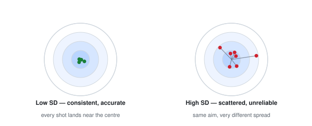

In words: same aim, different spread. Standard deviation measures consistency.

One rule that always holds: at least 75% of values sit within 2 standard deviations of the mean, at least 89% within 3. This is the worst case promise. For bell shaped data the real share is higher.

#### Percentiles and quartiles

Sort the data, then cut by position.

```text
Q1 = 25th percentile, a quarter sits below it
Q2 = median
Q3 = 75th percentile
IQR = Q3 - Q1, the middle half lives here
```

Example: marks 50, 60, 65, 70, 75, 80, 90. Q1 = 65, median = 70, Q3 = 80, IQR = 15.

The IQR ignores the ends, so outliers cannot move it. That helps with income, house rent, server latency.

Box plot rule for flagging:

```text
lower fence = Q1 - 1.5 * IQR
upper fence = Q3 + 1.5 * IQR
outside the fences = look closer
```

Saying "90th percentile of delivery is 42 minutes" means 90% arrived within 42, 10% took longer. Teams write service promises in this language.

#### Skew: which way is the tail?

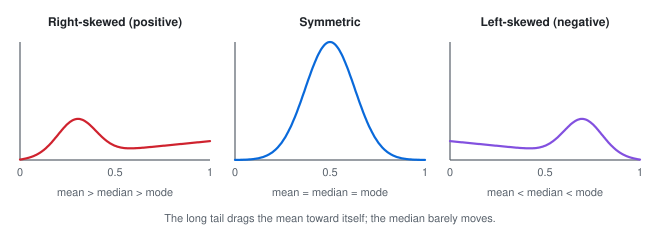

In words: a long right tail pulls the mean toward itself and leaves the median behind.

Right skew means a few very large values. Income, house prices, spend per customer, page load time. Use median and IQR here, or take log of the values.

Left skew means a few very small values. Exam scores when most score near 95 is a common one.

```text
right skew: mean > median > mode
left skew: mean < median < mode
```

Code:

```python
import pandas as pd
s = pd.Series([2, 4, 4, 4, 5, 5, 7, 9, 200])
print(s.skew())  # large positive means right tail
```

---

### 1.3 Box plot in 30 seconds

Take data 2, 4, 4, 4, 5, 5, 7, 9. Five numbers sum it up: min 2, Q1 4, median 4.5, Q3 5.5, max 9.

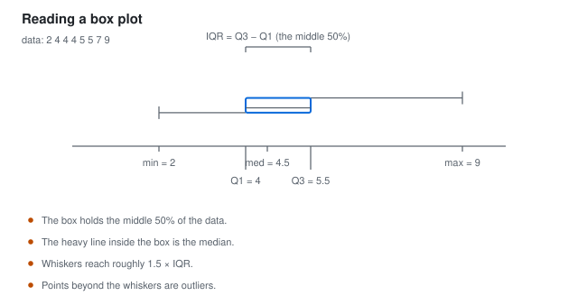

In words: the box runs Q1 to Q3, the line inside is the median, whiskers reach about 1.5 times IQR.

How to read it: wide box means spread out. Line inside is the middle. Dots past the whiskers deserve a look. Long top whisker often means right tail. Long bottom means left tail.


In words: same median can hide a tight group and a scattered one.

Habit that pays off: plot your target split by main category before any model. Ten seconds of looking beats ten numbers.

---

### 1.4 Z-score: how unusual is this point?

```text
z = (value - mean) / standard deviation
```

190 cm is tall for adults, normal for basketball players. Unusual depends on context. Z-score fixes the context.

Example: data 2, 4, 4, 4, 5, 5, 7, 9. Mean 5, SD 2.14. Value 9 gives z = (9 - 5) / 2.14 = 1.87.


In words: 1.87 standard deviations above the mean sits far in the right tail.

Three uses:

1. Flag outliers. Past 3 in either direction is worth a look, if the data is roughly bell shaped. For skewed data use the IQR fences from 1.2 instead.
2. Compare across units. Z-scores let you say whether a maths score or a height is more unusual.
3. Scale features for models. This is what StandardScaler does. Needed for k-NN, k-means, PCA, logistic regression, neural nets. Trees do not need it.

```python
import pandas as pd
from sklearn.preprocessing import StandardScaler

df = pd.DataFrame({"marks": [70, 80, 75, 90, 85]})
print(df.describe())

x = df["marks"]
z = (x - x.mean()) / x.std(ddof=1)
print(z.round(2).tolist())

print(StandardScaler().fit_transform(x.values.reshape(-1, 1)).ravel().round(2))
```

---

### 1.5 Do two things move together?

Correlation checks for a straight line link between two numbers. If one goes up, does the other tend to go up or down?


In words: the last panel curves like a U, so r sits near zero even though the link is strong. Always plot.

Pearson r runs -1 to 1. Plus 1 is a clean upward line. Minus 1 is a clean downward line. Zero means no straight line link.

```text
study hours vs marks: positive
study hours vs TV hours: negative
```

What r means in practice: square it. r = 0.6 gives r squared = 0.36, so about 36% of the swing in y follows a line with x. Do not read r itself as a percent.

Rough guide:

| r | r squared | read |
|---|---|---|
| 0 to 0.3 | 0 to 9% | weak |
| 0.3 to 0.5 | 9 to 25% | moderate |
| 0.5 to 0.7 | 25 to 49% | strong |
| above 0.7 | above 49% | very strong, check for leakage |

When Pearson struggles (ranks, skew, outliers, curved but steady climb), use Spearman. It works on order, so one wild point cannot break it.

Link is not cause. More ice cream sales and more drownings move together because summer drives both. Full story is in 6.6.

```python
import numpy as np, pandas as pd
from scipy import stats

df = pd.DataFrame({
    "hours": [1, 2, 3, 4, 5, 6, 7, 8],
    "marks": [50, 55, 58, 65, 70, 74, 82, 88]
})
print(df["hours"].corr(df["marks"]))

r, pval = stats.pearsonr(df["hours"], df["marks"])
print(f"r = {r:.3f}, p = {pval:.4f}")

x = np.linspace(-3, 3, 200)
y = x**2 + np.random.normal(0, 1, 200)
print(np.corrcoef(x, y)[0, 1])  # near 0, yet y follows x squared
```

---

### 1.6 Part 1 Cheat Sheet

| Measure | Sensitive to outliers | Robust to outliers | Works on categorical |
| :--- | :---: | :---: | :---: |
| mean / x-bar | YES | no | no |
| median | no | YES | no |
| mode | no | YES | YES |
| range | YES | no | no |
| variance / SD | YES | no | no |
| IQR | no | YES | no |
| z-score | YES | no | no |
| correlation r | YES | no | no |

Report a pair: centre with spread.

> "Mean 50, SD 3" is complete. "Mean 50" alone is half a sentence.

---
## 🎲 PART 2, Probability

*Probability is how we write down uncertainty.*

### 2.1 The Three Axioms (the rules everything must obey)

Start from a single definition and everything else follows.

What probability means:

```text
             number of times the outcome occurred
P(A)  =  ------------------------------------------
                 total number of trials
```

> *"Heads has probability 0.5"* does not say what this toss will be.
> It says: toss a fair coin a million times and about half land heads.
> It describes the long run, not the next toss.

#### Axiom 1, every probability is between 0 and 1

```text
0  <=  P(A)  <=  1
```

- P(A) = 0 -> impossible (rolling a 7 on a die)
- P(A) = 1 -> certain (the sun will rise tomorrow, practically speaking)
- P(A) = 0.5 -> coin flip

#### Axiom 2, the certain event

```text
P(S) = 1      where S is the whole sample space
```

#### Axiom 3, add mutually exclusive events

Mutually exclusive means the two things can never happen together. Then just add:

```text
P(A or B) = P(A) + P(B)     only if A and B are mutually exclusive
```

```text
  Two dice, roll a 6 on either:
    6 on die 1  -> P = 1/6
    6 on die 2  -> P = 1/6
    (they cannot both be 6 in one roll, so: total = 1/6 + 1/6 = 2/6 = 1/3)
```

#### The subtraction rule (complement)

The most used trick in stats. The complement of A is everything that is not A.

```text
P(not A) = 1 - P(A)     written as  P(A') or  P(A-bar)
```

```text
  P(some customer churns) is awkward to calculate directly.
  P(customer does NOT churn) is often easy.
  So compute the easy one and subtract from 1.
```

To find the chance of winning, analysts often work out the chance of not winning first. The second sum is usually easier.

#### General addition rule (overlapping events)

```text
P(A or B) = P(A) + P(B) - P(A and B)
```

You subtract the overlap because it got counted twice.

```text
  Card is a King or a Heart.
  P(King) = 4/52,  P(Heart) = 13/52,  P(King of Hearts) = 1/52
  P(King or Heart) = 4/52 + 13/52 - 1/52 = 16/52
```

---

### 2.2 Sample Space, Events, and Diagrams

- **Sample space S** = the set of *all* possible outcomes
- **Event** = any *subset* of S

```text
Two fair coins tossed.

S = { HH, HT, TH, TT }      -> 2^2 = 4 outcomes

A = "at least one head" = { HH, HT, TH }
P(A) = 3/4

B = "exactly two heads"  = { HH }
P(B) = 1/4
```

In a Venn diagram the overlap is `P(A and B)`. Add the two circles and you count the overlap twice, so subtract it once.

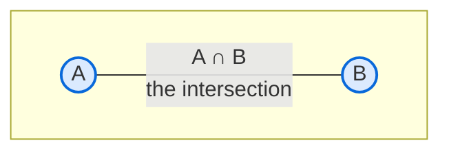

---

### 2.3 Counting: Permutations and Combinations

You need this for lottery numbers, committees, passwords, any place where you count ways things can happen.

#### Permutations (order MATTERS)

Gold versus silver matters. Giving gold to Amit and silver to Sumit is a different result from the reverse.

```text
        n!
P(n, r) = ----------------   =  n! / (n - r)!
```

```text
  Arrange 3 of 5 runners on a podium (1st, 2nd, 3rd):
  P(5,3) = 5 x 4 x 3 = 60
```

#### Combinations (order does NOT matter)

Picking a 3 person team from 5 students. Nobody is first or second in the team, so order does not count.

```text
           n!
C(n, r) = ----------   =  n! / [ r! * (n - r)! ]
          r!(n - r)!
```

```text
  Choose 3 students from 5:
  C(5,3) = 10
  Compare: P(5,3) = 60 = C(5,3) * 3! = 10 * 6  (order of the 3 chosen matters 6 ways)
```

Memory hook: combination means order does not count, permutation means it does.

#### Real data science uses

| Situation | Tool |
|---|---|
| Password / ID space size | n^r vs permutations & combinations |
| How many possible 10-digit PINs | 10^10 = 10 billion |
| Randomly picking 10 customers from 50,000 | C(50000, 10) |
| Number of features subsets in a model | 2^p |
| Sampling without replacement | hypergeometric (Part 3) |

Note: C(50000, 10) has about 274 digits. Do not run `factorial()` on it. Use `scipy.special.comb` or work with logs.

```python
from math import factorial, comb, perm
from scipy.special import comb as scomb, gammaln
import numpy as np

print(comb(5, 3))            # 10
print(perm(5, 3))            # 60
print(factorial(5))           # 120

# safe way for huge numbers
print(scomb(50000, 10))
logC = gammaln(50001) - gammaln(11) - gammaln(49991)
print(logC)                  # log of the result -- small, easy to handle
```

---

### 2.4 Conditional Probability

 *given that something already happened, how likely is the
other thing?*

```text
             P(A and B)
P(A | B) = --------------
               P(B)
```

Read it as **"A given B"**.

Example:

```text
A bag has: 3 red, 2 blue marbles. Two are drawn (without replacement).

Q1: P(second is red | first was red)?
Q2: P(second is blue | first was red)?
```

A tree makes it easy:

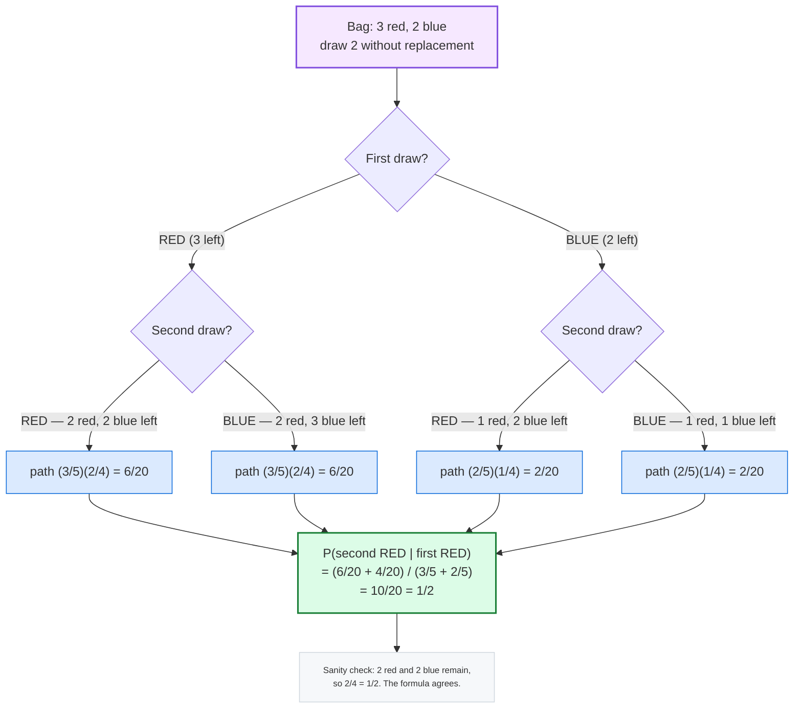

Add the paths that end with second red and first red:

```text
              (3/5 x 2/4) + (2/5 x 2/4)      =  6/20 + 4/20  =  10/20
P(second red | first red) = ------------------------------  =  1/2
                                  (3/5 + 2/5)
```

Check by thinking: after one red is out, 2 red and 2 blue stay in the bag. So red next is 2/4 = 1/2. The formula agrees. Run this kind of check every time.

**Q2** by symmetry = 1/2 as well.

#### Law of Total Probability

When `B` is actually several cases together, split it up:

```text
P(A) = SUM  P(A | Bi) * P(Bi)
```

Example:  60% of a shop's customers are online, 40% in-store. Online buyers
convert at 20%; in-store at 50%. What is the overall conversion rate?

```text
P(buy) = P(buy|online)*P(online) + P(buy|store)*P(store)
       = 0.20 * 0.60          + 0.50 * 0.40
       = 0.12                  + 0.20
       = 0.32                    -> 32%
```

Shop, app and hospital reports use this split all the time.

---

### 2.5 Bayes' Theorem, Thinking Backwards

 I saw an *effect*. What is the probability of the *cause*?

```text
              P(B | A) * P(A)
P(A | B) = --------------------
                 P(B)
```

In words: prior times likelihood, divided by total chance of seeing this evidence.

#### The Medical Test Problem (understand this and you understand Bayes)

```text
A disease affects 1 in 1000 people.              P(D)      = 0.001
A test is 99% accurate:                          P(+|D)    = 0.99
It also flags 5% of healthy people (false alarms) P(+|notD) = 0.05

Q: A person tests positive. What is P(disease | positive)?
```

First guess many people make: 99%, because the test is 99% right. That guess is wrong. It ignores how rare the disease is.

Count it out with 100,000 people:

| 100,000 people | Disease | No disease | Total |
|---|---|---|---|
| **Test positive** | 99 | 4,995 | 5,094 |
| **Test negative** | 1 | 94,905 | 94,906 |
| **Total** | 100 | 99,900 | 100,000 |

> P(disease | positive) = 99 / 5,094 ≈ **1.94%, about 2%**.

```text
P(D | +) = 99 / 5094 = 0.0194 = about 2%
```

Despite a 99%-accurate test, a positive result means only about a **2% chance of
disease**. The disease is so rare that the 5% false-alarm rate generates a *flood*
of false positives next to the few real cases.

A needle in a haystack, with a detector that also beeps on some straw. When straw is huge and needles are few, most beeps are straw.

This is why medical screening of rare diseases requires confirmatory tests, and
why fraud detection needs such careful threshold design.

#### Bayes in machine learning

- The **Naive Bayes classifier** assumes features are conditionally independent
  given the class. Surprisingly strong for text classification and spam
  detection, even though the assumption is almost always false in practice.
- **Bayesian A/B testing** is the correct way to decide between two variants
  *without* repeatedly peeking and stopping when the result looks good.
- **Markov-chain Monte Carlo**, used in Bayesian stats and modern generative
  models, is built entirely on this formula.
- **Posterior distributions** in Bayesian modelling: your belief before seeing
  data (prior), updated by the data, giving your belief after (posterior).

Start with a belief, then let evidence move it. Surprising evidence moves it more.

```python
# Bayes with integers -- the medical test example, no formula confusion
P_disease = 1/1000
P_pos_given_disease = 0.99
P_pos_given_healthy  = 0.05

numerator   = P_pos_given_disease * P_disease
denominator = P_pos_given_disease * P_disease + P_pos_given_healthy * (1 - P_disease)
print(f"P(disease | positive) = {numerator/denominator:.4f}")   # ~0.0196
```

---

### 2.6 Independence

A and B are independent if knowing B tells you nothing new about A:

```text
P(A and B) = P(A) * P(B)
P(A | B)   = P(A)
```

Example:  a person's height and their favourite colour are independent.
Height and weight are *not*.

Why it matters in data science:

1. The whole logic of Naive Bayes is built on assuming feature independence.
2. In regression, if two predictors are highly correlated with each other, the
   model becomes unstable (multicollinearity, Part 6).
3. In A/B testing, randomisation makes treatment and user identity independent,
   which is exactly why the test is unbiased.

Mutually exclusive versus independent, a very common confusion:

```text
Mutually exclusive: the two CANNOT both happen.
Independent:        knowing one tells you NOTHING about the other.

Can two events be both? Only if P(A and B) = 0.
  Mutually exclusive and P(A)>0 and P(B)>0  ->  NOT independent.
```

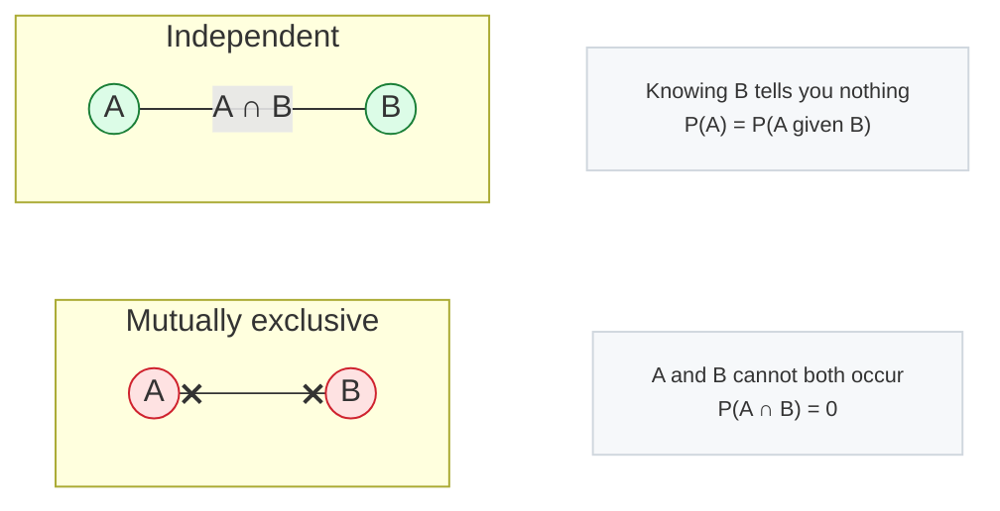

---

### 2.7 Common Probability Mistakes

| Mistake | Truth |
|---|---|
| "A 1% chance event happens every 100 tries" | No, random events have long gaps. This is the **gambler's fallacy**. |
| "Two 50% events are more likely together than separately" | No. Independence means P(both) = 0.5 x 0.5 = 0.25. |
| "P-value = probability the null hypothesis is true" | **No.** See Part 5. |
| "High correlation proves causation" | **No.** See 6.6. |
| "If the test is 99% accurate, a positive means 99%" | **No.** Base-rate fallacy, see 2.5. |
| "P(A) = 0.5 means this next toss will be heads" | No. It is a long-run statement. |
| "The expected value is the most likely outcome" | No. Expected value is a probability-weighted average and may not even be achievable. |

Gambler's fallacy: after five heads, the next fair toss is still 50% heads. The coin has no memory. Real systems can still show runs, like faulty batches on a line, because some hidden cause drifts slowly. That is a different story from one fair coin.

---
## 📉 PART 3, Probability Distributions

*A distribution says how likely each outcome is.*

### 3.1 What Is a Distribution?

A distribution answers: *"for each possible value, how likely is it?"*

It gives centre, spread, shape and tails in one picture.

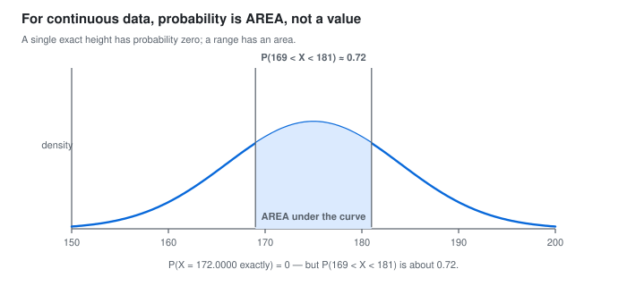

> **In words:** A single exact height has probability zero, but an interval has an
> area under the curve.

The two families:

| | Discrete | Continuous |
|---|---|---|
| What can take | countable values (0, 1, 2, 3) | any value in a range (height) |
| Probabilities | exact, sum to 1 | points have probability 0; **areas** matter |
| Written as | PMF | PDF |
| Drawn as | bars | a curve |

> Note: one exact height like 172.0000 cm has probability zero. An interval like 170 to 175 cm has a real chance, measured as area under the curve.

#### Notation

```text
X   ~  Normal(mu, sigma^2)     "X is distributed as Normal with mean mu and
                                variance sigma-squared"
P(X <= 4)                      "the probability that X is at most 4"
```

---

### 3.2 Discrete Distributions

#### Bernoulli, one trial, success or failure

```text
X ~ Bernoulli(p)
P(X = 1) = p        (success)
P(X = 0) = 1 - p    (failure)
E[X] = p        Var(X) = p(1-p)
```

**Real uses:** a customer clicks (1) or not (0). A user converts (1) or bounces (0).
A cell is defective (1) or fine (0).

This is the building block of yes/no models. Logistic regression predicts `P(Y = 1 | x)`.

---

#### Binomial, n independent Bernoulli trials, count the successes

```text
X ~ Binomial(n, p)

         n    n
P(X = k) = C   p  (1-p)     k = 0, 1, ... n
         k    k

E[X] = np        Var(X) = np(1-p)        SD = sqrt(np(1-p))
```

Toss a coin 10 times, count heads. Trials must be independent and share the same p.

**Real uses:** how many defects in a batch of 100 items; how many clicks out of
1000 impressions; how many people out of 500 will churn.

**Worked example:** what is the probability of exactly 3 heads in 10 fair tosses?

```text
C(10,3) * 0.5^3 * 0.5^7 = 120 * 0.001953125 = 0.2343750   -> about 23.4%
```

Mean np and variance np(1-p) mark out the binomial.

---

#### Poisson, counting rare events in a fixed interval

```text
X ~ Poisson(lambda)

            e^-lambda * lambda^k
P(X = k) = ---------------------        k = 0, 1, 2, ...
                  k!

E[X] = lambda          Var(X) = lambda
```

Calls per hour at a call centre. Cases per year of a rare illness. Typos per page.

Note that the mean equals the variance, both being lambda. The Poisson process
assumes events happen at a constant average rate, independently.

**Real uses:** the number of server errors per minute; the number of customers
arriving per hour; rare insurance claims.

**Worked example:** a website gets on average 3 errors per minute. What is the
probability of exactly 2 errors in the next minute?

```text
e^-3 * 3^2 / 2! = 0.0498 * 9 / 2 = 0.2240   -> about 22.4%
```

Poisson regression predicts counts like calls or arrivals that grow with exposure.

---

#### Geometric, trials until the first success

```text
X ~ Geometric(p)

P(X = k) = (1-p)^(k-1) * p        k = 1, 2, 3, ...

E[X] = 1/p
```

How many rolls until the first six?

**Real use:** number of customers who must be contacted before the first
purchase; the number of retries before success.

---

#### Hypergeometric, sampling without replacement

```text
X ~ Hypergeometric(N, K, n)

P(X = k) = C(K,k) * C(N-K, n-k) / C(N, n)

where N = population size, K = successes in population, n = sample size
```

Draw 5 cards from 52 and keep them out. Compared to
the binomial, the denominator shrinks after each draw, so the probabilities
change. That is the whole difference.

**Real use:** quality control. "Of 1000 chips, 50 are defective. I sample 20
without replacement. How many are defective?"

When to use which:

```text
with replacement    -> binomial        (e.g. tossing a coin, independent users)
without replacement -> hypergeometric  (e.g. sampling real customers from a list)
large N vs small n  -> hypergeometric approximates to binomial
```

---

#### Discrete Cheat Sheet

| Distribution | Counts | Parameters | E[X] | Var(X) | Use it for |
|---|---|---|---|---|---|
| Bernoulli | successes | p | p | p(1-p) | one yes/no trial |
| Binomial | successes in n trials | n, p | np | np(1-p) | n independent yes/no |
| Poisson | events in a fixed interval | lambda | lambda | lambda | rare events, constant rate |
| Geometric | trials to first success | p | 1/p | (1-p)/p^2 | waiting time |
| Hypergeometric | successes in a sample | N, K, n | nK/N | nK/N (1-K/N)(N-n)/(N-1) | sampling w/o replacement |

How to keep the three apart:

- Binomial = "how many successes out of n fixed trials?"
- Poisson = "how many events in a fixed time?" (the count has no fixed limit)
- Hypergeometric = "binomial, but I removed the successes as I went."

---

### 3.3 Continuous Distributions

#### Uniform, everything equally likely (the beginner's friend)

```text
X ~ Uniform(a, b)

              1
f(x) = -------------     for a <= x <= b
            b - a
           0        otherwise

E[X] = (a+b)/2        Var(X) = (b-a)^2 / 12
```


> **In words:** Support and shape decide the model: flat, bell-shaped, right-skewed
> or bounded on [0,1].

**Uses:** random number generation; as a starting point for Monte Carlo
integration; modelling genuinely "no information" data.

---

#### Normal (Gaussian), the king of distributions

```text
X ~ Normal(mu, sigma^2)

               1               (x - mu)^2
f(x) = --------------- * exp( - ------------- )
       sigma*sqrt(2*pi)        2*sigma^2
```

A symmetric bell. Mean, median and mode sit together at the centre.

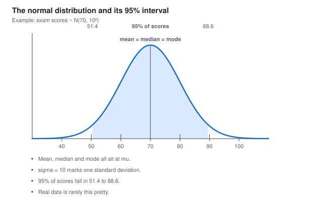

> **In words:** A symmetric bell centred on the mean; 95% of values lie within mu ± 1.96 sigma.

Careful with notation: `N(mu, sigma^2)` takes variance, not SD. So `Normal(0, 1)` has SD 1.

Why the normal distribution is so important:

1. The Central Limit Theorem (Part 4) says the *sample mean* of almost any
   population is approximately normal, which is why it appears everywhere.
2. It is fully described by just two numbers, mu and sigma.
3. Sum and average of independent normals are normal (a "stable" distribution).
4. It is closed under linear transformations, which is what makes linear
   regression work.

**The Empirical Rule (68-95-99.7):**

| Share of data | Range | Real-world use |
|---|---|---|
| 68% | mu ± 1 sigma | the bulk of a normal distribution |
| 95% | mu ± 2 sigma | a typical 95% confidence interval |
| 99.7% | mu ± 3 sigma | a range you can call 'almost certain' |

Do not assume normality for income, house prices, city sizes, waiting times, most engagement counts. They skew right. Try `np.log1p` first, or a rank method from Part 7.

---

#### Standard Normal and Z-scores

```text
Z = (X - mu) / sigma        ~  Normal(0, 1)
```

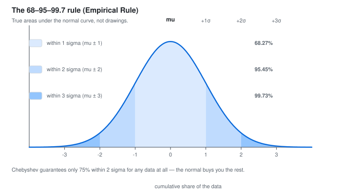

> **In words:** About 68% of data lies within 1 sigma, 95% within 2, and 99.7% within 3.

Example: scores follow `N(70, 10^2)`. Chance above 85? Scores of
above 85?

```text
z = (85 - 70)/10 = 1.5
P(Z > 1.5) = 1 - 0.9332 = 0.0668     -> about 6.7%
```

**In code:**

```python
from scipy import stats

mu, sigma = 70, 10
z = (85 - mu) / sigma
print(stats.norm.cdf(z))          # 0.9332  (area to the LEFT)
print(stats.norm.sf(z))           # 0.0668  (the answer) -- survival function
print(stats.norm.ppf(0.95))       # 1.6449  (the 95th percentile / z critical)
```

**Percentiles you should memorise:**

| Percentile | z |
|---|---|
| 90th | 1.28 |
| 95th | 1.645 |
| 97.5th | 1.96 |
| 99th | 2.576 |

> **Two-sided vs one-sided:** a 95% confidence interval uses z = 1.96 (which
> leaves 2.5% in each tail). A 95% *one-sided* threshold uses z = 1.645 (all
> 5% in one tail). This is a very common exam and coding mistake.

---

#### Exponential, "waiting time" distribution

```text
X ~ Exponential(lambda)

f(x) = lambda * exp(-lambda * x)    x >= 0

E[X] = 1/lambda      Var(X) = 1/lambda^2      SD = 1/lambda
```

**Memory hook: the mean and the standard deviation are the same number.**

Think of it this way: the waiting time between buses that arrive at a constant random
rate. The memoryless property:

```text
P(X > t + s | X > t) = P(X > s)
```

Once you have already waited 10 minutes, your expected *additional* wait is the
same as if you had just arrived. Past waiting tells you nothing.

**Real uses:** time to the next customer arrival; time until a machine fails;
time between system failures. The memoryless property is exactly why exponential
distributions drive reliability engineering and queueing theory.

**Weibull** is a generalisation, far more flexible, and the standard choice for
"how long until this component fails".

---

#### Beta, the distribution of a probability (used in A/B tests and optimisation)

```text
X ~ Beta(a, b),  a, b > 0

           x^(a-1) * (1-x)^(b-1)
f(x) = ---------------------------------      0 <= x <= 1
                 B(a, b)

E[X] = a/(a+b)      Var(X) = ab / [ (a+b)^2 (a+b+1) ]
```

**What it models:** an *unknown probability*. a and b encode how much you
believe success is and how confident you are.

Think of it this way: before seeing any data, you might guess a coin is fair, that is,
uniform on [0, 1] = `Beta(1, 1)`. After 7 heads and 3 tails, your updated
belief about the coin's bias is `Beta(8, 4)`, tightly centred near 0.7. This is
exactly the machinery behind **Bayesian A/B testing** and behind the sampling
distributions used in bandits and Bayesian optimisation.

---

#### Poisson vs Exponential, do not confuse them

```text
Poisson:      "how MANY events in an interval?"   (discrete count)
Exponential:  "how LONG until the next event?"      (continuous wait)
They are two views of the same underlying process.
```

---

### 3.4 Continuous Cheat Sheet

| Distribution | Shape | Support | E[X] | Var(X) | Use it for |
|---|---|---|---|---|---|
| Uniform | flat | [a, b] | (a+b)/2 | (b-a)^2/12 | no information; simulation |
| Normal | bell, symmetric | (-inf, inf) | mu | sigma^2 | the default continuous model |
| Exponential | decaying, right-skewed | [0, inf) | 1/lambda | 1/lambda^2 | waiting times |
| Beta | U-shape or bell on [0,1] | [0, 1] | a/(a+b) | ab/[(a+b)^2(a+b+1)] | unknown probabilities |
| (t) Student | bell, fatter tails | (-inf, inf) | mu | sigma^2(n-1)/(n-2) | small samples, unknown sigma |

---

### 3.5 Choosing a Distribution (a decision flow)

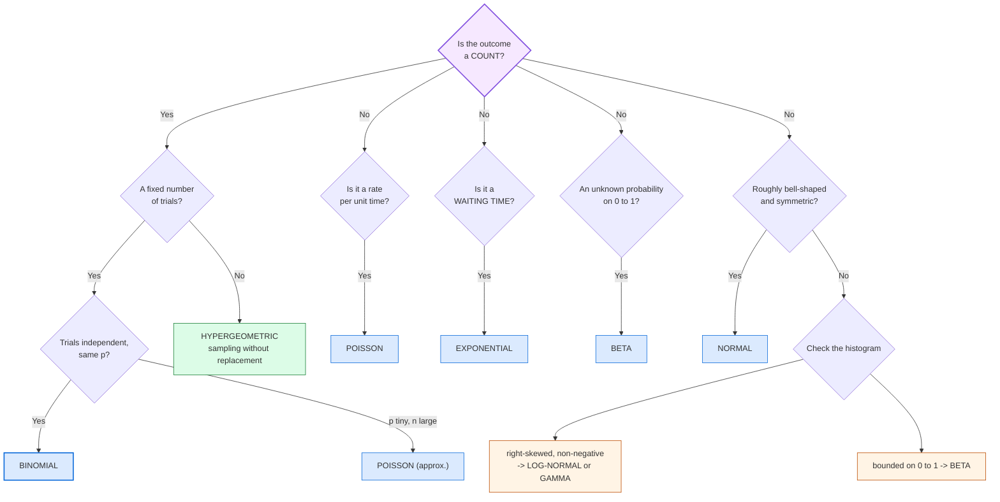

```python
from scipy import stats
import numpy as np

# discrete
print(stats.binom.pmf(3, 10, 0.5))     # P(exactly 3 heads in 10 tosses)
print(stats.binom.cdf(3, 10, 0.5))     # P(3 or fewer)
print(stats.binom.mean(10, 0.5), stats.binom.std(10, 0.5))
print(stats.poisson.pmf(2, 3))          # exactly 2, rate 3
print(stats.hypergeom.pmf(k=2, M=1000, n=50, N=20))

# continuous
print(stats.norm.pdf(1.5), stats.norm.cdf(1.5))
print(stats.expon.cdf(3, scale=1/2))    # note: scale = 1/lambda
print(stats.beta.cdf(0.7, 8, 4))
print(stats.t.cdf(2.2, df=19))
```
## 🔍 PART 4, Sampling and Estimation

*This is where statistics becomes genuinely powerful: drawing conclusions about
millions from an inspection of a thousand.*

### 4.1 Population vs Sample, The Core Idea

We **never** measure the whole population. We measure a sample and then *guess*
about the population, quantifying how badly we might be wrong.

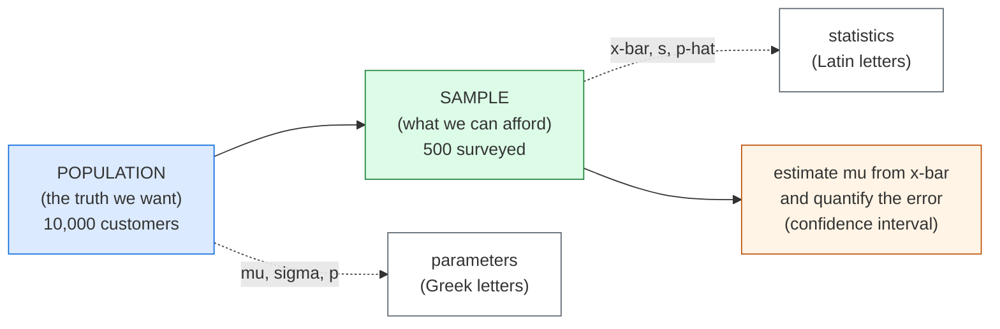

**The words to get right:**

| About the population | About the sample |
|---|---|
| parameter | statistic |
| mu, sigma, p, N | x-bar, s, p-hat, n |

You cannot weigh every person in India to find the average weight.
You weigh 10,000 of them, a good unbiased sample, and your sample mean is your
*best estimate* of the population mean. The CI tells you how much to trust it.

**Sampling error** = the difference between the sample statistic and the true
population parameter. It is unavoidable, and its size is predictable: it shrinks
as `1/sqrt(n)`.

```text
  To halve the margin of error, you must QUADRUPLE the sample size.
  n = 1,000   -> MOE ~ +/- 3.1 percentage points
  n = 4,000   -> MOE ~ +/- 1.55
  n = 10,000  -> MOE ~ +/- 1.0
```

This is why small polls are noisy and why "we surveyed 30 people" is not enough
for most claims.

---

### 4.2 Sampling Methods

#### 1. Simple Random Sampling (SRS)

Every member has an **equal** chance of being chosen. The gold standard.

**How:** number everyone, then use a random number generator to pick n.

**Weakness:** can be unlucky and get an unrepresentative group by chance.

#### 2. Systematic Sampling

Pick every kth element: `k = N / n`.

```text
Population of 1000, want 100  ->  k = 10  ->  pick 7th, 17th, 27th, ...
```

The trap: if the population has a hidden *period* matching k (e.g. a list
ordered by department, and k = 12), you systematically over-select some groups.
**Randomise the starting point** to avoid this.

#### 3. Stratified Sampling

**First divide the population into meaningful subgroups (strata), then sample
proportionally from each.**

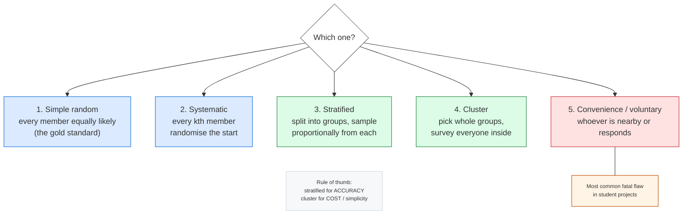

Stratified sampling **guarantees** representation, so it usually gives tighter
estimates than SRS.

**Use when:** you want to compare across groups (city, gender, product type), or
you know some strata are far more variable than others, in which case you can
sample those *more*. That choice is **proportionate vs Neyman allocation**.

#### 4. Cluster Sampling

Divide into natural groups, randomly select some groups, then survey
**everyone** in the selected groups.

```text
Choose 5 schools at random, survey all students in those 5.
```

It is **cheaper than stratified**, since you do not need to reach every subgroup
individually, but **less precise**: you get 5 "points" of information instead of
hundreds.

**Rule of thumb:** stratified for *accuracy* (you already have subgroup info),
cluster for *cost/simplicity* (you cannot easily reach individuals).

#### 5. Convenience and Voluntary Response, the biased ones

- **Convenience:** survey whoever is nearby, your friends, the people who
  responded on social media. Used constantly and dangerously.
- **Voluntary response:** people choose to participate. People with strong
  opinions are far more likely to answer, so the result is systematically
  skewed.

> **In a data science project, the most common fatal error is a convenience
> sample.** A survey of your classmates is not a study of Indian consumers, no
> matter how large it is.

---

### 4.3 Bias, The Silent Killer

**Bias is a systematic error that does not shrink as you collect more data.**
It is far more dangerous than random sampling error.

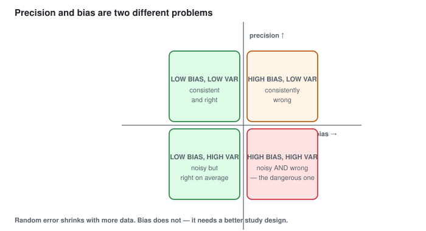

> **In words:** Random error shrinks with more data. Bias does not, which needs a
> better study design.

*(Axes: horizontal = bias, vertical = variance. The bottom-left is the best,
top-right the worst.)*

#### Types of bias you must know

| Bias | What it is | Real example |
|---|---|---|
| **Selection** | sample differs from population | surveying only gym members about diet |
| **Survivorship** | only "survivors" remain in the data | studying only planes that did *not* crash (Abraham Wald) |
| **Non-response** | non-respondents differ from respondents | income survey where the rich decline to answer -> results skew low |
| **Response** | people answer inaccurately | under-reporting alcohol, income or health |
| **Measurement** | bad instrument or definition | a watch that runs slow |
| **Recall** | memory is imperfect | "how much did you drink last year?" |
| **Voluntary response** | self-selected participants | online polls, customer satisfaction forms |
| **Confirmation** | you look where you expect to find it | only analysing metrics that support your pet theory |
| **Data leakage** | the model sees future/other info | a feature that only exists after the outcome |

**Abraham Wald's survivorship story:** during World War II, Wald examined
returning planes and advised reinforcing the parts with many bullet holes:
engines, wings, and so on. The naive reading is "bullets hit the wings". The
correct reading is that **planes with engines hit and that still flew back were
absent from the data.** You must reinforce where the planes *did not* return. The
insight generalises: **your dataset contains only the cases that survived the
process you are trying to understand.** Always ask: *who or what is missing from
this data, and would they look different?*

#### Missing data matters too

```text
  Missing Completely At Random (MCAR)  -> data vanishes for no reason related
                                          to anything. Rare in practice.
  Missing At Random (MAR)              -> missingness depends on other
                                          OBSERVED variables. Usually fine to
                                          drop or impute carefully.
  Missing Not At Random (MNAR)         -> missingness depends on the value
                                          itself. e.g. rich people do not
                                          report income.  -> BIASED
```

`df.dropna()` silently assumes MCAR. Knowing the difference is a genuine
interview-worthy skill.

---

### 4.4 The Central Limit Theorem (CLT)

 whatever shape your data has, the *distribution of its mean*
becomes approximately normal as the sample grows.

The CLT is an averaging machine. Take a wild, lumpy set of numbers,
average them, and the result smooths out into a nice bell curve. This is why
politicians' approval ratings hover around a stable value: different polls return
similar numbers even though individual opinions are scattered and polarised.

**The formal statement:**

```text
  Let X1, X2, ... Xn be i.i.d. random variables with mean mu and
  finite variance sigma^2. Then:

                 X-bar - mu
  X-bar  ~  N(  --------- ,  sigma^2/n )     for large n
                   sigma/sqrt(n)

  Equivalently:  (X-bar - mu) / (sigma/sqrt(n))  ~  N(0, 1)
```

Three things to remember:

1. The CLT works for *any* population (skewed, bimodal, uniform). It needs only
   finite variance and independence, which is what makes it so powerful.
2. The centre stays at mu (unbiased).
3. The spread shrinks as `1/sqrt(n)`. Your estimate gets more precise with more
   data, and you can predict exactly how much.


> **In words:** The population is right-skewed, but the distribution of its mean
> approaches a bell curve as n grows.

Two caveats (say these in any interview):

1. You need a reasonably large n. Rule of thumb: n >= 30 for a decent
   approximation, and **more** if the population is very skewed or has outliers.
2. It applies to the *mean* (and sum), not to the raw data. Your original data
   will never become normal by increasing n. Only the distribution of the average
   does.

**What CLT buys you:**

```text
  standard error of the mean   =  sigma / sqrt(n)
  confidence interval for mu    =  x-bar  +/-  z * (s / sqrt(n))
  test statistic (large n)      =  (x-bar - mu) / (s / sqrt(n))   ~ z
```

Notice that **the only difference from the naive version is the `sqrt(n)` in the
denominator.** That single fact is the engine behind most of Part 5.

```python
import numpy as np
import matplotlib.pyplot as plt
rng = np.random.default_rng(42)

# a horribly skewed population
pop = rng.exponential(scale=2, size=1_000_000)
print(f"population mean = {pop.mean():.3f}, sd = {pop.std():.3f}")

for n in [1, 5, 30, 100]:
    means = [rng.choice(pop, n, replace=True).mean() for _ in range(5000)]
    print(f"n={n:4d}  mean of means = {np.mean(means):.3f}  "
          f"sd of means = {np.std(means):.3f}  (theory: {pop.std()/np.sqrt(n):.3f})")

# visual: the CLT in action
fig, axes = plt.subplots(1, 4, figsize=(16, 3.5), sharey=True)
for ax, n in zip(axes, [1, 5, 30, 200]):
    m = [rng.choice(pop, n, replace=True).mean() for _ in range(4000)]
    ax.hist(m, bins=40, density=True)
    ax.set_title(f"n = {n}")
plt.suptitle("Sampling distribution of the mean (exponential population)")
plt.tight_layout(); plt.show()
```

---

### 4.5 Point Estimate vs Interval Estimate

- **Point estimate:** a single number. `x-bar = 52.3 kg`. Precise-sounding, but it
  gives no idea of the error, so a point estimate on its own is misleading.
- **Interval estimate:** a range. `52.3 kg, plus or minus 1.8 kg`. Honest about
  the uncertainty.

> An A/B test reported as "variant B gave 12.4% conversion" is useless. With a
> standard error of 1.5 points, you cannot tell whether B beat A. You need the
> interval.

#### Finding point estimates: maximum likelihood in five minutes

Where do estimates like x-bar come from? One idea covers most cases: pick the
parameter value that makes the data you saw most probable.

Flipping a coin 100 times with 63 heads. For a guess p, the chance of exactly
that outcome is `L(p) = p^63 * (1-p)^37`. Which p makes 63 heads least
surprising? Take the log (turns powers into sums), differentiate, set to zero:

```text
log L = 63*log(p) + 37*log(1-p)
d/dp  = 63/p - 37/(1-p) = 0   ->   p-hat = 63/100 = 0.63
```

The estimate is just the sample share. Same recipe gives more:

```text
Bernoulli (k wins in n tries)  ->  p-hat = k/n
Poisson counts                 ->  lambda-hat = x-bar
Normal mean (sigma known)      ->  mu-hat = x-bar
Normal variance                ->  sigma^2-hat = (1/n)*SUM(xi - x-bar)^2
```

Note the last line divides by n, not n-1. Maximum likelihood is slightly
biased here, and Bessel's n-1 correction from Part 1 fixes exactly that.

A cousin called the method of moments sets sample moments equal to theory
moments (x-bar = mu) and solves. Same answers in these cases, less general
otherwise. Most model fitting in machine learning, including logistic
regression in Part 7, is maximum likelihood under the hood.

```python
import numpy as np
rng = np.random.default_rng(11)

tosses = rng.binomial(1, 0.63, size=100)
print("MLE p-hat:", round(float(tosses.mean()), 3))   # ~0.63, matches k/n

counts = rng.poisson(4.2, size=2000)
print("MLE lambda-hat:", round(float(counts.mean()), 3))  # ~4.2, matches x-bar

x = rng.normal(68, 12, size=500)
print("MLE mu-hat:", round(float(x.mean()), 2))       # ~68
print("MLE sigma2 (n):", round(float(((x - x.mean())**2).mean()), 2))
print("sample var (n-1):", round(float(x.var(ddof=1)), 2))  # a touch larger
```

---

### 4.6 Confidence Intervals

**A confidence interval is a range of plausible values for the true parameter.**

**The 95% confidence interval, three equivalent forms:**

```text
  (1)  x-bar  +/-  1.96 * (s / sqrt(n))                  (large n, z)
  (2)  x-bar  +/-  t(alpha/2, n-1) * (s / sqrt(n))       (small n, t)
  (3)  Any range containing 95% of the probability of the
       statistic under the null hypothesis
```

**Step by step:**

```text
  Step 1:  Compute x-bar and s
  Step 2:  Standard error = s / sqrt(n)
  Step 3:  Critical value (z for 95% two-sided = 1.96)
  Step 4:  Margin of error = critical value * standard error
  Step 5:  CI = (x-bar - MoE,  x-bar + MoE)
```

**Worked example:** 100 students, mean marks = 68, SD = 12.

```text
  SE        = 12 / sqrt(100) = 1.2
  MoE       = 1.96 * 1.2      = 2.352
  95% CI    = (68 - 2.35, 68 + 2.35) = (65.65, 70.35)
```

How to interpret it, which is the part everyone gets wrong:

**Correct:**
> *"We are 95% confident that the true mean mark of all students lies between
> 65.65 and 70.35."*

**Incorrect:**
> *"There is a 95% chance the true mean is between 65.65 and 70.35."*

The difference matters because the parameter is a **fixed but unknown** number.
It is either in the interval or it is not, and there is no randomness about it.
What is random is **the interval itself**. Before you collect the data, the
method will produce a range that covers the truth 95% of the time. Once you have
the data, the range is just a number.

Correct mental image: imagine repeating the whole study 20,000 times with fresh
samples. About 19,000 of the resulting intervals would contain the true mean.
Your particular interval is one draw from that family.

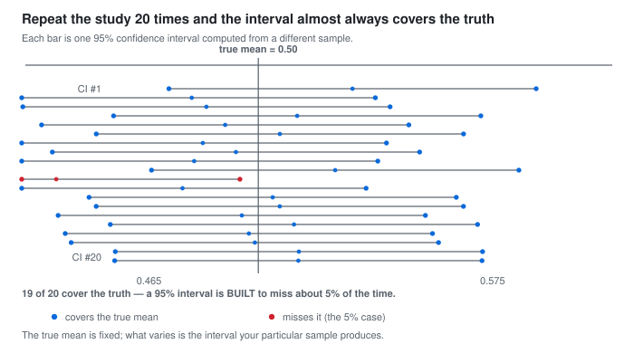

> **In words:** Repeat the study and about 95% of intervals will cover the truth. The
> other 5% are meant to miss.

**Confidence levels:**

| Level | Critical value (z) | Wider or narrower? |
|---|---|---|
| 90% | 1.645 | narrower, less confident |
| **95%** | **1.96** | **the standard choice** |
| 99% | 2.576 | wider, more confident |

**Choosing a level:** 95% is a fine default. Use 99% when a wrong decision is
very costly (drug safety, aviation, nuclear). Being "more confident" always means
a **wider, less precise** interval, and you cannot have both.

Why 95% and not 99%? Because 95% gives a *useful* precision at a *reasonable*
error rate. There is nothing magic about 0.95; it is a convention that balances
precision against the risk of a false conclusion.

#### Confident intervals for other quantities

```text
  Proportion (p-hat):   p-hat  +/-  z * sqrt( p-hat(1-p-hat)/n )
  Difference in means:  (x1-bar - x2-bar)  +/-  z * sqrt(s1^2/n1 + s2^2/n2)
  Ratio of variances:   F-distribution
  Correlation:          Fisher z-transformation
```

**Proportion CI note:** a **Wald interval** (`p +/- 1.96*SE`) performs badly for
small n or p near 0 or 1. Use the **Wilson score interval** instead
(`statsmodels.proportion_confint(..., method="wilson")`). This is a real,
practical gotcha: for a dataset with 3 successes out of 20, the Wald interval
can even extend below 0, which is impossible.

**Choosing your sample size (planning ahead):**

```text
  For estimating a mean with margin of error E (95% confidence):
  n = (1.96 * sigma / E)^2

  For estimating a proportion within margin E:
  n = 1.96^2 * p(1-p) / E^2      (worst case p = 0.5 gives n = 0.9604 / E^2)
```

```text
  n for 95% CI, +/- 3% :  n = 0.9604 / 0.03^2 = 1068
  n for 95% CI, +/- 2% :  n = 0.9604 / 0.02^2 = 2401
  n for 95% CI, +/- 1% :  n = 0.9604 / 0.01^2 = 9604
```

```python
import numpy as np
from scipy import stats

x = np.random.default_rng(1).normal(68, 12, size=100)
n = len(x); mean = x.mean(); s = x.std(ddof=1)
se = s / np.sqrt(n)

print(f"mean={mean:.3f}  sd={s:.3f}  se={se:.3f}")

# 95% CI, two ways -- both should agree closely
print(f"z-based : ({mean - 1.96*se:.3f}, {mean + 1.96*se:.3f})")
tcrit = stats.t.ppf(0.975, df=n-1)          # n-1 because sigma is unknown
print(f"t-based : ({mean - tcrit*se:.3f}, {mean + tcrit*se:.3f})")

# proportion CI (Wilson is the reliable one)
from statsmodels.stats.proportion import proportion_confint
successes, total = 47, 100
print("wilson:", proportion_confint(successes, total, method="wilson"))
print("wald  :", proportion_confint(successes, total, method="normal"))
print(stats.binom.ppf(0.025, total, successes/total),
      stats.binom.ppf(0.975, total, successes/total))   # exact (Clopper-Pearson)
```

---
## 🧪 PART 5, Hypothesis Testing

*How to make a defensible decision with real-world data.*

### 5.1 The Core Logic

Suppose a shop claims their new packaging gets a 60% click rate. You run an
experiment and observe 65%.

Two explanations:

1. The new packaging **really is** better.
2. You got **unlucky**, and a random fluctuation produced 65% even though the true
   rate is still 60%.

A test picks between the two while keeping mistakes in check.

> The trick: assume the opposite of your hope (the null), then ask "if the null were true, how surprising is my data?" Very surprising means reject the null.

This is proof by contradiction. You never prove the new claim, you only reject the old default or fail to.

---

### 5.2 The Hypotheses

```text
   H0 (null hypothesis)      the default, "no effect", "no difference"
                             usually states mu = some value, or a difference = 0
                             ** you must be able to survive being wrong about H0 **

   H1 / HA (alternative)      what you suspect / hope for
                             mu > value,  mu < value,  or  mu != value
```

| Alternative | Name | Question it answers |
|---|---|---|
| `H1: mu != mu0` | two-tailed | "is it different?" (either direction) |
| `H1: mu > mu0` | right-tailed | "is it larger?" |
| `H1: mu < mu0` | left-tailed | "is it smaller?" |

Write the null first. It is the boring default. The new claim must earn its place.

Common slip: writing `H0: mu != 5`. The null carries the equals sign, the alternative carries the inequality.

#### Significance level and the two errors

Pick `alpha` first (usually 0.05). No test is perfect.


> **In words:** Rejecting a true null is a Type I error (alpha); failing to reject a false one is Type II (beta). Power = 1 - beta.

A trial in court works like a test.
A guilty person walks free (Type II, missed a real problem). An innocent person is convicted (Type I, false alarm).
Judges accept some risk of a wrongful verdict. So must you.

**Key relationships:**

```text
  alpha = significance level, usually 0.05
  beta  = probability of missing a real effect, usually 0.05 to 0.20
  power = 1 - beta, usually >= 0.80
```

"Alpha = 0.05" means: if the null is true, you accept a 5% chance of rejecting it by mistake.

Note the direction: it is the probability of the **error given the null**, i.e.
`P(reject H0 | H0 true) = alpha`. It is **not** the probability that the null is
true, and **not** the probability your result is a fluke (that is
approximately the p-value, with subtle differences).

Power analysis (choosing n):

- Power rises with a **larger effect size**, a **larger alpha**, a **larger n**,
  or a **lower sigma**.
- To reach 80% power for a medium effect you typically need roughly **n = 100**
  per group (very rough, and it depends entirely on the effect size).
- If your experiment is underpowered, a non-significant result tells you almost
  nothing. It does not prove "no effect".

---

### 5.3 The p-value, Explained Properly

The p-value is the chance of data this extreme or more, assuming the null is true.

```text
  p-value = P(data this extreme or more | H0 is true)
```

#### A concrete example

```text
  H0: the coin is fair (p = 0.5)
  H1: the coin is biased (p != 0.5)
  Observed: 40 heads in 50 tosses
```

```text
  Under H0, the probability of getting 40 or more heads, or 10 or fewer:
  P(X >= 40) + P(X <= 10) = 0.0004 + 0.0004 = 0.0008 approx  (two-tailed)
```

That is very unlikely if the coin were fair. So we reject fairness.

#### The four biggest p-value misconceptions

| Wrong statement | Why it is wrong |
|---|---|
| "p = 0.05 means there is a 5% chance H0 is true" | It is `P(data \| H0)`, **not** `P(H0 \| data)`. See Bayes. |
| "p = 0.05 means a 5% chance this result is a fluke" | Too crude. It is a tail probability under a specific model, not a "chance of fluke". |
| "p < 0.05 means the result is important" | A tiny lift can be "significant" with huge n and still worthless. Always report size and interval with the p-value. |
| "p >= 0.05 means H0 is true" | Failing to reject is not accepting. It often means the study lacked power. |

**The right way to talk about a p-value:**

> *"Assuming the null is true and the model assumptions hold, data this
> extreme would occur 3% of the time. This is evidence against the null."*

**Report the p-value honestly:** `p < 0.001` is better than `p = 0.000`, which
is better than `p < 0.05`. Rounding a p-value to 0 or 1 is bad practice.

**A nice analogy for significance thresholds:** p-values relate to significance
levels the way they do in a *reproducibility crisis*. With 20 comparisons at the
0.05 level you expect **1 false positive by pure chance**, even when nothing is
really happening.

---

### 5.4 The 5-Step Procedure (any hypothesis test)

```text
  1. State the hypotheses       H0 and H1
  2. Choose alpha               usually 0.05
  3. Choose the test statistic   t, F, chi-square, z
  4. Compute p-value / critical value
  5. Decide and interpret
        p <= alpha  -> REJECT H0   ("statistically significant")
        p >  alpha  -> FAIL to reject H0
```

> **Verb discipline matters.** "Reject H0", not "accept H1". "Fail to reject
> H0", not "accept H0". The distinction reflects that your data genuinely cannot
> separate "no effect" from "an effect too small for me to detect".

---

### 5.5 t-Tests

The t-test is used when you are comparing **means** and the population SD is
**unknown** (so you use `s`), especially with small samples.

**The Student's t-distribution:** bell-shaped like the normal, but with **fatter
tails** (more probability out in the extremes). This is deliberate, and it
compensates for the extra uncertainty of estimating sigma from a small sample.

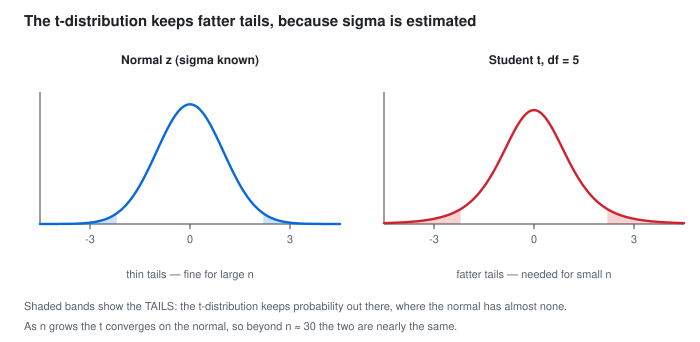

> **In words:** The t-distribution has fatter tails than the normal, which is why small samples need it.

```text
  As n grows,  t -> normal.
  n = 30+  ->  use z, t is nearly identical
  n < 30    ->  must use t
```

#### The general form of a t-statistic

```text
                     x-bar  -  mu0
  t  =  -------------------------- ,    df = n - 1
               s / sqrt(n)
```

**Read it as: "how many standard errors is my observed mean away from the value
the null predicts?"**

#### 5.5.1 One-sample t-test

*"Is the mean of this one sample different from a known value?"*

```text
  H0: mu = mu0
  t  = (x-bar - mu0) / (s / sqrt(n)),   df = n - 1
```

**Worked example:** 25 students score a mean of 78 on a test, SD = 10. Is this
different from 75?

```text
  t = (78 - 75) / (10 / sqrt(25)) = 3 / 2 = 1.5,   df = 24
  p = 0.1464  (two-tailed)   ->  fail to reject H0
```

```text
  78 is not significantly different from 75.
  (With n = 25 the test is not very sensitive. Notice the CI approach in Part 4
   gives the same answer and is often easier to interpret.)
```

```python
from scipy import stats
x = [78]
# real one-sample test:
import numpy as np
rng = np.random.default_rng(0)
x = rng.normal(78, 10, 25)
t, p = stats.ttest_1samp(x, 75)
print(t, p)
```

#### 5.5.2 Two-sample (independent) t-test

*"Are two unrelated groups different?"* e.g. customers who saw the ad vs those
who did not.

```text
  H0: mu1 = mu2      (i.e. mu1 - mu2 = 0)

                        x1-bar - x2-bar
  t = ------------------------------------
        sqrt( s1^2/n1 + s2^2/n2 )        df = n1 + n2 - 2
```

**Two variants you must know:**

| Test | When to use | Equal variances? |
|---|---|---|
| **Student's** (pooled) | variances are similar | yes, assumed |
| **Welch's** | variances differ or sample sizes differ | no (the safe default) |

**Always use Welch's in practice.** It is barely less powerful and it removes an
assumption you usually cannot verify. (`stats.ttest_ind(a, b, equal_var=False)`
in modern `scipy` is the default.)

The important warning: this test is sensitive to **skewness and outliers**.
If the data is strongly skewed or has extreme outliers, use the Mann-Whitney
test (Part 7) or a log transformation instead.

```python
import numpy as np
from scipy import stats

rng = np.random.default_rng(7)
a = rng.normal(100, 15, 200)     # group A
b = rng.normal(104, 25, 200)     # group B (different SD on purpose)

t, p = stats.ttest_ind(a, b, equal_var=False)    # Welch's
print(t, p)

# do it manually to check your understanding
na, nb = len(a), len(b)
se = np.sqrt(a.var(ddof=1)/na + b.var(ddof=1)/nb)
t_manual = (a.mean() - b.mean()) / se
print(t_manual)

# confidence interval for the difference -- usually MORE useful than the p-value
diff = a.mean() - b.mean()
crit = stats.t.ppf(0.975, df=na+nb-2)
print(f"difference = {diff:.2f}  95% CI = ({diff-crit*se:.2f}, {diff+crit*se:.2f})")
```

**Paired t-test** is for **matched/repeated** measurements, where the two
samples are not independent:

```text
  t = mean(d) / (s_d / sqrt(n)),  where d_i = x_i - y_i
```

**Examples:** before-and-after weight loss; the same users' scores before and
after training; matched pairs (twins, same city, same day of week).

Pairing is powerful because the paired design removes all the between-subject
variation, so the test becomes far more sensitive. Use a paired design whenever
you possibly can.

```python
import numpy as np
from scipy import stats

before = np.array([200, 210, 190, 220, 205, 198])
after  = np.array([190, 195, 180, 200, 195, 185])
t, p = stats.ttest_rel(after, before)   # paired
print(t, p)                              # likely very significant
```

---

### 5.6 Chi-Square Test of Independence

For **categorical** data in a contingency table.

**Question:** *"Are these two categorical variables associated?"*

|          | Clicked | Not clicked | Total |
|----------|---------|-------------|-------|
| Variant A | 120 | 380 | 500 |
| Variant B | 95 | 405 | 500 |
| **Total** | 215 | 785 | 1000 |

Expected counts under independence are all well above 5, so the chi-square test applies.

```text
                Observed
  chi^2 = SUM  ---------^2
                Expected
```

where `Expected = (row total * column total) / grand total`.

- **H0:** the two variables are **independent** (no association)
- **H1:** they are associated
- `df = (rows - 1)(cols - 1)`
- Assumption: expected counts should be **at least 5** per cell. Below that,
  use **Fisher's exact test** instead, which is why `scipy` and
  `statsmodels` may warn you.

```python
import numpy as np
from scipy import stats

obs = np.array([[120, 380], [95, 405]])
chi2, p, dof, expected = stats.chi2_contingency(obs, correction=False)
print(f"chi2={chi2:.3f}  p={p:.4f}  dof={dof}")
print("expected counts:\n", expected)

# 2x2 convenience: the chi-square is equivalent to a proportion z-test
count, n1, n2 = 120, 500, 500
from statsmodels.stats.proportion import proportions_ztest
print(proportions_ztest([count, 95], [n1, n2]))
```

**A/B test takeaway:** when you compare two proportions in an A/B test, the
chi-square test on a 2x2 table is the standard approach. Report the p-value
**and** the lift with a confidence interval, rather than the word "significant".

---

### 5.7 ANOVA (Comparing More Than Two Groups)

t-tests compare two groups. What if you have five?

The logic of ANOVA: if all the group means were really equal, how spread out
would the group means be, purely by luck? If the observed spread is much larger,
at least one group must genuinely differ.

```text
  Between-group variation: differences AMONG the group means
  Within-group variation:  differences WITHIN each group

                 SS_between
  F  =  ------------------------ ,  df_between = k-1,  df_within = N-k
              SS_within
```

- **H0:** all group means are equal
- **Rejection:** F is large / p is small
- `k` = number of groups, `N` = total sample size

ANOVA only tells you "at least one is different". It does not tell you *which*.
For that you use **post-hoc tests** (Tukey's HSD, Bonferroni, Scheffe), which
control the family-wise error rate. Software usually reports them automatically
(`statsmodels.stats.anova_lm` with `typ=2`, or
`statsmodels.stats.multicomp.pairwise_tukeyhsd`).

ANOVA also assumes the residuals are normally distributed and the variances are
similar across groups. With wildly unequal variances or strong skewness, use
Welch's ANOVA (`stats.f_oneway(..., equal_var=False)`) or the Kruskal-Wallis
test (Part 7).

**The visual intuition, and why ANOVA exists:**

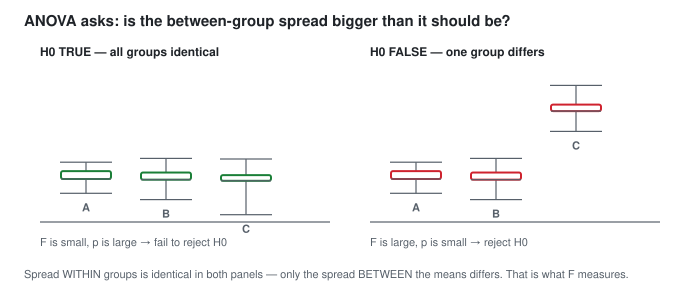

> **In words:** Same spread within groups in both panels; only the spread between
> the means differs, which is what F measures.

```python
import numpy as np
from scipy import stats
import pandas as pd

rng = np.random.default_rng(3)
df = pd.DataFrame({
    "value": np.concatenate([rng.normal(10, 1, 30),
                             rng.normal(10, 1, 30),
                             rng.normal(14, 1, 30)]),
    "group": ["A"]*30 + ["B"]*30 + ["C"]*30
})
print(stats.f_oneway(*[g["value"] for _, g in df.groupby("group")]))

import statsmodels.formula.api as smf
import statsmodels.api as sm

# effect size (eta-squared) and post-hoc comparisons -- no extra library needed
model = smf.ols("value ~ C(group)", data=df).fit()
print(sm.stats.anova_lm(model))     # the ANOVA table + PR(>F) p-value

from statsmodels.stats.multicomp import pairwise_tukeyhsd
res = pairwise_tukeyhsd(df["value"], df["group"])
print(res)                         # "which pairs actually differ?"

# eta-squared: between-group SS / total SS
ss_within = sum(g["value"].var(ddof=1) * (len(g) - 1) for _, g in df.groupby("group"))
ss_total = ((df["value"] - df["value"].mean())**2).sum()
ss_between = ss_total - ss_within
print(f"eta^2 = {ss_between / ss_total:.3f}")

# Welch's ANOVA (needs scipy 1.11+; else use Kruskal-Wallis below)
try:
    print(stats.f_oneway(*[g["value"] for _, g in df.groupby("group")], equal_var=False))
except TypeError:
    print("old scipy: skip Welch, use Kruskal-Wallis in 7.2")
```

---

### 5.8 Testing a Correlation

```text
  H0: rho = 0   (no linear relationship in the population)
  H1: rho != 0

  t = r * sqrt( (n-2) / (1 - r^2) ),   df = n - 2
```

**Read the formula's logic:** as `r` moves away from 0 the numerator grows; as `r`
approaches 1 the denominator shrinks, so `t` explodes. The closer `r` is to 1
or -1, the smaller the p-value, **for a given n**.

**Caution:** significance grows with n even when the relationship is
meaningless. With n = 1,000,000, an `r` of 0.01 is "highly significant" and
still useless for prediction. Always report the r value alongside the p-value.

```python
import numpy as np
from scipy import stats
x1 = np.array([1, 2, 3, 4, 5, 6, 7, 8])
x2 = np.array([50, 55, 58, 65, 70, 74, 82, 88])
r, p = stats.pearsonr(x1, x2)
t = r * np.sqrt((len(x1)-2)/(1-r**2))
print(r, p, t)
# or the confidence interval for r:
print(stats.pearsonr.__doc__.split("confidence_interval")[0][:0] or "")
z = np.arctanh(r); se = 1/np.sqrt(len(x1)-3)
print(np.tanh([z-1.96*se, z+1.96*se]))
```

---

### 5.9 Multiple Testing and p-hacking

If you run 20 independent tests at alpha = 0.05, the chance of **at least one**
false positive is:

```text
  1 - (1 - 0.05)^20 = 1 - 0.95^20 = 1 - 0.358 = 0.642   -> 64%!
```

Trying hundreds of features and variants, then keeping the best p-value, fills your results with false hits.

**The fixes:**

| Method | Idea | When used |
|---|---|---|
| **Bonferroni** | compare against `alpha / m` | few tests, simple, conservative |
| **Holm-Bonferroni** | step-down, more powerful than Bonferroni | default choice in most software |
| **Benjamini-Hochberg (FDR)** | control the *expected proportion* of false discoveries | many tests (thousands of features, gene studies) |
| **Holdout / validation set** | test on data never used to choose | ML model selection |

Other ways people fool themselves:

- **p-hacking**: trying many analyses until one crosses 0.05.
- **HARKing** (Hypothesizing After Results are Known): presenting a
  post-hoc exploratory pattern as a pre-planned hypothesis. Exploratory results
  are still useful; just label them as exploratory and confirm
  on fresh data.
- **Optional stopping**: peeking at results daily and stopping the moment
  p < 0.05. This inflates the false-positive rate far above alpha. Use a
  pre-planned sample size, or sequential methods (always-valid inference,
  Bayesian A/B testing).
- **Garden of forking paths**: every analytic choice (bin boundaries, outlier
  rules, variable transformations) is a fork. Even one "wrong" choice invalidates
  the pre-registration.

```python
from statsmodels.stats.multitest import multipletests
import numpy as np
pvals = np.array([0.001, 0.008, 0.039, 0.041, 0.042, 0.06, 0.074, 0.205, 0.212, 0.216])
rej, p_adj, _, _ = multipletests(pvals, alpha=0.05, method="fdr_bh")
print("raw     ", np.round(pvals, 3))
print("BH adj  ", np.round(p_adj, 3))
print("reject? ", rej)
```

---

### 5.10 Part 5 Cheat Sheet

| Situation | Test | Statistic | df | Assumes |
|---|---|---|---|---|
| 1 mean vs a value | one-sample t | t | n-1 | ~normal or n>=30 |
| 2 independent means | independent t (Welch) | t | n1+n2-2 | similar variances |
| 2 matched measurements | paired t | t | n-1 | differences ~normal |
| 3+ group means | one-way ANOVA | F | k-1, N-k | normal residuals, equal var |
| 2 categorical variables | chi-square | chi^2 | (r-1)(c-1) | expected counts >= 5 |
| 2 proportions | 2x2 chi-square / z | z | 1 | counts large enough |
| Correlation is real? | t on r | t | n-2 | bivariate normal |
| Non-normal / ordinal | Mann-Whitney, Kruskal-Wallis | U, H | -- | none (rank-based) |

Always report: test statistic, df, p-value, effect size, and a confidence interval. A bare p-value is not enough.

## 🧮 PART 6, Regression Analysis

*Regression turns description into prediction.*

### 6.1 The Idea

We want to predict a number like price, marks, sales or temperature from other variables.

Simple linear regression fits the best straight line through a cloud of points.


> **In words:** The line is chosen to make the sum of the squared residuals as small as possible.

You step on a scale each morning while dieting. You
know that on average every extra kilo you carry costs about 0.5 extra
kilograms per month of dieting. That is a regression line.

**The model:**

```text
  y = b0 + b1 * x  +  e

  y  = the value you want to predict        (the response / dependent variable)
  x  = the variable you know               (the predictor / independent variable)
  b0 = the intercept  ("what happens when x = 0")
  b1 = the slope      ("how much y changes per unit of x")
  e  = the error / residual (what the model could not explain)
```

Two unknowns, two meanings:

- **b1 (slope):** *the rate of change.* "For each extra hour of study, marks
  rise by 1.8 points."
- **b0 (intercept):** *the baseline.* "With zero study hours, a student scores
  about 52."

Reporting the slope is a "per unit" statement, so it is only meaningful if you
also say *per what unit*, and in what units.

Careful with the intercept. "Marks at zero study hours" may sit outside your data, since most students study something. The intercept only means something when x = 0 is a real case.

---

### 6.2 Least Squares, Why "Best Fit" Means What It Does

The line must keep the squared vertical gaps to the points as small as possible. Each gap is a residual, e = y - y-hat.


> **In words:** Squaring the errors stops them cancelling and punishes large misses harder.

Why square the errors?

1. Squaring removes the sign. Without it, errors above and below the line cancel, and every line looks equally good.
2. Squaring punishes large errors more. One wild miss ruins the fit, which is what you want.

Aiming at a dartboard: mean absolute error is your average distance from the bullseye. Mean squared error punishes one dart far from the centre more than a few darts slightly off. It is the standard choice because it is smooth and easy to optimise.

> In machine learning, MSE and RMSE are the loss functions of linear regression. The best fit line and the minimum loss model are the same thing.

The formulas:

```text
              n
       SUM (xi - x-bar)(yi - y-bar)
b1  =  ------------------------------          (this is cov(x,y)/var(x))
              n
       SUM (xi - x-bar)^2

b0  =  y-bar  -  b1 * x-bar
```

Note that b1 is literally the correlation scaled by the ratio of the standard
deviations:

```text
       cov(x, y)          r * s_y
b1  =  ---------  =   --------------
       var(x)                s_x
```

Worth noting:

```text
  - If b1 = 0  then  r = 0.    Slope and correlation are the same thing here.
  - If s_x = s_y  then  b1 = r.  With standardised X and Y, slope = correlation.
  - The SIGN of b1 is always the sign of r.
```

Standardising X and Y is like converting kilometres and miles to metres. Once both share a unit, slope equals correlation.

```python
import numpy as np
from scipy import stats

x = np.array([1, 2, 3, 4, 5, 6, 7, 8])
y = np.array([50, 55, 58, 65, 70, 74, 82, 88])

b1 = np.cov(x, y, ddof=0)[0, 1] / np.var(x)
b0 = y.mean() - b1 * x.mean()
print(f"b1 = {b1:.4f}, b0 = {b0:.4f}")

res = stats.linregress(x, y)
print(res)    # slope, intercept, r, r^2, p, stderr
```

---

### 6.3 Understanding R-Squared

```text
                SSR          sum of squares of the regression (explained)
  R^2  =  -------------  =  1  -  --------------
                SST            sum of squares total (unexplained + explained)
```

It is the share of the swing in y that the model explains.

Saying study explains 40% of the swing in marks leaves 60% to other factors like prior ability, sleep, luck and teaching quality.

Reading R^2:

| R^2 | Interpretation |
|---|---|
| 0.9 | the model explains 90% of the variation, excellent for most purposes |
| 0.5 | half, moderate and typical in social science |
| 0.1 | very little, but might still beat a naive baseline |
| 0.0 | the model explains nothing |

> Warning: a high R^2 does not mean cause, and does not promise good predictions on new data. R^2 is measured on the data you fitted. On new data it usually drops.

In simple linear regression, `R^2 = r^2`. This fails for multiple regression, where R^2 can climb just because you added predictors.

Adjusted R^2 penalises extra predictors:

```text
  R^2_adj = 1 - (1 - R^2)(n - 1)/(n - p - 1)
```

where p counts predictors. Use adjusted R^2 to compare models with different counts, since it rises only when a predictor earns its place.

Honesty check: predicting house prices from the current sale price gives R^2 = 0.99. That is leakage, not skill. A feature known only after prediction time must stay out of the model.

---

### 6.4 Residuals: did the model miss a pattern?

A residual is the mistake on one row: `e_i = y_i - y-hat_i`.

```text
   perfect fit: all residuals ~ 0
   underfitting: a clear pattern (a curve) is left over
   overfitting:  residuals are ~0 on training data but bad on new data
```

A good model leaves no pattern in its residuals. A pattern means the shape is wrong and you waste information.


> **In words:** A good fit leaves no pattern. A curve means the model form is wrong,
> a funnel means the variance is not constant.

Plots worth checking:

| Plot | x-axis | What a bad look means |
|---|---|---|
| **Residuals vs fitted** | y-hat | curvature -> wrong functional form |
| **Q-Q plot** | theoretical quantiles | points off the diagonal -> non-normal errors |
| **Scale-Location** | y-hat | funnel shape -> **heteroscedasticity** |
| **Residuals vs a predictor** | that predictor | curve -> a transformation is needed |

**Heteroscedasticity** (the most common assumption violation):


> **In words:** A funnel breaks the constant-variance assumption, so standard errors are too narrow and p-values too small.

A $20 error on a $20 purchase is not the same as a $20 error on a
$20,000 house. Predicting a large number is naturally less precise in absolute
terms.

The fix: use a **log transformation** on y, or use **heteroscedasticity-robust
standard errors** (`statsmodels` `cov_type="HC3"`), or switch to quantile
regression. Never ignore it if your residual-vs-fitted plot shows a funnel,
because your confidence intervals will be too narrow.

**Use and influential points:**

- Use = how *unusual* a point is in x (does it sit alone at the edge?).
- Influence = how much the point *changes* the fitted line if removed.
  (There is a technical definition based on hat values and residuals; the
  practical test is simple: **delete it, refit, and see if the coefficients
  change much.**)


> **In words:** Use is how isolated a point is in x; influence is how much the
> fit moves if you delete it.

Outliers and influential points differ. An odd y with normal x is often noise. A point far out in x can drag the whole slope.

---

### 6.5 The Four Regression Assumptions

For confidence intervals and p-values on the coefficients to be valid:

```text
  1. LINEARITY
     The relationship between x and y is a straight line.
     Check: residuals vs fitted shows no curve.

  2. INDEPENDENCE
     Observations are independent of each other.
     Check: think about the data collection.
     *** This is the assumption most often violated in real datasets ***
     Time-series data (one row per day) is ALWAYS dependent.
     Fix: time-series models, GEE / mixed models, clustered standard errors.

  3. HOMOSCEDASTICITY
     The residual variance is constant across x.
     Check: Scale-Location plot -- no funnel.
     Fix: log transform, robust standard errors, quantile regression.

  4. NORMALITY of residuals (for small n)
     The residuals are approximately normal.
     Check: Q-Q plot.
     IMPORTANT: this assumption is about the RESIDUALS, not about y itself!
     For large n, regression is robust to this. It matters mainly for
     small-sample t-tests and CIs.
```

Easy to miss:

> These rules cover the errors, not X or Y. X and Y need not be normal. The residuals should behave. Without that, small sample p-values suffer first.

Linearity and independence matter most. The other two mainly shape your error bars and small sample tests.

---

### 6.6 Correlation Is Not Causation (and Why Not)

Four ways a correlation can mislead:

1. A lurking third variable

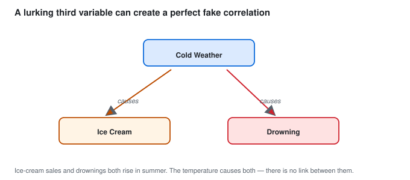

> **In words:** A lurking third variable can manufacture a perfect fake correlation.

Ice cream sales and drownings both rise in summer. The temperature causes both,
and there is no link between ice cream and drowning.

2. Reverse cause

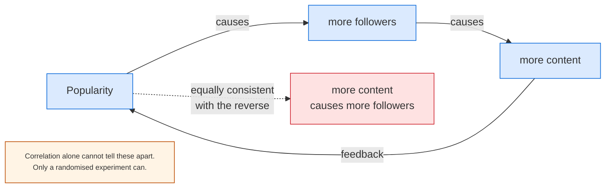

"Blogs with more links get more traffic" and "more traffic gets you more links"
both look identical in the data. A/B tests or careful design are the only way to
tell them apart.

3. Selection bias (Part 4.3, the returning airplanes).

4. Pure chance. Test 20 variables at p < 0.05 and one will look "significant" by luck (Part 5.9).

#### Simpson's paradox: the winner flips when you split

A real kidney-stone study compared two treatments:

| Patients | Treatment A | Treatment B |
|---|---|---|
| All | 273/350 = 78% | 289/350 = 83%, B wins |
| Small stones | 81/87 = 93% | 234/270 = 87%, A wins |
| Large stones | 192/263 = 73% | 55/80 = 69%, A wins |

A wins in both groups but loses overall. How? Doctors gave B mostly to easy
small-stone cases and A to the hard large-stone ones. Stone size drives both
the treatment choice and recovery, so it is a confounder (item 1 above), and
the pooled rate hides it because the group sizes differ so much.

Rule: split by the big background variable before comparing rates. Pooled
rates lie whenever the groups are mixed unevenly. This bites in A/B tests
(split by device or country), hiring funnels (split by role), and medicine
(split by severity).

Correlation screens, it never concludes. For cause you need one of:

- a randomised experiment (A/B test), the best case
- a natural experiment (difference-in-differences, instruments, discontinuity)
- clear causal assumptions in observational data, stated openly

---

### 6.7 Multiple Linear Regression

Real problems have many causes, so the model generalises:

```text
  y = b0 + b1*x1 + b2*x2 + b3*x3 + ... + bn*xn + e
```

House price:

```text
  price = b0
        + b1 * area
        + b2 * bedrooms
        + b3 * distance_to_c metro
        + ...
```

The challenge is that each coefficient means something only if the others are
held constant. "Holding bedrooms and age constant, each extra square metre adds
b1." Coefficient interpretation in multiple regression is therefore harder and
always conditional.

The risk is multicollinearity:

If two predictors are nearly duplicates of each other, the model becomes
unstable. The coefficients can swing wildly, flip sign, and become huge, while
the overall fit barely changes.


> **In words:** When two predictors point the same way, the model cannot separate
> them and the coefficients become unstable.

Detection:

```text
                 r                1
  VIF_i  =  ----------------  = --------
              1 - r_i^2         (1 - R^2_i)
```

- VIF < 5 -> fine
- VIF 5-10 -> moderate concern
- VIF > 10 -> serious problem

Fixes: drop one of the pair, combine them with PCA, or use ridge or Lasso.

> Lasso can shrink coefficients to exactly zero, so it selects features. Ridge shrinks toward zero without removing. Both express doubt about large coefficients.

```python
import numpy as np, pandas as pd
import statsmodels.api as sm
from statsmodels.stats.outliers_influence import variance_inflation_factor

rng = np.random.default_rng(11)
n = 200
x1 = rng.normal(0, 1, n)                 # area
x2 = 0.9 * x1 + rng.normal(0, 0.4, n)    # bedrooms -- highly correlated with x1
x3 = rng.normal(0, 1, n)                 # age, independent
y = 5 + 3*x1 + 1.5*x2 - 2*x3 + rng.normal(0, 2, n)

df = pd.DataFrame({"area": x1, "bedrooms": x2, "age": x3, "price": y})

# add a constant explicitly -- statsmodels does NOT do this for you
X = sm.add_constant(df[["area", "bedrooms", "age"]])
model = sm.OLS(df["price"], X).fit()
print(model.summary())

# multicollinearity check
print("VIF:", [round(variance_inflation_factor(X.values, i), 2) for i in range(1, X.shape[1])])

# heteroscedasticity-robust standard errors
print(sm.OLS(df["price"], X).fit(cov_type="HC3").summary())

# regularisation fixes it
from sklearn.linear_model import Ridge, Lasso
print(Lasso(alpha=0.1).fit(df[["area","bedrooms","age"]], y).coef_)
```

---

### 6.8 Overfitting and Underfitting

This idea carries straight into machine learning.


> **In words:** More parameters fit the training data better while generalising
> worse. Score on held-out data, not training data.

| | Underfitting | Overfitting |
|---|---|---|
| Meaning | misses the real pattern | memorises noise |
| Train error | high | very low |
| Test error | high | high |
| Bias | high bias | low bias |
| Variance | low variance | high variance |
| Model | too simple | too complex |
| Fix | more features, a better form | more data, regularisation, simpler model |

A story that makes it stick:

A friend memorises last year's paper with the answer key and scores 100% on it. Hand them this year's paper and the score drops. Nothing was learned, only memorised.

Overfitting works the same way. Too many parameters memorise training rows plus their noise, and fail on new rows.

Learning the noise looks like this:

```text
   y = 3.1 x + 0.23 + random noise

   Fit 1:  y = 3.0 x + 0.2      R^2 = 0.90   -> good, generalises
   Fit 2:  y = 7.5 x - 2.1      R^2 = 0.92   -> better on THIS data, WORSE on new data
```

The remedies:

| Technique | Effect |
|---|---|
| **More data** | the most reliable cure, since noise cannot be memorised if it varies |
| **Simpler model** | fewer parameters, less to overfit |
| **Regularisation** (L1/L2, ridge/lasso) | penalises large coefficients |
| **Cross-validation** | estimate generalisation *before* touching the test set |
| **Early stopping** | stop training when validation error starts rising |
| **Dropout / batch norm** (deep learning) | the neural-network equivalents |
| **Pruning / depth limits** (trees) | stop splitting too early |
| **Feature selection** | remove useless predictors |

**Cross-validation in one picture:**

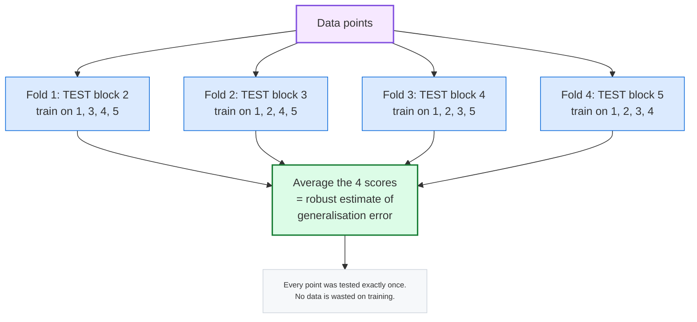

Honest workflow:

```text
  1. SPLIT: train (70%) / validation (15%) / test (15%)
        -- the test set is touched EXACTLY ONCE, at the very end
  2. TRAIN on the training set
  3. TUNE using the validation set (or cross-validation within the training set)
  4. REPORT metrics on the test set, once
  5. If you iterate on the test set, it has silently become a validation set
     and your reported number is optimistic.
```

Scores on training data show memory. Scores on held-out data show learning. Only the second counts.

---
## 🛠️ PART 7, Non-Parametric Methods and Practical Data Science Topics

*Real data breaks rules. This part covers what to do then.*

### 7.1 When the Normal Assumption Fails

The t-test wants roughly normal residuals. Real data often refuses.


> **In words:** A few very large values stretch the tail right, dragging the mean past the median.

Signs a t-test may fail:

- The Q-Q plot's points curve away from the straight line
- The histogram has a long tail on one side
- The box plot has a long whisker
- You have a handful of extreme values
- The sample is small (n < 30) *and* the data looks skewed

Options, best first:

| Option | When to use it |
|---|---|
| **Transform** the data (`log`, `sqrt`, `box-cox`) | Right-skewed positive data; almost always works, and keeps the parametric test's higher power |
| **Use a non-parametric test** | Ordinal data, heavy outliers, or a transformation that does not help |
| **Use a robust method** (median/MAD) | Describing the data rather than testing it |
| **Bootstrap** (resampling) | When nothing else is valid, see 7.6 |

The log transform fixes right skew most days:

```text
  x  ->  log(x)
```

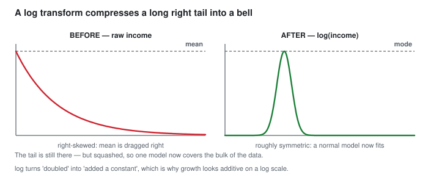

> **In words:** A log compresses the long right tail, so one normal model now
> covers the bulk of the data.

It works because the log squeezes large values and stretches small ones. Growth that multiplies becomes growth that adds. A 10% rise then means the same at any scale.

```text
  log transforms "a value doubled" into "a value added a constant":
      log(2x) - log(x) = log(2)   -- the same, whatever x is
```

```python
import numpy as np, pandas as pd
from scipy import stats

rng = np.random.default_rng(4)
income = rng.lognormal(mean=10, sigma=1.0, size=5000)   # right-skewed

print(f"raw    : skew={pd.Series(income).skew():.2f}")
log_inc = np.log(income)
print(f"logged : skew={pd.Series(log_inc).skew():.2f}")   # much closer to 0

# does a t-test survive the transform?
a = rng.exponential(scale=2, size=60)
b = rng.exponential(scale=2.5, size=60)
print("raw t-test   p =", stats.ttest_ind(a, b, equal_var=False).pvalue)
print("log t-test   p =", stats.ttest_ind(np.log(a), np.log(b), equal_var=False).pvalue)

# and a non-parametric one, which needs no transformation at all
print("Mann-Whitney p =", stats.mannwhitneyu(a, b, alternative="two-sided").pvalue)
```

---

### 7.2 Non-Parametric (Rank-Based) Tests

Core idea: drop the values, keep only their ranks, test the ranks.

Instead of exact salaries, compare how many people earn
more than you. If Bob outranks Alice, Paula, and everyone else, that is powerful
information even if you do not know the exact amounts.

Why ranking helps: ranks have no outliers, no skew and no units. A
billionaire's salary and a student's salary become merely the 500th and 12th
places. The test is therefore immune to exactly the problems that broke your
parametric assumption.

The cost: you throw away real information, namely the actual magnitudes.
Non-parametric tests are typically a little **less powerful** when the parametric
assumptions *do* hold. That is the trade-off, robustness for power.

```text
  Values:            12   5000   15    9000   13
  Their ranks:        3      4    2      5    1
  ---------------------- the whole test works on this row only
```

#### The main tests

| Test | Question | Replaces | Assumes |
|---|---|---|---|
| **Wilcoxon signed-rank** | are paired differences centred on 0? | paired t-test | differences symmetric |
| **Mann-Whitney U** | do two independent groups differ? | independent t-test | similar shapes |
| **Kruskal-Wallis H** | do 3+ groups differ? | one-way ANOVA | similar shapes |
| **Friedman** | do 3+ *matched* groups differ? | repeated-measures ANOVA | none |
| **Sign test** | is the median difference > 0? | anything, ultra-safe | none at all |

**How the Mann-Whitney U actually works:**

```text
  Combine both groups, sort all values, and assign ranks 1, 2, 3, ...
  Then ask: does group A sit systematically higher in the ranking than group B?

  If the ranks are randomly mixed -> U is near n1*n2/2 -> p is large.
  If group A occupies all the top ranks -> U is small -> p is small.
```

The honest caveat, which is worth knowing before you use it: the Mann-Whitney test
strictly tests whether one distribution is *stochastically larger* than the other.
It is equivalent to "the means differ" only when both groups have the **same
shape** (in particular, both normal or both skewed the same way). If group A is
normal and group B is heavily skewed, a significant Mann-Whitney result does
**not** cleanly mean "B's median is higher". Always plot the two box plots
before interpreting.

A rule of thumb for choosing:

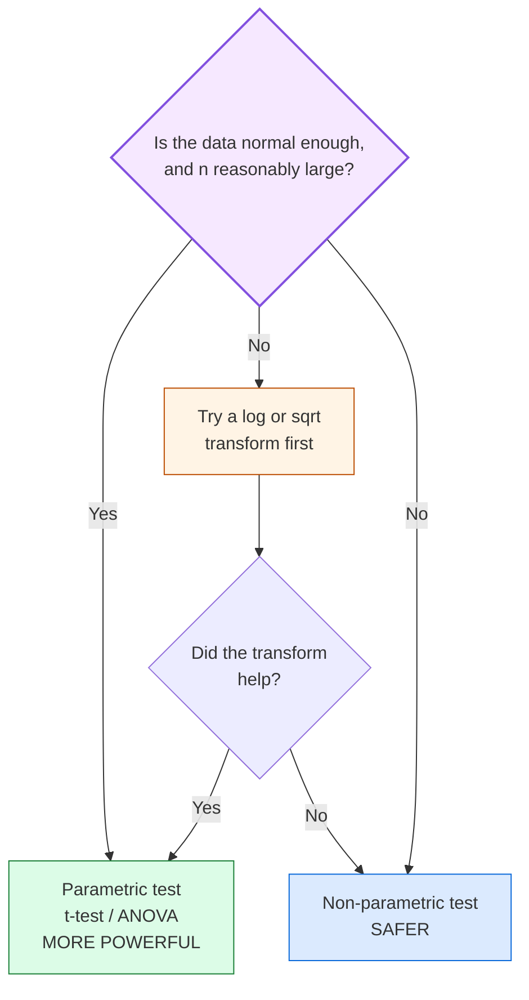

```python
import numpy as np
from scipy import stats
rng = np.random.default_rng(7)

# heavy-tailed data -- where parametric tests break
a = np.array([12, 15, 14, 13, 900, 14, 12, 13, 15, 14])
b = np.array([20, 22, 21, 19, 23, 21, 20, 22, 21, 23])

# --- parametric (misleading here: two "outliers" dominate the means) ---
print("t-test   :", stats.ttest_ind(a, b, equal_var=False))

# --- non-parametric (only ranks matter) ---
u, p = stats.mannwhitneyu(a, b, alternative="two-sided")
print(f"Mann-Whitney U={u}, p={p:.5f}")

# Wilcoxon signed-rank for PAIRED data
before = np.array([200, 210, 190, 220, 205, 198, 500])
after  = np.array([190, 195, 180, 200, 195, 185, 470])
print("Wilcoxon :", stats.wilcoxon(after, before))

# Kruskal-Wallis for 3+ groups
g1 = rng.normal(10, 1, 30); g2 = rng.normal(10, 1, 30); g3 = rng.normal(13, 1, 30)
print("Kruskal  :", stats.kruskal(g1, g2, g3))

# Friedman for matched groups (e.g. 3 treatments, same 20 patients)
f1 = rng.normal(10, 1, 20); f2 = rng.normal(11, 1, 20); f3 = rng.normal(12, 1, 20)
print("Friedman :", stats.friedmanchisquare(f1, f2, f3))

# the ultra-safe sign test -- assumes literally nothing
d = after - before
print("sign test:", stats.binomtest((d > 0).sum(), len(d), 0.5, alternative="greater").pvalue)
```

**Which one to reach for, quickly:**

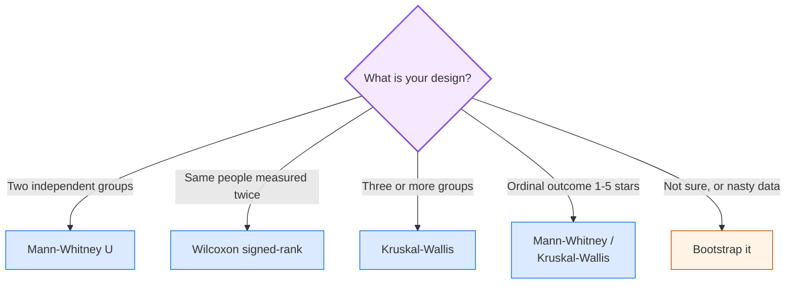

---

#### The permutation test: what would chance do?

If the group labels mean nothing, shuffling them should not change the gap.
So shuffle 10,000 times, recompute the gap each time, and count how often the
shuffled gap beats yours. That share is the p-value. No bell curve, no ranks,
and it works for any stat you like: means, medians, even ratios.

Reach for it with small samples, odd shapes, or a custom stat no textbook test
covers. The price is compute, which is pocket change today. It sits between
the rank tests above (fixed stats, fast) and the bootstrap in 7.6 (resample
with replacement to get intervals).

```python
import numpy as np
from scipy import stats
rng = np.random.default_rng(9)

a = np.array([12, 15, 14, 13, 16, 14, 12, 13])
b = np.array([20, 22, 21, 19, 23, 21, 20, 22])
obs = b.mean() - a.mean()

pool = np.concatenate([a, b])
n = len(a)
sims = np.array([(lambda q: q[:n].mean() - q[n:].mean())(rng.permutation(pool))
                 for _ in range(10000)])
p_perm = (np.abs(sims) >= abs(obs)).mean()
print(f"observed gap = {obs:.2f}, permutation p = {p_perm:.4f}")
print("t-test p     =", round(float(stats.ttest_ind(a, b, equal_var=False).pvalue), 4))
print("Mann-Whitney =", round(float(stats.mannwhitneyu(a, b, alternative='two-sided').pvalue), 4))
```

---
### 7.3 Robust Statistics, Describing Data That Misbehaves

A **robust** statistic is one that is not unduly influenced by a few extreme
values. Robustness is exactly what Part 1 taught us to want, and here is the
formal vocabulary for it.

#### The breakdown point, the key idea

**The breakdown point is the fraction of your data that can be corrupted to
"infinity" before the statistic itself becomes infinity.**


> **In words:** The mean has a breakdown point of 0%; the median has 50%. That is the formal reason the median survives outliers.

**The intuition is exactly the "mean vs the CEO salary" story from Part 1,
now written down as a number.** A 50% breakdown point means the median can
absorb an astonishing amount of corruption.

#### The robust toolkit

| Instead of | Use | Breakdown point | Notes |
|---|---|---|---|
| mean | **median** | 50% | the champion |
| mean | **trimmed mean** (10% trimmed) | ~10% | a compromise: keeps some efficiency, gains robustness |
| SD | **MAD** (median absolute deviation) | 50% | like the SD, but for the median |
| SD | **IQR / IQRN** | 50% | Q3 - Q1, scaled by 1.349 for normality |
| min/max | **5th and 95th percentile** |, | for display |
| straight least squares | **robust regression** (Huber, RANSAC) |, | for modelling, see 7.6 |

**MAD, Median Absolute Deviation:**

```text
MAD = median( | x_i - median(x) | )
```

Analogy: if the median is the "centre" of your data, the MAD is the "typical
distance from the centre". That is the SD's job, but computed robustly.

Getting a normal-consistent scale estimate from the MAD:

```text
                        MAD
  sigma_hat  =  1.4826 x ----
                        median(|x|)

  (because for normal data, median(|x - mean|) = 0.6745 * sigma,
   so dividing by 0.6745 -- i.e. multiplying by 1.4826 -- recovers sigma)
```

So `1.4826 * MAD` gives you a quantity directly comparable with the ordinary SD,
but it is not destroyed by outliers. This is the standard "robust z-score":

```text
  robust z_i  =  (x_i - median(x)) / (1.4826 * MAD)
```

**Rule of thumb for a robust z:** flag `|robust z| > 3.5` as an outlier. Compare
with the classic `|z| > 3` rule, which is fragile precisely because it is built
from the mean and SD, the very things outliers corrupt. Note the logical loop:
**using mean/SD to detect outliers means the outliers have already corrupted
your detector.**

```python
import numpy as np, pandas as pd

x = np.array([12, 14, 13, 15, 14, 12, 16, 13, 14, 15, 500])  # one bad row
s = pd.Series(x)

print("mean   :", s.mean().round(2), " median:", s.median())      # 58 vs 14
print("std    :", round(s.std(ddof=1), 2))
mad = np.median(np.abs(x - np.median(x)))
print("MAD    :", mad, " -> robust sigma =", round(1.4826*mad, 3))

# outlier detection: the fragile way vs the robust way
z_naive   = (s - s.mean()) / s.std(ddof=1)
z_robust  = (s - s.median()) / (1.4826 * mad)
out = pd.DataFrame({"value": s, "z_naive": z_naive.round(2),
                    "z_robust": z_robust.round(2)})
print(out)
print("flagged (|z|>3) naive  :", out.index[out.z_naive.abs()  > 3].tolist())
print("flagged (|z|>3.5) robust:", out.index[out.z_robust.abs() > 3.5].tolist())

# 20% trimmed mean: drop the bottom and top 20% first
from scipy.stats import trim_mean
print("20% trimmed mean:", round(trim_mean(x, 0.2), 3))
```

Robust statistics are not the universal answer, because they throw away
information. If your data is clean and normal, the mean and SD are *more*
efficient: they use the actual magnitudes, not just the order. Robust methods
are insurance you pay for with a small efficiency loss, and you should buy that
insurance when your data is genuinely suspect.

---
### 7.4 Categorical Data: Proportions, Odds and Ratios

Part 5.6 handled categorical data with a chi-square test. Now the **effect
size** side, since "is it significant?" and "is it important?" are different
questions, and only the effect size answers the second.

#### Proportion

```text
                number of successes
  p_hat  =  -------------------------
                 total observations
```

#### The three risk measures

**Relative risk (risk ratio), for COHORT studies / A/B tests:**

```text
                    risk in exposed group
  RR  =  -----------------------------
                   risk in unexposed group
```

Think of it this way: a fire safety campaign is run in 10 towns. The fire rate falls from
5 per 1,000 to 4 per 1,000. The RR is 0.8, so "the rate was 20% lower".

**Relative risk reduction** = `1 - RR` = 20%. This is exactly the "uplift" or
"lift" that A/B tests report.

**Odds ratio (OR), for CASE-CONTROL studies:**

```text
                      p1 / (1 - p1)
  OR  =  -------------------------------
                      p0 / (1 - p0)
```

The difference between RR and OR, which is the single most important thing here:

```text
  RR and OR tell you DIFFERENT stories whenever the outcome is not rare.

  risk:      1%  ->  2%        RR = 2.0   "risk DOUBLED"
             odds: 1%  ->  2.02%     OR = 2.05   "odds roughly doubled"

  risk:     50%  ->  60%       RR = 1.2   "risk rose 20%"
             odds: 50%  ->  60%     OR = 1.5   "odds rose 50% !"

             ^ the 50% case is why "odds" and "risk" are not
               interchangeable, and why oversampling can distort ORs.
```

**Rule of thumb:** if you can compute the risk directly (a cohort or randomised
design, that is an A/B test), **report the relative risk**. Odds ratios are needed
only when you cannot follow people over time, which is what a case-control
design forces on you.

**Absolute risk, the number to actually tell a decision-maker:**

```text
  ARR (absolute risk reduction) = p0 - p1
  NNT (number needed to treat)   = 1 / ARR
```

```text
  Suppose a treatment reduces the risk of a complication from 10% to 9%.
    RR   = 0.9          -> "a 10% relative reduction"
    ARR  = 0.01         -> "an absolute reduction of 1 percentage point"
    NNT  = 1/0.01 = 100 -> "you must treat 100 patients to save ONE life"

  The NNT is the number a hospital, a manager or a government actually cares
  about. It is honest, absolute, and free of framing tricks.
```

Relative measures alone are dangerous: a treatment that cuts risk from
2% to 1% sounds like a big "50% relative reduction", but that is only
1 percentage point absolute (NNT = 100). It sounds impressive precisely because the baseline
was tiny. Always report the baseline alongside the relative
number. This is the single best lesson in effect-size reporting.

#### What a chi-square test cannot tell you

```text
  A 2x2 chi-square gives you a p-value. It does NOT tell you:
    - how big the difference is
    - which direction
    - whether the effect matters commercially

  Pair it with a risk ratio + confidence interval, always.
```

**A standard A/B test result, done properly:**

```text
  Variant A: 1,204 / 10,000 = 12.04%
  Variant B: 1,351 / 10,000 = 13.51%

  Absolute lift = +1.47 percentage points
  Relative lift = 13.51/12.04 - 1 = +12.2%     <- the number marketers quote
  95% CI for the difference: (+0.31pp, +2.63pp)
  p = 0.012                                       <- significant
  NNT-equivalent: to gain 1 extra conversion you need ~68 extra visitors

  Verdict: ship it. The effect is small but real, and the CI excludes zero.
```

```python
import numpy as np
from scipy import stats
import statsmodels.api as sm
from statsmodels.stats.contingency_tables import Table2x2

# --- A/B test on two proportions -------------------------------------------
conv = np.array([1351, 1204])       # conversions
visits = np.array([10000, 10000])    # visitors per variant
p1, p2 = conv[0]/visits[0], conv[1]/visits[1]

print(f"A: {p1:.4f}   B: {p2:.4f}")
print(f"absolute lift = {(p2-p1)*100:.2f} percentage points")
print(f"relative lift = {(p2/p1-1)*100:.1f} %")

# difference in proportions + CI, via the standard 2x2 table
table = np.array([[conv[0], visits[0]-conv[0]],
                  [conv[1], visits[1]-conv[1]]])
chi2, p, dof, expected = stats.chi2_contingency(table)
print(f"chi2={chi2:.3f} p={p:.4f}  expected={expected.ravel()}")

ci = sm.stats.proportion_confint(conv[0], visits[0], method="wilson")
print("B conversion 95% CI:", (round(ci[0],4), round(ci[1],4)))

# relative risk, odds ratio, and their CIs
t2x2 = Table2x2(np.array([[1351, 8649], [1204, 8796]]))
print("risk ratio :", t2x2.riskratio, " CI:", t2x2.riskratio_confint())
print("odds ratio :", t2x2.oddsratio, " CI:", t2x2.oddsratio_confint())

# effect size for a chi-square: Cramer's V  (sqrt(chi2 / (n * min(r-1, c-1))))
n = table.sum()
print(f"Cramer's V = {np.sqrt(chi2 / (n * 1)):.4f}")
```

**Interpreting effect sizes for categorical data (Cramer's V):**

| V | Strength |
|---|---|
| 0.1 | small |
| 0.3 | medium |
| 0.5+ | large |

---

### 7.5 Time Series, A Brief, Honest Introduction

**A time series is data where the *order* of observation carries information.**
That single fact changes the rules.


> **In words:** Observed = trend + seasonal + residual; the three panels add back up
> to the original line.

#### The three ingredients of any time series

```text
  1. TREND       the long-run direction        sales are growing over the years
  2. SEASONALITY  a pattern that repeats        every December sales spike
  3. NOISE       everything you cannot explain   random day-to-day wobble
```

**Decomposition** splits the series into those three parts. Plotting them
separately is often the fastest way to understand a business metric.

```text
  observed = trend + seasonal + residual
```

#### Why time series break ordinary statistics

> **The rows of a time series are almost never independent.**

This violates the independence assumption of the t-test, the regression standard
errors, and the confidence interval. Consequences:

- **Standard errors are too small** -> p-values are too small -> you find
  "significance" that is really just one long trend.
- **The model will look far more accurate than it is**, because it has seen the
  same trends in the past and can cheat.

Think of it this way: you are trying to see whether a student is genuinely improving by
examining their test scores. If you take ten tests in a row on the same day and
the student happens to be well-rested, the scores will look correlated, but that
is not learning, it is just one good day measured repeatedly. The observations
are the same event, counted ten times.

The consequences in practice:

```text
  a time series model trained on Jan-Aug and tested on Sep-Oct
  is NOT the same problem as random train/test split, because
  training on the future and testing on the past is impossible in production.

  NEVER use a random split on time-ordered data. ALWAYS split by time:
      train = oldest, test = newest.
  This is called a "walk-forward" or "rolling-origin" evaluation.
```

#### Stationarity, in plain words

A series is **stationary** if its statistical properties (mean, variance,
autocorrelation) stay roughly constant over time.

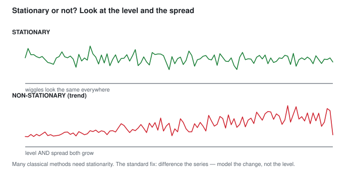

> **In words:** Stationary means the wiggles look the same everywhere; a trend means
> they grow.

Why it matters: many classical forecasting methods (ARIMA, and the assumptions
behind confidence intervals) require stationarity. The standard fix is to
**difference** the series, taking the change instead of the level:

```text
  level:   100, 103, 101, 108, 112
  diff:      ,  +3,  -2,  +7,  +4      <- the trend is gone
```

#### Autocorrelation (ACF), "does today predict tomorrow?"

```text
  lag 0 (today with itself)   = +1.00   (trivially)
  lag 1 (today vs yesterday)  = high    if the series is sticky
  lag 2                       = ...
```


> **In words:** High at lag 1 and decaying means the series has short-term memory.
> Yesterday helps predict today.

**How to read it:** if the ACF is high at lag 1 and fades away, your series has
short-term memory and yesterday helps predict today. If there is a spike at, say,
lag 7, there is a **weekly** pattern, a strong clue about your business.

```text
  spike at lag 7   -> weekly seasonality
  spike at lag 12  -> monthly
  spike at lag 24  -> hourly, or a 2-year cycle
  slow decay       -> trend / non-stationary
  oscillating      -> seasonality
  all near zero    -> white noise (unpredictable)
```

Key practical points for a data scientist:

- Always plot the series before modelling anything.
- Check for missing values: a "gap" that is really `NaN` breaks every
  time-based method.
- Beware of leakage through time (Part 6.3). "Average of the last 7 days" is fine; "the final value" is not.
- Compare against a naive baseline ("tomorrow equals today"). If a clever model cannot beat it, ship the naive one.
- Log-transform highly trending or multiplicative-growth series.

```python
import numpy as np, pandas as pd
import matplotlib.pyplot as plt
import statsmodels.api as sm
from statsmodels.tsa.stattools import adfuller

# a synthetic series: trend + weekly seasonality + noise
rng = np.random.default_rng(20)
n = 200
dates = pd.date_range("2023-01-01", periods=n, freq="D")
trend = np.linspace(0, 20, n)
weekly = 3 * np.sin(2 * np.pi * np.arange(n) / 7)
noise = rng.normal(0, 1.5, n)
s = pd.Series(trend + weekly + noise, index=dates, name="y")

print(s.describe())
print("rolling mean (7d):\n", s.rolling(7).mean().head(8).round(2))

# ADF test for stationarity  (H0: the series has a unit root, i.e. is NOT stationary)
adf = adfuller(s, autolag="AIC")
print(f"ADF statistic={adf[0]:.3f}  p-value={adf[1]:.4f}   "
      f"{'stationary (reject unit root)' if adf[1] < 0.05 else 'non-stationary (keep unit root)'}")

# differencing removes the trend
d = s.diff().dropna()
print("ADF after 1st difference p =", round(adfuller(d)[1], 4))

# autocorrelation
acf = sm.tsa.acf(s.dropna(), nlags=21, fft=True)
print("ACF lags 0-7:", np.round(acf[:8], 2))    # spike at lag 7 = weekly

# decomposition
from statsmodels.tsa.seasonal import seasonal_decompose
comp = seasonal_decompose(s, model="additive", period=7, extrapolate_trend="freq")
comp.plot(); plt.show()

# honest evaluation: train on the PAST, test on the FUTURE
train, test = s[:160], s[160:]

# naive baseline: "tomorrow equals today"
naive_pred = pd.Series([train.iloc[-1]] * len(test), index=test.index)

# ARIMA (stationary model on the differenced series)
fit = sm.tsa.ARIMA(train, order=(1, 1, 1)).fit()
fc = fit.get_forecast(steps=len(test))
arima_pred = pd.Series(fc.predicted_mean, index=test.index)

print("naive  MAE:", round((test - naive_pred).abs().mean(), 3))
print("ARIMA  MAE:", round((test - arima_pred).abs().mean(), 3))
# ^ if ARIMA barely wins, the naive baseline may be the right production choice
```

---
### 7.6 A Complete Worked Example: Customer Churn

**This section is the one to re-read before any project or interview.** It ties
every part of the book into a single realistic workflow.

#### The business question

> "Churn is 32% this quarter. Should we launch a retention campaign, and if so,
> for which customers?"

#### The bootstrap, the universal escape hatch

Before the full example, one technique that solves "I do not know the
distribution" problems. Learn it and you can analyse almost anything.

**The idea:** you cannot compute the sampling distribution analytically, so
**simulate** it by resampling.

```text
  The population
  |  o o o o o o o o o o o o o o o o o o o o o o o o o o o o o |
  |  ^ ^  ^   ^  ^   ^ ^  ^  ^  ^   ^ ^  ^   ^  ^  ^  ^  ^  ^   |
  +----------------------------------------------------------------->

  Step 1: DRAW a sample of n items WITH replacement
  Step 2: compute the statistic (e.g. the mean)
  Step 3: put the items back, and REPEAT B times

  Step 4: the distribution of those B means IS the bootstrap
          sampling distribution. Its spread is your standard error.
```

Think of it this way: you cannot read every card in the deck, so you shuffle, deal
`n` cards, note the total, put them back, shuffle again, deal again, a thousand
times. The pattern of totals tells you how uncertain your first estimate was.

Why it works: the empirical distribution of your data is your best estimate
of the population, so resampling from it approximates drawing from the
population. It makes no normality assumption at all.

```python
import numpy as np
import pandas as pd

rng = np.random.default_rng(30)
x = rng.lognormal(mean=10, sigma=1.0, size=500)   # badly skewed

# --- bootstrap a confidence interval for the mean -------------------------
B = 10_000
boot_means = [rng.choice(x, size=len(x), replace=True).mean() for _ in range(B)]
boot_means = np.array(boot_means)

lo, hi = np.percentile(boot_means, [2.5, 97.5])
print(f"mean          = {x.mean():.3f}")
print(f"bootstrap 95% CI = ({lo:.3f}, {hi:.3f})")

# the naive approach assumes normality -- badly biased here
from scipy import stats
se_naive = x.std(ddof=1) / np.sqrt(len(x))
print(f"naive (normal) CI = ({x.mean()-1.96*se_naive:.3f}, {x.mean()+1.96*se_naive:.3f})")

# --- bootstrap the DIFFERENCE between two groups (the A/B test) -----------
a = rng.lognormal(10, 1.0, 300)
b = rng.lognormal(10.2, 1.0, 300)      # b is genuinely ~2% higher

obs_diff = b.mean() - a.mean()
boot_diff = np.array([rng.choice(b, len(b), replace=True).mean()
                      - rng.choice(a, len(a), replace=True).mean()
                      for _ in range(B)])
lo, hi = np.percentile(boot_diff, [2.5, 97.5])
print(f"\nobserved difference = {obs_diff:.3f}")
print(f"bootstrap 95% CI      = ({lo:.3f}, {hi:.3f})")
print("significant?" , "YES" if lo > 0 else "NO -- CI includes zero")
```

**Bootstrap rule of thumb:** you need roughly `B >= 1000` to `10000` resamples
for a stable 95% interval. The bootstrap is a **computational** method, so it is
slow for big data, but it requires no assumptions, which is a very good trade.

#### Step 1, Load and inspect

```python
import numpy as np, pandas as pd
import matplotlib.pyplot as plt
import seaborn as sns

# Simulate a realistic churn dataset
rng = np.random.default_rng(42)
n = 5000
tenure   = rng.integers(1, 72, n)
monthly  = np.round(rng.lognormal(3.6, 0.6, n), 2)
plan     = rng.choice(["Basic", "Standard", "Premium"], n, p=[0.5, 0.3, 0.2])
support  = rng.poisson(1.5, n)
contract = rng.choice(["Month-to-month", "One year", "Two year"], n, p=[0.55, 0.3, 0.15])
# churn depends on tenure, contract and support -- so a real signal exists
logit = (-0.03 * tenure + 0.8 * (contract == "Month-to-month")
         - 0.25 * support + 0.5 * (plan == "Basic"))
churn = (rng.random(n) < 1 / (1 + np.exp(-logit))).astype(int)

df = pd.DataFrame({"tenure": tenure, "monthly": monthly, "plan": plan,
                   "support": support, "contract": contract, "churn": churn})
print(df.shape)
print(df.head())
```

#### Step 2, Descriptive statistics FIRST (Part 1)

```python
# Step 2 -- runs after the Step 1 block above, which builds df
import matplotlib.pyplot as plt
import seaborn as sns

# the overall picture
print(df[["tenure", "monthly", "support"]].describe().round(2))

# churn rate
print(f"\noverall churn rate = {df['churn'].mean():.1%}")     # ~30-35%

# is monthly_charges skewed?  (decide mean vs median here)
print("skew:", df["monthly"].skew().round(2))                # > 0 -> use median

# churn by category -- box plot + grouped mean
print(df.groupby("contract")["churn"].agg(["count", "mean"]).round(3))
print(df.groupby("plan")["churn"].mean().round(3))

fig, axes = plt.subplots(1, 3, figsize=(15, 4))
sns.histplot(df["monthly"], kde=True, ax=axes[0], bins=40)
axes[0].set_title("monthly_charges (right-skewed)")
sns.boxplot(x="contract", y="churn", data=df, ax=axes[1])
axes[1].set_title("churn by contract")
sns.scatterplot(x="tenure", y="churn", data=df, alpha=0.1, ax=axes[2])
axes[2].set_title("churn vs tenure")
plt.tight_layout(); plt.show()
```

#### Step 3, Is the difference real? (Part 5)

```python
# Step 3 -- runs after Steps 1-2 above, which build df
import numpy as np
import pandas as pd
from scipy import stats
import statsmodels.api as sm
from statsmodels.stats.proportion import proportion_confint

# categorical -> chi-square
ct = pd.crosstab(df["contract"], df["churn"])
chi2, p, dof, expected = stats.chi2_contingency(ct)
print(f"chi2 = {chi2:.2f}, p = {p:.3g}  (expected counts all >= 5? "
      f"{(expected >= 5).all()})")

# effect size, not just significance
n_tot = ct.values.sum()
print(f"Cramer's V = {np.sqrt(chi2 / n_tot):.3f}")

# numeric -> compare medians (skewed!), so Mann-Whitney is the right call
churned   = df.loc[df.churn == 1, "monthly"]
retained  = df.loc[df.churn == 0, "monthly"]
u, p = stats.mannwhitneyu(churned, retained, alternative="two-sided")
print(f"Mann-Whitney p = {p:.3g}  "
      f"medians: churned {churned.median():.2f} vs retained {retained.median():.2f}")

# tenure is roughly normal-ish -> t-test is fine, and we report the CI
t, p = stats.ttest_ind(df.loc[df.churn==1,"tenure"], df.loc[df.churn==0,"tenure"],
                       equal_var=False)
d = df.loc[df.churn==1,"tenure"].mean() - df.loc[df.churn==0,"tenure"].mean()
se = np.sqrt(df.loc[df.churn==1,"tenure"].var(ddof=1)/ (df.churn==1).sum()
             + df.loc[df.churn==0,"tenure"].var(ddof=1)/(df.churn==0).sum())
crit = stats.t.ppf(0.975, df=len(df)-2)
print(f"tenure difference = {d:.2f} months  95% CI = ({d-crit*se:.2f}, {d+crit*se:.2f})  p = {p:.3g}")
```

The honest summary of Step 3: churners differ significantly in tenure, plan,
contract and support calls. We have shown **association**. To say contract type
*causes* churn you would need a randomised experiment, and you cannot randomly
assign contract terms.

#### Step 4, Logistic regression (Part 6 logic, for a binary outcome)

```python
# Step 4 -- runs after Steps 1-3 above, which build df
import numpy as np
import pandas as pd
import statsmodels.formula.api as smf

model = smf.logit("churn ~ tenure + np.log(monthly) + support + C(contract) + C(plan)",
                  data=df).fit()
print(model.summary())

# interpret as odds ratios
params = pd.DataFrame({"coef": model.params, "odds_ratio": np.exp(model.params),
                       "p_value": model.pvalues})
print(params.round(4))

# predicted probabilities for a business decision
new = pd.DataFrame({"tenure": [2, 2, 60, 60],
                    "monthly": [85.0]*4,
                    "support": [0, 0, 0, 0],
                    "contract": ["Month-to-month", "One year",
                                 "Month-to-month", "Two year"],
                    "plan": ["Basic"]*4})
pred = model.predict(new)
print(new.assign(p_churn=pred.round(4)))
```

**Why log-odds?** The outcome is binary, so the model predicts a **probability**,
which must sit between 0 and 1. A straight line has no such guarantee; the
logistic (sigmoid) function guarantees it:


> **In words:** The sigmoid keeps every predicted probability inside [0, 1], which a
> straight line cannot.

**Reading an odds ratio:**

```text
  OR = 2.0  ->  double the ODDS of churning (not "double the probability")
  OR = 0.6  ->  40% lower odds
  A logistic coefficient of 0.7 -> exp(0.7) = 2.01, so ~2x the odds
```

The classic confusion: odds and probability differ (Part 7.4). An OR of 2
does **not** mean "chance doubled" unless the baseline risk is small.

**Tree models are usually better for this task.** Churn is tabular, and
random forests / gradient boosting handle non-linearity and interactions
automatically. The logistic model's real value is that its **coefficients are
interpretable**, which is valuable when you must justify a decision to a
non-technical stakeholder.

#### Step 5, Decision, with uncertainty attached

```text
  A month-to-month, 2-month-tenure, Basic-plan customer
      -> predicted churn probability ~ 79%
  A two-year, 60-month-tenure, Basic-plan customer
      -> predicted churn probability ~ 24%

  ACTION: target retention offers at the high-risk segment.

  BUT ALSO REPORT:
    - the model's performance on held-out data (AUC, and the AUC curve)
    - the confidence interval on each estimate
    - the expected VALUE of the campaign:
          (customers saved) x (their value) - (cost of the offer)
    - that the model finds ASSOCIATION, not necessarily causation
```

**Refinement: uplift modelling.** Churn probability is not the same as
*sensitivity to treatment*. Some high-risk customers would churn no matter what
you offer them. The customers who benefit from a retention call are those with
high probability **and** high treatment sensitivity. Chasing the wrong group
wastes the entire campaign budget. This is an important distinction in applied
data science.

#### How to defend this analysis in an interview

1. "I checked the **data quality** first: missing values, duplicates, ranges,
   the units, the class balance, and whether rows are independent."
2. "I looked at the **distributions** before choosing a summary, and used the
   median and IQR because charges are skewed."
3. "I used an appropriate **test for each variable type**: chi-square for
   categorical, a t-test where normality was plausible, Mann-Whitney where it
   was not. I checked the assumptions rather than assuming them."
4. "I reported **effect sizes and confidence intervals**, alongside p-values."
5. "I reported the **baseline rate** next to every relative measure."
6. "I fit a model, then **checked its assumptions** (residuals, VIF, influence)
   and validated it on **held-out data** with a **time-ordered split**.
7. "I compared it to a **naive baseline**. If the model cannot beat 'most
   customers do not churn', it is not worth shipping."
8. "I am careful about **causal claims**: this is observational data, so I
   would propose an **A/B test** to confirm the campaign actually reduces churn."
9. "I know the **limitations**: selection bias in who was surveyed, no
   information on unobserved confounders such as income or competitor offers,
   and drift over time."

Every item in that list is a concept from this book.

---


---

## 📎 Appendices

Formula sheets, cheat tables, worked practice questions, a glossary,
and the mistakes that trip up most data scientists.

### 🧾 APPENDIX A, Formula Sheet

*Everything in one place. Greek letters = population, Latin = sample.*

#### A.1 Descriptive

```text
mean (x-bar)                 = (1/n) SUM xi
median                       = the 50th percentile
mode                         = the most frequent value
range                        = max - min
variance (sample, s^2)       = (1/(n-1)) SUM (xi - x-bar)^2
variance (population, sigma^2)= (1/n) SUM (xi - mu)^2
standard deviation           = sqrt(variance)
IQR                          = Q3 - Q1
outlier fences               = Q1 - 1.5*IQR   and   Q3 + 1.5*IQR
skewness                     = [(1/n) SUM (xi - x-bar)^3] / s^3
kurtosis                     = [(1/n) SUM (xi - x-bar)^4] / s^4
z-score                      = (x - x-bar) / s
z for a raw value            = (x - mu) / sigma
```

#### A.2 Correlation and Regression

```text
covariance                   = (1/(n-1)) SUM (xi - x-bar)(yi - y-bar)
Pearson r                    = cov(x,y) / (s_x * s_y)
r^2                          = (explained variation) / (total variation)
r^2 for simple regression     = r^2
adjusted r^2                 = 1 - (1 - r^2)(n-1)/(n-p-1)
regression slope (b1)        = cov(x,y) / var(x)
regression intercept (b0)    = y-bar - b1 * x-bar
line                         = y = b0 + b1*x + e
residual                     = e = y - y-hat
VIF                          = 1 / (1 - R^2_i)
logistic model               = p(x) = 1 / (1 + exp(-(b0 + b1*x1 + ...)))
odds ratio                   = exp(coefficient)
```

#### A.3 Probability

```text
P(A)                         = number of favourable / total outcomes
P(A or B)  disjoint          = P(A) + P(B)
P(A or B)  overlapping        = P(A) + P(B) - P(A and B)
P(not A)                     = 1 - P(A)
P(A and B)  independent      = P(A) * P(B)
P(A | B)                     = P(A and B) / P(B)
P(A | B)  independent        = P(A)
law of total probability     = SUM P(A|Bi) * P(Bi)
```

**Bayes' theorem:**

```text
                   P(B | A) * P(A)
P(A | B)  =  -------------------------
                      P(B)
```

**Permutations and combinations:**

```text
P(n, r)  = n! / (n - r)!              order matters
C(n, r)  = n! / [ r! (n - r)! ]       order does not matter
```

#### A.4 Distributions

```text
Bernoulli(p)     P(X=1) = p                        E = p              Var = p(1-p)
Binomial(n,p)    P(X=k) = C(n,k) p^k (1-p)^(n-k)   E = np             Var = np(1-p)
Poisson(lambda)  P(X=k) = e^-lambda lambda^k / k!   E = lambda         Var = lambda
Geometric(p)     P(X=k) = (1-p)^(k-1) p            E = 1/p            Var = (1-p)/p^2
Hypergeometric   P(X=k) = C(K,k)C(N-K,n-k)/C(N,n) E = nK/N
Uniform(a,b)     f(x) = 1/(b-a)                     E = (a+b)/2       Var = (b-a)^2/12
Normal(mu,s^2)   f(x) = 1/(s*sqrt(2pi)) e^(-(x-mu)^2/2s^2)
                                                     E = mu            Var = sigma^2
Exponential(l)  f(x) = lambda e^(-lambda x)         E = 1/lambda      Var = 1/lambda^2
Beta(a,b)        f(x) = x^(a-1)(1-x)^(b-1)/B(a,b)   E = a/(a+b)       Var = ab/[(a+b)^2(a+b+1)]
```

**Useful critical values (z):**

```text
90% CI  ->  z = 1.645      90th percentile
95% CI  ->  z = 1.96       95th percentile
99% CI  ->  z = 2.576      99th percentile
(one-sided 95% threshold -> z = 1.645)
```

**Empirical rule (normal data):** 68% within 1 SD, 95% within 2 SD, 99.7% within 3 SD.

#### A.5 Sampling and Estimation

```text
standard error of the mean   = sigma / sqrt(n)          <- note the sqrt(n)!
95% CI for a mean (z)         = x-bar +/- 1.96 * (s/sqrt(n))
95% CI for a mean (t)         = x-bar +/- t(0.025, n-1) * (s/sqrt(n))
95% CI for a proportion       = p-hat +/- 1.96 * sqrt(p-hat(1-p-hat)/n)
CI for a difference of means  = (x1-bar - x2-bar) +/- z*sqrt(s1^2/n1 + s2^2/n2)
CI for a correlation          = Fisher z: z = 0.5 ln[(1+r)/(1-r)]
CI for an odds ratio          = ln(OR) +/- 1.96 * sqrt(1/a + 1/b + 1/c + 1/d)

power                         = 1 - beta
Type I error (alpha)          = P(reject H0 | H0 true)
Type II error (beta)          = P(fail to reject H0 | H0 false)
sample size for a mean        = (1.96 * sigma / E)^2
sample size for a proportion  = 1.96^2 * p(1-p) / E^2
```

**Central Limit Theorem:**

```text
                 X-bar - mu
X-bar  ~  N(  --------- ,  sigma^2/n  )
                 sigma/sqrt(n)
```

#### A.6 Hypothesis Testing

```text
p-value = P(data this extreme or more | H0 is true)

one-sample t      t = (x-bar - mu0)/(s/sqrt(n))                  df = n-1
two-sample t (W)  t = (x1-bar - x2-bar)/sqrt(s1^2/n1 + s2^2/n2)   df = n1+n2-2
paired t          t = mean(d)/(s_d/sqrt(n))                      df = n-1
ANOVA             F = (SS_between/k-1) / (SS_within/N-k)         df = k-1, N-k
chi-square        chi^2 = SUM (O-E)^2 / E                        df = (r-1)(c-1)
correlation       t = r*sqrt((n-2)/(1-r^2))                       df = n-2
critical z        = (observed - null) / (s/sqrt(n))   ~  N(0,1) for large n

expected count in a cell = (row total * column total) / grand total
```

#### A.7 Robust Statistics

```text
MAD                      = median(|xi - median(x)|)
robust sigma             = 1.4826 * MAD
robust z                 = (xi - median(x)) / (1.4826 * MAD)
trimmed mean             = mean after discarding the top and bottom p%
breakdown point of the mean   = 0%      (one bad point is fatal)
breakdown point of the median = 50%
```

#### A.8 Effect Sizes

```text
Cohen's d            = (x1-bar - x2-bar) / s_pooled
eta-squared          = SS_between / SS_total
partial eta-squared  = SS_effect / (SS_effect + SS_error)
Cramer's V           = sqrt(chi^2 / (n * min(r-1, c-1)))
odds ratio           = (a*d)/(b*c)     for a 2x2 table
risk ratio           = risk1 / risk0
absolute risk diff   = p0 - p1
NNT                  = 1 / |absolute risk difference|
R^2                  = 1 - SSE/SST
log-loss (cross-entropy) = -SUM [y*log(p) + (1-y)*log(1-p)]
```

---
### 📋 APPENDIX B, Distribution and Test Cheat Tables

#### B.1 Discrete distributions at a glance

| Distribution | Notation | Parameters | Support | E[X] | Var(X) | Use it for | `scipy.stats` |
|---|---|---|---|---|---|---|---|
| Bernoulli | B(p) | p | 0, 1 | p | p(1-p) | one yes/no trial | `stats.bernoulli` |
| Binomial | Bin(n,p) | n, p | 0..n | np | np(1-p) | n independent yes/no trials | `stats.binom` |
| Poisson | Poi(lambda) | lambda | 0,1,2,... | lambda | lambda | rare events per interval | `stats.poisson` |
| Geometric | Geo(p) | p | 1,2,3,... | 1/p | (1-p)/p^2 | trials to first success | `stats.geom` |
| Hypergeometric | Hyper(N,K,n) | N,K,n | 0..min(K,n) | nK/N | see below | sampling without replacement | `stats.hypergeom` |

#### B.2 Continuous distributions at a glance

| Distribution | Notation | E[X] | Var(X) | Shape | `scipy.stats` |
|---|---|---|---|---|---|
| Uniform | Unif(a,b) | (a+b)/2 | (b-a)^2/12 | flat | `stats.uniform` |
| Normal | N(mu, sigma^2) | mu | sigma^2 | symmetric bell | `stats.norm` |
| Log-normal | LN(mu, sigma) | e^(mu+sigma^2/2) | (e^sigma^2-1)e^(2mu+sigma^2) | right-skewed | `stats.lognorm` |
| Exponential | Exp(lambda) | 1/lambda | 1/lambda^2 | right-skewed | `stats.expon` |
| Gamma | Gam(a, rate) | a/rate | a/rate^2 | right-skewed | `stats.gamma` |
| Beta | Beta(a,b) | a/(a+b) | ab/[(a+b)^2(a+b+1)] | on [0,1] | `stats.beta` |
| Student t | t(df) | 0 (or mu) | n/(n-2) | bell, fat tails | `stats.t` |
| Chi-square | chi2(df) | df | 2*df | right-skewed | `stats.chi2` |
| F | F(d1,d2) | d2/(d2-2) | ... | right-skewed | `stats.f` |

#### B.3 Which test? (the decision tree)

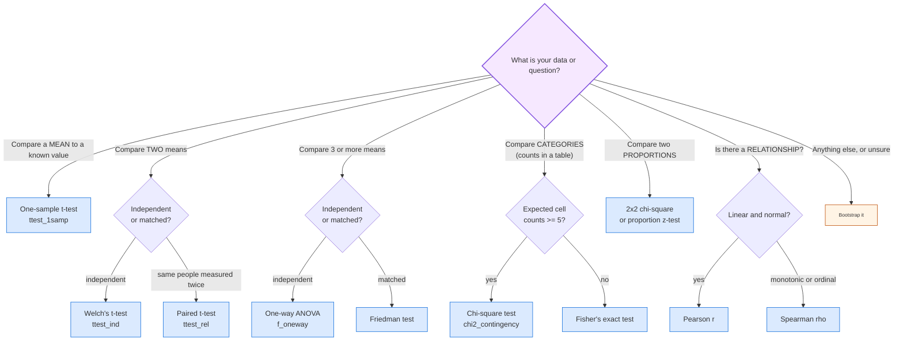

#### B.4 Choosing a significance level

| Situation | alpha | Note |
|---|---|---|
| General exploratory work | 0.05 | the standard convention |
| Medical / safety decisions | 0.01 or 0.001 | cost of a false positive is high |
| Many comparisons (screening) | lower, or use FDR | otherwise false discoveries pile up |
| Publishing a headline result | 0.05 with a power analysis | power >= 0.80 is a minimum |

**Never** change alpha after seeing the data. Choosing it in advance is what
makes the error rate meaningful.

#### B.5 Effect size reference

| Measure | Value | Interpretation |
|---|---|---|
| Pearson r | 0.10 | negligible |
| | 0.30 | moderate |
| | 0.50 | large |
| Cohen's d | 0.2 | small |
| | 0.5 | medium |
| | 0.8 | large |
| Cramér's V | 0.1 / 0.3 / 0.5 | small / medium / large |
| R^2 | 0.02 / 0.13 / 0.26 | small / medium / large (Cohen) |

---
### ✍️ APPENDIX C, Practice Questions with Worked Answers

#### C.1 Descriptive Statistics

**Q1.** The marks of 10 students are 45, 50, 52, 53, 55, 55, 58, 60, 65, 72.
Find the mean, median, mode, range and SD.

```text
sum  = 45+50+52+53+55+55+58+60+65+72 = 565
mean = 565/10 = 56.5

median = average of the 5th and 6th values = (55+55)/2 = 55
mode   = 55 (appears twice; everything else once)
range  = 72 - 45 = 27

deviations from 56.5: -11.5 -6.5 -4.5 -3.5 -1.5 -1.5  1.5  3.5  8.5  15.5
squares:              132.25 42.25 20.25 12.25 2.25 2.25 2.25 12.25 72.25 240.25
sum of squares = 538.5
s^2 = 538.5/9 = 59.83
s   = sqrt(59.83) = 7.74
```

**Q2.** Salaries in a company: 45, 47, 50, 52, 55, 5000 (in thousands). Which is
better for reporting the "typical" salary, the mean or the median?

> **Median** (= 51). The mean is 874.9, which no employee earns. The outlier
> destroys the mean. Always pair a centre with a spread: "median 51, IQR 4.5".

**Q3.** Is it possible for the standard deviation to be negative?

> No. Every deviation is squared before summing, so s^2 >= 0, and s = sqrt(s^2) is
> defined only for s^2 >= 0. Hence s >= 0 always.

**Q4.** The mean of 5 values is 20 and the variance is 4. What is the SD?

```text
s = sqrt(4) = 2
```

**Q5.** You add 10 to every value in a dataset. What happens to the mean and SD?

> The mean increases by 10; the SD is **unchanged**. Adding a constant shifts
> the whole distribution without stretching it. The z-scores are identical too.

**Q6.** You multiply every value by 3. What happens?

> The mean and the SD are **both multiplied by 3**. Variance is multiplied by 9.
> This is exactly why StandardScaler is needed before distance-based models.

#### C.2 Probability

**Q7.** A bag has 4 red and 6 blue balls. Two are drawn without replacement.
What is the probability both are red?

```text
P = (4/10) x (3/9) = 12/90 = 2/15 = 0.1333
```
Note the second probability is 3/9, **not** 4/10. Drawing without replacement
changes the probabilities. (This is why the hypergeometric exists.)

**Q8.** Is `P(A) * P(B) = P(A and B)` always true?

> No. Only when A and B are **independent**. For a fair coin, P(H) * P(H) = 0.25
> but P(two heads) = 0.25 by chance. That matches here, but the *reason* is
> independence, not the formula always holding. In general, use
> `P(A and B) = P(A) * P(A given B)`.

**Q9.** A test is 99% sensitive and 99% specific for a disease affecting 1% of
people. A person tests positive. What is the probability they are sick?

> **About 50%.** Setup with 100,000 people:
>
> ```
>                    | Disease  | No disease |  Total
>  Positive          |    990   |      990   |   1,980
>  Negative          |     10   |    98,990  |  99,000
>  ------------------+----------+------------+--------
>  Total             |  1,000   |   99,990   | 100,000
> ```
>
> `P(disease | positive) = 990/1980 = 0.50`.
> The test looks superb and is nearly useless, because the disease is so rare.
> **The base rate beats the accuracy.** This is the single most important
> intuition in the whole book.

**Q10.** Give an example of two mutually exclusive but not independent events.

> Two fair dice: A = "die 1 shows 6", B = "die 2 shows 6". They cannot both occur
> (P(A and B) = 0), so they are mutually exclusive. But P(A) = 1/6 and
> P(A|B) = 1/6, so B tells you nothing about A. Actually they *are* independent
> here, so this pair does not work.
>
> **A working example:** A = "the die shows an even number", B = "the die shows
> exactly 3". Mutually exclusive (P(A and B) = 0), but P(A|B) = 0, not 1/2, so
> knowing B changes everything. **Not independent.**

#### C.3 Distributions

**Q11.** A call centre gets 4 calls per minute on average. What is the
probability of 0 calls in a minute?

```text
Poisson: P(X=0) = e^-4 * 4^0/0! = e^-4 = 0.0183   -> about 1.8%
```

**Q12.** Dice are rolled 12 times. Which distribution, and what are E[X] and Var(X)?

> Binomial(n=12, p=1/6). E[X] = 12/6 = 2. Var[X] = 12 * (1/6) * (5/6) = 1.667.

**Q13.** A random variable is Normal with mean 100 and variance 25. What is its SD,
and what is the 95% CI for a single observation?

```text
sigma = sqrt(25) = 5
95% of a single observation:  100 +/- 1.96*5 = (90.2, 109.8)
```

**Q14.** Which is bigger, E[X] for a Poisson(3) or for a Poisson(8)? Why do their
means and variances being equal matter?

> E[X] = lambda, so 8 is bigger. The equality of mean and variance is not
> accidental. It is the defining property that makes the Poisson the natural
> model for rare, independent, constant-rate events.

#### C.4 Estimation and Testing

**Q15.** A sample of 64 values has mean 50 and SD 8. Find the 95% CI for the
population mean.

```text
SE      = 8/sqrt(64) = 8/8 = 1
95% CI  = 50 +/- 1.96*1 = (48.04, 51.96)
```

**Q16.** How large a sample is needed for a 95% CI with a margin of error 2,
assuming SD = 10?

```text
n = (1.96*10/2)^2 = 96.04  ->  round UP to 97
```
(always round **up**, never down)

**Q17.** A test gives p = 0.03. You reject H0 at alpha = 0.05 but not at 0.01.
What does that mean?

> The result is significant at the 5% level but not at the 1% level. p = 0.03 is
> the smallest alpha at which you would reject. Report p = 0.03 exactly and state
> the alpha you chose **in advance**.

**Q18.** What is the difference between Type I and Type II errors?

> Type I: rejecting a true H0 (alpha), a false positive. "Concluding there is an
> effect when there is none."
> Type II: failing to reject a false H0 (beta), a false negative. "Missing a real
> effect." Power = 1 - beta.

**Q19.** A t-test gives p = 0.20. Does that prove the two groups are identical?

> **No.** Failing to reject H0 is not accepting it. A non-significant result may
> simply mean the sample was too small to detect a real difference. To claim "no
> difference", you must run an **equivalence test** with a pre-specified
> practically-important margin, and have adequate power.

**Q20.** A/B test: variant B converts 5.2% vs A's 5.0% on 50,000 users each. Is B
better?

```text
difference = 0.2 pp
SE approx = sqrt(0.05*0.95/50000 + 0.052*0.948/50000) = 0.00194
z = 0.002/0.00194 = 1.03   ->  p ~ 0.30.   NOT significant.
```
This is a real lesson: with a large enough n you can detect tiny differences,
and with a small n you can miss real ones. Always state the effect size and the CI.

#### C.5 Correlation and Regression

**Q21.** A correlation of r = 0.85 between screen time and exam marks. Can you
conclude that screen time reduces marks?

> **No.** Three reasons: correlation is not causation; there may be a confounder
> (a student who sleeps badly might both scroll more and score lower); and it
> could even be reverse causation. Also, r = 0.85 explains 72% of variance, not 85%.

**Q22.** In a simple regression, y = 3 + 2x. What is the y-value when x = 5? What
does the slope mean?

```text
y = 3 + 2(5) = 13
The slope: for each one-unit increase in x, y increases by 2 on average,
           holding nothing else constant (there is only one predictor here).
```

**Q23.** A model has R^2 = 0.95 but the residuals-vs-fitted plot shows a strong
fan shape. What is wrong?

> **Heteroscedasticity.** The standard errors and p-values are unreliable. Fix it
> by log-transforming y, using heteroscedasticity-robust standard errors
> (`cov_type="HC3"`), or using quantile regression. A high R^2 does not excuse a
> violated assumption.

**Q24.** You add a feature to your model and R^2 rises from 0.80 to 0.805. Should
you keep it?

> Not on that evidence alone. Use the **adjusted R^2**, or better, compare
> performance on a **validation set**. With thousands of features, tiny R^2
> increases are guaranteed by chance alone.

**Q25.** Your model's training error is 0.01 and its test error is 0.25. Diagnose.

> **Overfitting.** The model memorised the training data. Remedies: more data,
> regularisation, a simpler model, early stopping, and proper cross-validation.

#### C.6 Exam-style Short Answers (write these out in full)

1. Explain the Central Limit Theorem and state two of its uses.
2. Explain the difference between Type I and Type II errors with an example of each.
3. What is a p-value? State three things a p-value is **not**.
4. Why is the standard deviation preferred to the variance for interpretation?
5. Explain why `n-1` appears in the sample variance formula.
6. Describe the four assumptions of linear regression and how to check each.
7. What is multicollinearity, how do you detect it, and how do you fix it?
8. Explain the difference between statistical significance and practical
   significance, with an example.
9. What is the central limit theorem's role in constructing confidence intervals?
10. Explain the base rate fallacy with a numerical example.

Sample answer for Q3, listing what a p-value is NOT:
- NOT the probability that H0 is true
- NOT the probability that the result is a coincidence
- NOT the probability that your alternative hypothesis is correct
- NOT a measure of the size or importance of the effect

---
### 📖 APPENDIX D, Glossary

**Accuracy**: how close a measure is to the true value. (See *precision*.)

**Alternative hypothesis (H1)**: the claim you suspect; carries the inequality.

**Analysis of variance (ANOVA)**: a family of tests comparing the means of 3+
groups, based on a ratio of between-group to within-group variation.

**Arithmetic mean**: the sum of values divided by their count.

**Autocorrelation**: correlation of a series with a lagged version of itself.

**Bayes' theorem**: the formula for updating a prior belief with evidence:
`P(A|B) = P(B|A)P(A)/P(B)`.

**Bell curve**: informal name for the normal distribution.

**Bernoulli**: a distribution for a single success/failure trial.

**Beta distribution**: models an unknown probability between 0 and 1.

**Bias (statistical)**: a systematic error that does not decrease with more
data.

**Binomial distribution**: the count of successes in n independent trials.

**Breakdown point**: the fraction of corrupted data a statistic can tolerate
before becoming useless. Median: 50%. Mean: 0%.

**Central Limit Theorem (CLT)**: the sample mean of almost any population
approaches normality as n grows.

**Chi-square test**: a test of association between categorical variables.

**Coefficient of variation**: `SD / mean`, a relative measure of spread. Useful
when means differ in scale or units.

**Complementary event**: the event "not A". `P(not A) = 1 - P(A)`.

**Conditional probability**: `P(A|B)`, the probability of A given that B occurred.

**Confidence interval**: a range of plausible values for a parameter, derived
from the data at a chosen confidence level.

**Confounding variable (lurking variable)**: a third variable that causes both
the presumed cause and the effect.

**Contingency table (crosstab)**: a table of counts of two categorical
variables crossed.

**Continuous distribution**: a distribution over a continuum; probabilities are
areas, not points.

**Correlation**: the strength and direction of a linear relationship between two
numeric variables. Always between -1 and 1.

**Covariance**: how two variables move together, in the units of the product
of the two variables.

**Cramér's V**: an effect size for a chi-square test.

**Data**: recorded observations.

**Degrees of freedom (df)**: the number of independent pieces of information
available. Variance uses n-1; a t-test uses n-1 (or n1+n2-2).

**Descriptive statistics**: methods that summarise and describe a dataset.

**Discrete distribution**: a distribution over countable values.

**Dispersion**: how spread out the data is. (See *spread*.)

**Effect size**: the magnitude of a relationship or difference, as opposed to
its statistical significance. (Examples: Cohen's d, R^2, Cramér's V, NNT.)

**Empirical rule**: 68-95-99.7: the proportion of normal data within 1, 2, 3 SD.

**Estimate**: a sample statistic used as a guess for a population parameter.

**Fisher's exact test**: the exact test of independence for small samples or
small expected counts.

**Geometric distribution**: trials needed until the first success.

**Heteroscedasticity**: non-constant variance of residuals across the range of
a predictor. Violates a regression assumption.

**Histogram**: a bar chart of the frequency of values in each interval.

**Homoscedasticity**: constant variance of residuals. The assumption that
heteroscedasticity violates.

**Hypothesis**: a testable claim about a population.

**Hypothesis testing**: a formal procedure for deciding whether data provide
enough evidence against the null hypothesis.

**Independence**: knowing one event gives no information about another.
`P(A and B) = P(A)P(B)`.

**Inferential statistics**: drawing conclusions about a population from a sample.

**Interquartile range (IQR)**: `Q3 - Q1`, the width of the middle 50% of data.

**Independence assumption**: the regression assumption that observations do not
influence one another.

**Kruskal-Wallis test**: the non-parametric alternative to one-way ANOVA.

**Kurtosis**: how heavy-tailed a distribution is relative to a normal
distribution.

**Use**: how extreme a point's predictor value is. A high-use point
sits alone at the edge of the x range.

**Linear regression**: modelling y as a linear function of one or more
predictors.

**Logistic regression**: modelling the probability of a binary outcome using a
sigmoid of the linear predictor. Returns odds ratios.

**Mann-Whitney U test**: the non-parametric alternative to the independent
t-test; compares ranks.

**Margin of error**: `critical value x standard error`; the half-width of a
confidence interval.

**Mean absolute deviation (MAD)**: the median of the absolute deviations from
the median; a robust measure of spread.

**Mean (average)**: the sum of values divided by their count.

**Median**: the middle value of the sorted data. Robust.

**Mode**: the most frequent value. The only central tendency valid for
categorical data.

**Multicollinearity**: strong correlation among predictors, destabilising
regression coefficients.

**Multivariate normal**: the joint distribution of several normals; required
for the standard bivariate correlation test.

**Mutually exclusive**: two events that cannot both occur.

**Non-parametric test**: a test that does not assume a specific distribution,
usually by working on ranks.

**Normal distribution**: the bell-shaped distribution with density
`f(x) = (1/sigma sqrt(2pi)) exp(-(x-mu)^2 / 2 sigma^2)`.

**Null hypothesis (H0)**: the default claim, usually "no effect" or "no
difference". The burden of proof is on the alternative.

**Omitted variable bias**: bias in a coefficient caused by leaving out a
variable that affects both x and y.

**One-tailed test**: a directional test (greater than or less than).

**Outlier**: an observation unusually far from the rest.

**p-value**: the probability of data at least as extreme as observed,
**assuming H0 is true**.

**Parameter**: a numerical characteristic of a population (mu, sigma, p).

**Poisson distribution**: the count of rare events in a fixed interval.

**Population**: the entire group under study.

**Power**: `1 - beta`, the probability of correctly rejecting a false null.

**Predictor / independent variable**: the input x in a model.

**Probability**: a number between 0 and 1 expressing the likelihood of an event,
defined as a long-run frequency.

**Proportion**: a count divided by its total.

**p-value adjusted (FDR / Bonferroni)**: a p-value corrected for making many
comparisons.

**Quantile**: a value below which a given proportion of the data falls. (See
*percentile*.)

**Quartile**: the 25th, 50th and 75th percentiles.

**Random variable**: a variable whose value is determined by chance.

**Range**: `max - min`.

**Regression to the mean**: the statistical phenomenon where extreme
measurements tend to be followed by less extreme ones. Also applies to
improvement after a deliberately bad first attempt.

**Relative risk**: the ratio of two risks. An A/B test's "lift".

**Residual**: the difference between observed and predicted values.

**Response / dependent variable**: the outcome y in a model.

**Robust statistic**: a statistic not unduly influenced by outliers.

**Sample**: the subset of a population actually studied.

**Sampling distribution**: the distribution of a statistic over repeated
samples. The basis of all inference.

**Skewness**: the asymmetry of a distribution; positive (right) or negative
(left).

**Spread**: how dispersed the data is. (See *dispersion*.)

**Standard deviation**: the square root of the variance; the average distance
from the mean, in the data's own units.

**Standard error**: the SD of a statistic, not of the data:
`SD / sqrt(n)`. Shrinks with the square root of n.

**Standard normal (Z)**: a normal distribution with mean 0 and SD 1.

**Statistic**: a numerical characteristic of a sample (x-bar, s, p-hat).

**Stem-and-leaf plot**: a compact text display of a distribution's shape.

**Stochastic process**: a time-indexed family of random variables.

**Sum of squares (SST, SSR, SSE)**: total, regression, and error variation in
regression.

**t-distribution**: a bell-shaped distribution with heavier tails than the
normal, used when sigma is unknown or n is small.

**Time series**: data indexed by time, where order matters.

**Trimmed mean**: a mean computed after discarding the highest and lowest p%.

**Type I error**: rejecting a true null. False positive. Rate = alpha.

**Type II error**: failing to reject a false null. False negative. Rate = beta.

**Unbiased estimator**: a statistic whose expected value equals the population
parameter it estimates.

**Variance**: the average squared deviation from the mean.

**z-score**: the number of standard deviations a value is from the mean.

---

### 🚨 APPENDIX E, Top 20 Statistical Mistakes in Data Science

*Print this page and keep it near you.*

| # | Mistake | The fix |
|---|---|---|
| 1 | Reporting only a p-value | Report effect size **and** a confidence interval |
| 2 | Treating p < 0.05 as "important" | With huge n, tiny meaningless effects are "significant". Report magnitude. |
| 3 | Not checking data quality first | Missing values, duplicates and unit errors corrupt every later step |
| 4 | Random train/test split on time-ordered data | Split by time. Random splits leak the future. |
| 5 | Using the mean and SD on skewed data | Use the median and IQR, or log-transform first |
| 6 | Assuming normality without checking | Look at a Q-Q plot; use non-parametric tests when it fails |
| 7 | Reporting accuracy only on training data | Always evaluate on held-out data |
| 8 | Forgetting a naive baseline | If your model cannot beat "predict the majority class", drop it |
| 9 | Using mean/SD to find outliers, then removing them | Outliers have already corrupted the detector. Use MAD / IQR. |
| 10 | Fitting a model with no plan for missing data | Know whether it is MCAR, MAR or MNAR before imputing |
| 11 | Treating a convenience sample as representative | The most common fatal flaw in student and industry projects |
| 12 | Claiming causation from observational data | Say "associated with". Propose an A/B test. |
| 13 | Ignoring data leakage | A feature known only *after* the outcome cannot be used in production |
| 14 | Running 100 tests and reporting the best | Correct for multiple comparisons (Benjamini-Hochberg) |
| 15 | Not checking residual assumptions in regression | Look at residual-vs-fitted, Q-Q and Scale-Location plots |
| 16 | Reporting a relative risk without the baseline | A "50% reduction" from 2% to 1% is only 1pp absolute (NNT = 100) |
| 17 | Skipping the log transform on right-skewed money data | `np.log1p` is your friend |
| 18 | Treating 0-4 satisfaction ratings as interval data | Report the median and use rank-based methods |
| 19 | Iterating on the test set until results look good | The test set is consumed the first time you look |
| 20 | Believing a single metric tells the whole story | Always pair with a second view (a CI, a calibration curve, a confusion matrix) |

Three habits that prevent almost all of the above:

1. **PLOT FIRST.** Always. Histogram, box plot, scatter plot, before any number.
2. **ASK** "what could make this number wrong?" before you report it.
3. **STATE YOUR ASSUMPTIONS** and check each one explicitly. A stated, checked
   assumption is a strength. An unchecked one is a liability waiting for a stakeholder.

---

## 🙌 Closing Note

You have now seen the whole arc: **describe** your data (Part 1), **quantify
uncertainty** (Parts 2-3), **generalise** from samples (Part 4), **test** claims
(Part 5) and **model** relationships (Part 6), then **handle messiness** (Part 7).

Three ideas run through all of it:

1. There is **always** uncertainty. Your job is to quantify and report it, not
   to hide it behind a single confident number.
2. Your **assumptions matter more than your formulas**. Always check them.
3. A **statistic without context is meaningless**. Always report the effect size,
   the interval, the baseline, and the sample you measured.

Statistics is less about memorising formulas. It is the habit of asking, of every number: *how confident can I be, and why?*

---

*End of document.*
