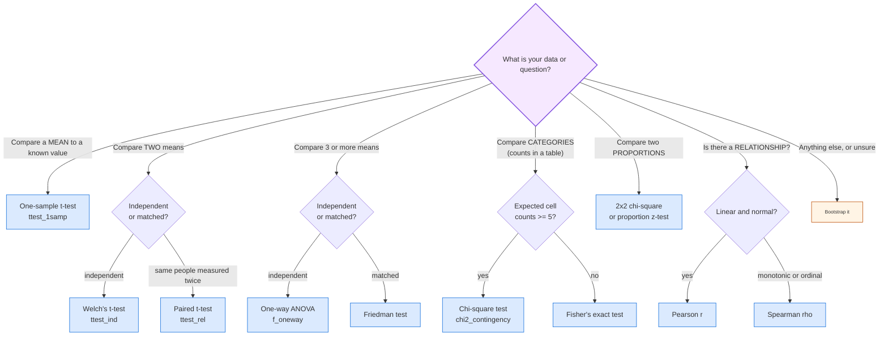

## 📎 Appendices

Formula sheets, cheat tables, worked practice questions, a glossary,
and the mistakes that trip up most data scientists.

### 🧾 APPENDIX A, Formula Sheet

*Everything in one place. Greek letters = population, Latin = sample.*

#### A.1 Descriptive

```text
mean (x-bar)                 = (1/n) SUM xi
median                       = the 50th percentile
mode                         = the most frequent value
range                        = max - min
variance (sample, s^2)       = (1/(n-1)) SUM (xi - x-bar)^2
variance (population, sigma^2)= (1/n) SUM (xi - mu)^2
standard deviation           = sqrt(variance)
IQR                          = Q3 - Q1
outlier fences               = Q1 - 1.5*IQR   and   Q3 + 1.5*IQR
skewness                     = [(1/n) SUM (xi - x-bar)^3] / s^3
kurtosis                     = [(1/n) SUM (xi - x-bar)^4] / s^4
z-score                      = (x - x-bar) / s
z for a raw value            = (x - mu) / sigma
```

#### A.2 Correlation and Regression

```text
covariance                   = (1/(n-1)) SUM (xi - x-bar)(yi - y-bar)
Pearson r                    = cov(x,y) / (s_x * s_y)
r^2                          = (explained variation) / (total variation)
r^2 for simple regression     = r^2
adjusted r^2                 = 1 - (1 - r^2)(n-1)/(n-p-1)
regression slope (b1)        = cov(x,y) / var(x)
regression intercept (b0)    = y-bar - b1 * x-bar
line                         = y = b0 + b1*x + e
residual                     = e = y - y-hat
VIF                          = 1 / (1 - R^2_i)
logistic model               = p(x) = 1 / (1 + exp(-(b0 + b1*x1 + ...)))
odds ratio                   = exp(coefficient)
```

#### A.3 Probability

```text
P(A)                         = number of favourable / total outcomes
P(A or B)  disjoint          = P(A) + P(B)
P(A or B)  overlapping        = P(A) + P(B) - P(A and B)
P(not A)                     = 1 - P(A)
P(A and B)  independent      = P(A) * P(B)
P(A | B)                     = P(A and B) / P(B)
P(A | B)  independent        = P(A)
law of total probability     = SUM P(A|Bi) * P(Bi)
```

**Bayes' theorem:**

```text
                   P(B | A) * P(A)
P(A | B)  =  -------------------------
                      P(B)
```

**Permutations and combinations:**

```text
P(n, r)  = n! / (n - r)!              order matters
C(n, r)  = n! / [ r! (n - r)! ]       order does not matter
```

#### A.4 Distributions

```text
Bernoulli(p)     P(X=1) = p                        E = p              Var = p(1-p)
Binomial(n,p)    P(X=k) = C(n,k) p^k (1-p)^(n-k)   E = np             Var = np(1-p)
Poisson(lambda)  P(X=k) = e^-lambda lambda^k / k!   E = lambda         Var = lambda
Geometric(p)     P(X=k) = (1-p)^(k-1) p            E = 1/p            Var = (1-p)/p^2
Hypergeometric   P(X=k) = C(K,k)C(N-K,n-k)/C(N,n) E = nK/N
Uniform(a,b)     f(x) = 1/(b-a)                     E = (a+b)/2       Var = (b-a)^2/12
Normal(mu,s^2)   f(x) = 1/(s*sqrt(2pi)) e^(-(x-mu)^2/2s^2)
                                                     E = mu            Var = sigma^2
Exponential(l)  f(x) = lambda e^(-lambda x)         E = 1/lambda      Var = 1/lambda^2
Beta(a,b)        f(x) = x^(a-1)(1-x)^(b-1)/B(a,b)   E = a/(a+b)       Var = ab/[(a+b)^2(a+b+1)]
```

**Useful critical values (z):**

```text
90% CI  ->  z = 1.645      90th percentile
95% CI  ->  z = 1.96       95th percentile
99% CI  ->  z = 2.576      99th percentile
(one-sided 95% threshold -> z = 1.645)
```

**Empirical rule (normal data):** 68% within 1 SD, 95% within 2 SD, 99.7% within 3 SD.

#### A.5 Sampling and Estimation

```text
standard error of the mean   = sigma / sqrt(n)          <- note the sqrt(n)!
95% CI for a mean (z)         = x-bar +/- 1.96 * (s/sqrt(n))
95% CI for a mean (t)         = x-bar +/- t(0.025, n-1) * (s/sqrt(n))
95% CI for a proportion       = p-hat +/- 1.96 * sqrt(p-hat(1-p-hat)/n)
CI for a difference of means  = (x1-bar - x2-bar) +/- z*sqrt(s1^2/n1 + s2^2/n2)
CI for a correlation          = Fisher z: z = 0.5 ln[(1+r)/(1-r)]
CI for an odds ratio          = ln(OR) +/- 1.96 * sqrt(1/a + 1/b + 1/c + 1/d)

power                         = 1 - beta
Type I error (alpha)          = P(reject H0 | H0 true)
Type II error (beta)          = P(fail to reject H0 | H0 false)
sample size for a mean        = (1.96 * sigma / E)^2
sample size for a proportion  = 1.96^2 * p(1-p) / E^2
```

**Central Limit Theorem:**

```text
                 X-bar - mu
X-bar  ~  N(  --------- ,  sigma^2/n  )
                 sigma/sqrt(n)
```

#### A.6 Hypothesis Testing

```text
p-value = P(data this extreme or more | H0 is true)

one-sample t      t = (x-bar - mu0)/(s/sqrt(n))                  df = n-1
two-sample t (W)  t = (x1-bar - x2-bar)/sqrt(s1^2/n1 + s2^2/n2)   df = n1+n2-2
paired t          t = mean(d)/(s_d/sqrt(n))                      df = n-1
ANOVA             F = (SS_between/k-1) / (SS_within/N-k)         df = k-1, N-k
chi-square        chi^2 = SUM (O-E)^2 / E                        df = (r-1)(c-1)
correlation       t = r*sqrt((n-2)/(1-r^2))                       df = n-2
critical z        = (observed - null) / (s/sqrt(n))   ~  N(0,1) for large n

expected count in a cell = (row total * column total) / grand total
```

#### A.7 Robust Statistics

```text
MAD                      = median(|xi - median(x)|)
robust sigma             = 1.4826 * MAD
robust z                 = (xi - median(x)) / (1.4826 * MAD)
trimmed mean             = mean after discarding the top and bottom p%
breakdown point of the mean   = 0%      (one bad point is fatal)
breakdown point of the median = 50%
```

#### A.8 Effect Sizes

```text
Cohen's d            = (x1-bar - x2-bar) / s_pooled
eta-squared          = SS_between / SS_total
partial eta-squared  = SS_effect / (SS_effect + SS_error)
Cramer's V           = sqrt(chi^2 / (n * min(r-1, c-1)))
odds ratio           = (a*d)/(b*c)     for a 2x2 table
risk ratio           = risk1 / risk0
absolute risk diff   = p0 - p1
NNT                  = 1 / |absolute risk difference|
R^2                  = 1 - SSE/SST
log-loss (cross-entropy) = -SUM [y*log(p) + (1-y)*log(1-p)]
```

---
### 📋 APPENDIX B, Distribution and Test Cheat Tables

#### B.1 Discrete distributions at a glance

| Distribution | Notation | Parameters | Support | E[X] | Var(X) | Use it for | `scipy.stats` |
|---|---|---|---|---|---|---|---|
| Bernoulli | B(p) | p | 0, 1 | p | p(1-p) | one yes/no trial | `stats.bernoulli` |
| Binomial | Bin(n,p) | n, p | 0..n | np | np(1-p) | n independent yes/no trials | `stats.binom` |
| Poisson | Poi(lambda) | lambda | 0,1,2,... | lambda | lambda | rare events per interval | `stats.poisson` |
| Geometric | Geo(p) | p | 1,2,3,... | 1/p | (1-p)/p^2 | trials to first success | `stats.geom` |
| Hypergeometric | Hyper(N,K,n) | N,K,n | 0..min(K,n) | nK/N | see below | sampling without replacement | `stats.hypergeom` |

#### B.2 Continuous distributions at a glance

| Distribution | Notation | E[X] | Var(X) | Shape | `scipy.stats` |
|---|---|---|---|---|---|
| Uniform | Unif(a,b) | (a+b)/2 | (b-a)^2/12 | flat | `stats.uniform` |
| Normal | N(mu, sigma^2) | mu | sigma^2 | symmetric bell | `stats.norm` |
| Log-normal | LN(mu, sigma) | e^(mu+sigma^2/2) | (e^sigma^2-1)e^(2mu+sigma^2) | right-skewed | `stats.lognorm` |
| Exponential | Exp(lambda) | 1/lambda | 1/lambda^2 | right-skewed | `stats.expon` |
| Gamma | Gam(a, rate) | a/rate | a/rate^2 | right-skewed | `stats.gamma` |
| Beta | Beta(a,b) | a/(a+b) | ab/[(a+b)^2(a+b+1)] | on [0,1] | `stats.beta` |
| Student t | t(df) | 0 (or mu) | n/(n-2) | bell, fat tails | `stats.t` |
| Chi-square | chi2(df) | df | 2*df | right-skewed | `stats.chi2` |
| F | F(d1,d2) | d2/(d2-2) | ... | right-skewed | `stats.f` |

#### B.3 Which test? (the decision tree)



#### B.4 Choosing a significance level

| Situation | alpha | Note |
|---|---|---|
| General exploratory work | 0.05 | the standard convention |
| Medical / safety decisions | 0.01 or 0.001 | cost of a false positive is high |
| Many comparisons (screening) | lower, or use FDR | otherwise false discoveries pile up |
| Publishing a headline result | 0.05 with a power analysis | power >= 0.80 is a minimum |

**Never** change alpha after seeing the data. Choosing it in advance is what
makes the error rate meaningful.

#### B.5 Effect size reference

| Measure | Value | Interpretation |
|---|---|---|
| Pearson r | 0.10 | negligible |
| | 0.30 | moderate |
| | 0.50 | large |
| Cohen's d | 0.2 | small |
| | 0.5 | medium |
| | 0.8 | large |
| Cramér's V | 0.1 / 0.3 / 0.5 | small / medium / large |
| R^2 | 0.02 / 0.13 / 0.26 | small / medium / large (Cohen) |

---
### ✍️ APPENDIX C, Practice Questions with Worked Answers

#### C.1 Descriptive Statistics

**Q1.** The marks of 10 students are 45, 50, 52, 53, 55, 55, 58, 60, 65, 72.
Find the mean, median, mode, range and SD.

```text
sum  = 45+50+52+53+55+55+58+60+65+72 = 565
mean = 565/10 = 56.5

median = average of the 5th and 6th values = (55+55)/2 = 55
mode   = 55 (appears twice; everything else once)
range  = 72 - 45 = 27

deviations from 56.5: -11.5 -6.5 -4.5 -3.5 -1.5 -1.5  1.5  3.5  8.5  15.5
squares:              132.25 42.25 20.25 12.25 2.25 2.25 2.25 12.25 72.25 240.25
sum of squares = 538.5
s^2 = 538.5/9 = 59.83
s   = sqrt(59.83) = 7.74
```

**Q2.** Salaries in a company: 45, 47, 50, 52, 55, 5000 (in thousands). Which is
better for reporting the "typical" salary, the mean or the median?

> **Median** (= 51). The mean is 874.9, which no employee earns. The outlier
> destroys the mean. Always pair a centre with a spread: "median 51, IQR 4.5".

**Q3.** Is it possible for the standard deviation to be negative?

> No. Every deviation is squared before summing, so s^2 >= 0, and s = sqrt(s^2) is
> defined only for s^2 >= 0. Hence s >= 0 always.

**Q4.** The mean of 5 values is 20 and the variance is 4. What is the SD?

```text
s = sqrt(4) = 2
```

**Q5.** You add 10 to every value in a dataset. What happens to the mean and SD?

> The mean increases by 10; the SD is **unchanged**. Adding a constant shifts
> the whole distribution without stretching it. The z-scores are identical too.

**Q6.** You multiply every value by 3. What happens?

> The mean and the SD are **both multiplied by 3**. Variance is multiplied by 9.
> This is exactly why StandardScaler is needed before distance-based models.

#### C.2 Probability

**Q7.** A bag has 4 red and 6 blue balls. Two are drawn without replacement.
What is the probability both are red?

```text
P = (4/10) x (3/9) = 12/90 = 2/15 = 0.1333
```
Note the second probability is 3/9, **not** 4/10. Drawing without replacement
changes the probabilities. (This is why the hypergeometric exists.)

**Q8.** Is `P(A) * P(B) = P(A and B)` always true?

> No. Only when A and B are **independent**. For a fair coin, P(H) * P(H) = 0.25
> but P(two heads) = 0.25 by chance. That matches here, but the *reason* is
> independence, not the formula always holding. In general, use
> `P(A and B) = P(A) * P(A given B)`.

**Q9.** A test is 99% sensitive and 99% specific for a disease affecting 1% of
people. A person tests positive. What is the probability they are sick?

> **About 50%.** Setup with 100,000 people:
>
> ```
>                    | Disease  | No disease |  Total
>  Positive          |    990   |      990   |   1,980
>  Negative          |     10   |    98,990  |  99,000
>  ------------------+----------+------------+--------
>  Total             |  1,000   |   99,990   | 100,000
> ```
>
> `P(disease | positive) = 990/1980 = 0.50`.
> The test looks superb and is nearly useless, because the disease is so rare.
> **The base rate beats the accuracy.** This is the single most important
> intuition in the whole book.

**Q10.** Give an example of two mutually exclusive but not independent events.

> Two fair dice: A = "die 1 shows 6", B = "die 2 shows 6". They cannot both occur
> (P(A and B) = 0), so they are mutually exclusive. But P(A) = 1/6 and
> P(A|B) = 1/6, so B tells you nothing about A. Actually they *are* independent
> here, so this pair does not work.
>
> **A working example:** A = "the die shows an even number", B = "the die shows
> exactly 3". Mutually exclusive (P(A and B) = 0), but P(A|B) = 0, not 1/2, so
> knowing B changes everything. **Not independent.**

#### C.3 Distributions

**Q11.** A call centre gets 4 calls per minute on average. What is the
probability of 0 calls in a minute?

```text
Poisson: P(X=0) = e^-4 * 4^0/0! = e^-4 = 0.0183   -> about 1.8%
```

**Q12.** Dice are rolled 12 times. Which distribution, and what are E[X] and Var(X)?

> Binomial(n=12, p=1/6). E[X] = 12/6 = 2. Var[X] = 12 * (1/6) * (5/6) = 1.667.

**Q13.** A random variable is Normal with mean 100 and variance 25. What is its SD,
and what is the 95% CI for a single observation?

```text
sigma = sqrt(25) = 5
95% of a single observation:  100 +/- 1.96*5 = (90.2, 109.8)
```

**Q14.** Which is bigger, E[X] for a Poisson(3) or for a Poisson(8)? Why do their
means and variances being equal matter?

> E[X] = lambda, so 8 is bigger. The equality of mean and variance is not
> accidental. It is the defining property that makes the Poisson the natural
> model for rare, independent, constant-rate events.

#### C.4 Estimation and Testing

**Q15.** A sample of 64 values has mean 50 and SD 8. Find the 95% CI for the
population mean.

```text
SE      = 8/sqrt(64) = 8/8 = 1
95% CI  = 50 +/- 1.96*1 = (48.04, 51.96)
```

**Q16.** How large a sample is needed for a 95% CI with a margin of error 2,
assuming SD = 10?

```text
n = (1.96*10/2)^2 = 96.04  ->  round UP to 97
```
(always round **up**, never down)

**Q17.** A test gives p = 0.03. You reject H0 at alpha = 0.05 but not at 0.01.
What does that mean?

> The result is significant at the 5% level but not at the 1% level. p = 0.03 is
> the smallest alpha at which you would reject. Report p = 0.03 exactly and state
> the alpha you chose **in advance**.

**Q18.** What is the difference between Type I and Type II errors?

> Type I: rejecting a true H0 (alpha), a false positive. "Concluding there is an
> effect when there is none."
> Type II: failing to reject a false H0 (beta), a false negative. "Missing a real
> effect." Power = 1 - beta.

**Q19.** A t-test gives p = 0.20. Does that prove the two groups are identical?

> **No.** Failing to reject H0 is not accepting it. A non-significant result may
> simply mean the sample was too small to detect a real difference. To claim "no
> difference", you must run an **equivalence test** with a pre-specified
> practically-important margin, and have adequate power.

**Q20.** A/B test: variant B converts 5.2% vs A's 5.0% on 50,000 users each. Is B
better?

```text
difference = 0.2 pp
SE approx = sqrt(0.05*0.95/50000 + 0.052*0.948/50000) = 0.00194
z = 0.002/0.00194 = 1.03   ->  p ~ 0.30.   NOT significant.
```
This is a real lesson: with a large enough n you can detect tiny differences,
and with a small n you can miss real ones. Always state the effect size and the CI.

#### C.5 Correlation and Regression

**Q21.** A correlation of r = 0.85 between screen time and exam marks. Can you
conclude that screen time reduces marks?

> **No.** Three reasons: correlation is not causation; there may be a confounder
> (a student who sleeps badly might both scroll more and score lower); and it
> could even be reverse causation. Also, r = 0.85 explains 72% of variance, not 85%.

**Q22.** In a simple regression, y = 3 + 2x. What is the y-value when x = 5? What
does the slope mean?

```text
y = 3 + 2(5) = 13
The slope: for each one-unit increase in x, y increases by 2 on average,
           holding nothing else constant (there is only one predictor here).
```

**Q23.** A model has R^2 = 0.95 but the residuals-vs-fitted plot shows a strong
fan shape. What is wrong?

> **Heteroscedasticity.** The standard errors and p-values are unreliable. Fix it
> by log-transforming y, using heteroscedasticity-robust standard errors
> (`cov_type="HC3"`), or using quantile regression. A high R^2 does not excuse a
> violated assumption.

**Q24.** You add a feature to your model and R^2 rises from 0.80 to 0.805. Should
you keep it?

> Not on that evidence alone. Use the **adjusted R^2**, or better, compare
> performance on a **validation set**. With thousands of features, tiny R^2
> increases are guaranteed by chance alone.

**Q25.** Your model's training error is 0.01 and its test error is 0.25. Diagnose.

> **Overfitting.** The model memorised the training data. Remedies: more data,
> regularisation, a simpler model, early stopping, and proper cross-validation.

#### C.6 Exam-style Short Answers (write these out in full)

1. Explain the Central Limit Theorem and state two of its uses.
2. Explain the difference between Type I and Type II errors with an example of each.
3. What is a p-value? State three things a p-value is **not**.
4. Why is the standard deviation preferred to the variance for interpretation?
5. Explain why `n-1` appears in the sample variance formula.
6. Describe the four assumptions of linear regression and how to check each.
7. What is multicollinearity, how do you detect it, and how do you fix it?
8. Explain the difference between statistical significance and practical
   significance, with an example.
9. What is the central limit theorem's role in constructing confidence intervals?
10. Explain the base rate fallacy with a numerical example.

Sample answer for Q3, listing what a p-value is NOT:
- NOT the probability that H0 is true
- NOT the probability that the result is a coincidence
- NOT the probability that your alternative hypothesis is correct
- NOT a measure of the size or importance of the effect

---
### 📖 APPENDIX D, Glossary

**Accuracy**: how close a measure is to the true value. (See *precision*.)

**Alternative hypothesis (H1)**: the claim you suspect; carries the inequality.

**Analysis of variance (ANOVA)**: a family of tests comparing the means of 3+
groups, based on a ratio of between-group to within-group variation.

**Arithmetic mean**: the sum of values divided by their count.

**Autocorrelation**: correlation of a series with a lagged version of itself.

**Bayes' theorem**: the formula for updating a prior belief with evidence:
`P(A|B) = P(B|A)P(A)/P(B)`.

**Bell curve**: informal name for the normal distribution.

**Bernoulli**: a distribution for a single success/failure trial.

**Beta distribution**: models an unknown probability between 0 and 1.

**Bias (statistical)**: a systematic error that does not decrease with more
data.

**Binomial distribution**: the count of successes in n independent trials.

**Breakdown point**: the fraction of corrupted data a statistic can tolerate
before becoming useless. Median: 50%. Mean: 0%.

**Central Limit Theorem (CLT)**: the sample mean of almost any population
approaches normality as n grows.

**Chi-square test**: a test of association between categorical variables.

**Coefficient of variation**: `SD / mean`, a relative measure of spread. Useful
when means differ in scale or units.

**Complementary event**: the event "not A". `P(not A) = 1 - P(A)`.

**Conditional probability**: `P(A|B)`, the probability of A given that B occurred.

**Confidence interval**: a range of plausible values for a parameter, derived
from the data at a chosen confidence level.

**Confounding variable (lurking variable)**: a third variable that causes both
the presumed cause and the effect.

**Contingency table (crosstab)**: a table of counts of two categorical
variables crossed.

**Continuous distribution**: a distribution over a continuum; probabilities are
areas, not points.

**Correlation**: the strength and direction of a linear relationship between two
numeric variables. Always between -1 and 1.

**Covariance**: how two variables move together, in the units of the product
of the two variables.

**Cramér's V**: an effect size for a chi-square test.

**Data**: recorded observations.

**Degrees of freedom (df)**: the number of independent pieces of information
available. Variance uses n-1; a t-test uses n-1 (or n1+n2-2).

**Descriptive statistics**: methods that summarise and describe a dataset.

**Discrete distribution**: a distribution over countable values.

**Dispersion**: how spread out the data is. (See *spread*.)

**Effect size**: the magnitude of a relationship or difference, as opposed to
its statistical significance. (Examples: Cohen's d, R^2, Cramér's V, NNT.)

**Empirical rule**: 68-95-99.7: the proportion of normal data within 1, 2, 3 SD.

**Estimate**: a sample statistic used as a guess for a population parameter.

**Fisher's exact test**: the exact test of independence for small samples or
small expected counts.

**Geometric distribution**: trials needed until the first success.

**Heteroscedasticity**: non-constant variance of residuals across the range of
a predictor. Violates a regression assumption.

**Histogram**: a bar chart of the frequency of values in each interval.

**Homoscedasticity**: constant variance of residuals. The assumption that
heteroscedasticity violates.

**Hypothesis**: a testable claim about a population.

**Hypothesis testing**: a formal procedure for deciding whether data provide
enough evidence against the null hypothesis.

**Independence**: knowing one event gives no information about another.
`P(A and B) = P(A)P(B)`.

**Inferential statistics**: drawing conclusions about a population from a sample.

**Interquartile range (IQR)**: `Q3 - Q1`, the width of the middle 50% of data.

**Independence assumption**: the regression assumption that observations do not
influence one another.

**Kruskal-Wallis test**: the non-parametric alternative to one-way ANOVA.

**Kurtosis**: how heavy-tailed a distribution is relative to a normal
distribution.

**Use**: how extreme a point's predictor value is. A high-use point
sits alone at the edge of the x range.

**Linear regression**: modelling y as a linear function of one or more
predictors.

**Logistic regression**: modelling the probability of a binary outcome using a
sigmoid of the linear predictor. Returns odds ratios.

**Mann-Whitney U test**: the non-parametric alternative to the independent
t-test; compares ranks.

**Margin of error**: `critical value x standard error`; the half-width of a
confidence interval.

**Mean absolute deviation (MAD)**: the median of the absolute deviations from
the median; a robust measure of spread.

**Mean (average)**: the sum of values divided by their count.

**Median**: the middle value of the sorted data. Robust.

**Mode**: the most frequent value. The only central tendency valid for
categorical data.

**Multicollinearity**: strong correlation among predictors, destabilising
regression coefficients.

**Multivariate normal**: the joint distribution of several normals; required
for the standard bivariate correlation test.

**Mutually exclusive**: two events that cannot both occur.

**Non-parametric test**: a test that does not assume a specific distribution,
usually by working on ranks.

**Normal distribution**: the bell-shaped distribution with density
`f(x) = (1/sigma sqrt(2pi)) exp(-(x-mu)^2 / 2 sigma^2)`.

**Null hypothesis (H0)**: the default claim, usually "no effect" or "no
difference". The burden of proof is on the alternative.

**Omitted variable bias**: bias in a coefficient caused by leaving out a
variable that affects both x and y.

**One-tailed test**: a directional test (greater than or less than).

**Outlier**: an observation unusually far from the rest.

**p-value**: the probability of data at least as extreme as observed,
**assuming H0 is true**.

**Parameter**: a numerical characteristic of a population (mu, sigma, p).

**Poisson distribution**: the count of rare events in a fixed interval.

**Population**: the entire group under study.

**Power**: `1 - beta`, the probability of correctly rejecting a false null.

**Predictor / independent variable**: the input x in a model.

**Probability**: a number between 0 and 1 expressing the likelihood of an event,
defined as a long-run frequency.

**Proportion**: a count divided by its total.

**p-value adjusted (FDR / Bonferroni)**: a p-value corrected for making many
comparisons.

**Quantile**: a value below which a given proportion of the data falls. (See
*percentile*.)

**Quartile**: the 25th, 50th and 75th percentiles.

**Random variable**: a variable whose value is determined by chance.

**Range**: `max - min`.

**Regression to the mean**: the statistical phenomenon where extreme
measurements tend to be followed by less extreme ones. Also applies to
improvement after a deliberately bad first attempt.

**Relative risk**: the ratio of two risks. An A/B test's "lift".

**Residual**: the difference between observed and predicted values.

**Response / dependent variable**: the outcome y in a model.

**Robust statistic**: a statistic not unduly influenced by outliers.

**Sample**: the subset of a population actually studied.

**Sampling distribution**: the distribution of a statistic over repeated
samples. The basis of all inference.

**Skewness**: the asymmetry of a distribution; positive (right) or negative
(left).

**Spread**: how dispersed the data is. (See *dispersion*.)

**Standard deviation**: the square root of the variance; the average distance
from the mean, in the data's own units.

**Standard error**: the SD of a statistic, not of the data:
`SD / sqrt(n)`. Shrinks with the square root of n.

**Standard normal (Z)**: a normal distribution with mean 0 and SD 1.

**Statistic**: a numerical characteristic of a sample (x-bar, s, p-hat).

**Stem-and-leaf plot**: a compact text display of a distribution's shape.

**Stochastic process**: a time-indexed family of random variables.

**Sum of squares (SST, SSR, SSE)**: total, regression, and error variation in
regression.

**t-distribution**: a bell-shaped distribution with heavier tails than the
normal, used when sigma is unknown or n is small.

**Time series**: data indexed by time, where order matters.

**Trimmed mean**: a mean computed after discarding the highest and lowest p%.

**Type I error**: rejecting a true null. False positive. Rate = alpha.

**Type II error**: failing to reject a false null. False negative. Rate = beta.

**Unbiased estimator**: a statistic whose expected value equals the population
parameter it estimates.

**Variance**: the average squared deviation from the mean.

**z-score**: the number of standard deviations a value is from the mean.

---

### 🚨 APPENDIX E, Top 20 Statistical Mistakes in Data Science

*Print this page and keep it near you.*

| # | Mistake | The fix |
|---|---|---|
| 1 | Reporting only a p-value | Report effect size **and** a confidence interval |
| 2 | Treating p < 0.05 as "important" | With huge n, tiny meaningless effects are "significant". Report magnitude. |
| 3 | Not checking data quality first | Missing values, duplicates and unit errors corrupt every later step |
| 4 | Random train/test split on time-ordered data | Split by time. Random splits leak the future. |
| 5 | Using the mean and SD on skewed data | Use the median and IQR, or log-transform first |
| 6 | Assuming normality without checking | Look at a Q-Q plot; use non-parametric tests when it fails |
| 7 | Reporting accuracy only on training data | Always evaluate on held-out data |
| 8 | Forgetting a naive baseline | If your model cannot beat "predict the majority class", drop it |
| 9 | Using mean/SD to find outliers, then removing them | Outliers have already corrupted the detector. Use MAD / IQR. |
| 10 | Fitting a model with no plan for missing data | Know whether it is MCAR, MAR or MNAR before imputing |
| 11 | Treating a convenience sample as representative | The most common fatal flaw in student and industry projects |
| 12 | Claiming causation from observational data | Say "associated with". Propose an A/B test. |
| 13 | Ignoring data leakage | A feature known only *after* the outcome cannot be used in production |
| 14 | Running 100 tests and reporting the best | Correct for multiple comparisons (Benjamini-Hochberg) |
| 15 | Not checking residual assumptions in regression | Look at residual-vs-fitted, Q-Q and Scale-Location plots |
| 16 | Reporting a relative risk without the baseline | A "50% reduction" from 2% to 1% is only 1pp absolute (NNT = 100) |
| 17 | Skipping the log transform on right-skewed money data | `np.log1p` is your friend |
| 18 | Treating 0-4 satisfaction ratings as interval data | Report the median and use rank-based methods |
| 19 | Iterating on the test set until results look good | The test set is consumed the first time you look |
| 20 | Believing a single metric tells the whole story | Always pair with a second view (a CI, a calibration curve, a confusion matrix) |

Three habits that prevent almost all of the above:

1. **PLOT FIRST.** Always. Histogram, box plot, scatter plot, before any number.
2. **ASK** "what could make this number wrong?" before you report it.
3. **STATE YOUR ASSUMPTIONS** and check each one explicitly. A stated, checked
   assumption is a strength. An unchecked one is a liability waiting for a stakeholder.

---
