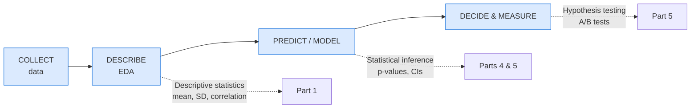
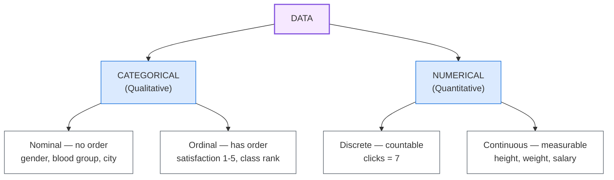

> ⚠️ **Generated file — do not edit here.** Edit `basic-statistics.md` at the
> repo root instead, then run `python3 split.py`.

## 🎯 PART 0, Orientation: What Statistics Is, and Why

### 0.1 Statistics = Decision-Making Under Uncertainty

Imagine a medicine that "works" for 8 out of 10 patients. Sounds great, right?
But what if it works for 90 out of 100 people, and works for 9 out of 10 for a
harmless sugar pill? Is the medicine doing anything, or did the patients get
better by luck?

That question is statistics.

> Statistics means collecting and reading data so we can decide even when we are not fully sure.

Real data is always messy and noisy. Statistics gives us a principled way to say
*"I am 95% confident"* instead of *"I think so"*.

### 0.2 Why a Data Science Student Cannot Escape It

The data science workflow already contains statistics at every stage:

- **Describing your data** -> descriptive statistics (Part 1)
- **Quantifying the chance of chance** -> probability (Part 2, 3)
- **Generalising from a sample** -> inference (Part 4, 5)
- **Relating variables and predicting** -> regression (Part 6)

Every time someone says *"our model is 94% accurate, so it is great"*, a
statistician asks: accurate **on what**? How big was the test set? Is that better
than guessing? Statistics is the reality check on machine learning.

### 0.3 The Two Branches

| Branch | Question it answers | Tools |
|---|---|---|
| **Descriptive** | What does my data look like? | mean, median, SD, charts, correlation |
| **Inferential** | What can I conclude about the *world* from this data? | t-test, confidence interval, p-value |

Think of it this way: descriptive is the nurse noting your temperature. Inferential is the doctor judging whether you are sick or it is just a one day blip.

### 0.4 Key Vocabulary (Learn These Words First)

| Term | Meaning | Everyday example |
|---|---|---|
| **Population** | The *entire* group you care about | All 1.4 billion people in India |
| **Sample** | The small piece you actually measured | 1,000 people you surveyed |
| **Variable** | A characteristic you measure | Height, age, salary |
| **Data point (observation)** | One row / one measurement | "Rahul is 172 cm" |
| **Parameter** | A *number about the population* (mu, sigma, p) | India's true average height |
| **Statistic** | A *number computed from a sample* (x-bar, s, p-hat) | Average height of your 1,000 people |
| **Unit of analysis** | What one row represents | One student, one transaction, one day |

> **Classic trap:** Greek letters (mu, sigma, p) = population.
> Latin letters (x-bar, s, p-hat) = sample.
> You estimate parameters with statistics. People often say
> "mean" for both.

### 0.5 Types of Variables

The statistical method you use depends on the variable type. Averaging *heights*
gives a mean that means something. Averaging *blood groups* does not, because the
mean of A, B, AB and O is nonsense.

### 0.6 Measurement Scales (4 levels)

| Scale | Examples | Can you add? | Can you average? |
|---|---|---|---|
| **Nominal** | gender, city, eye colour | No | No |
| **Ordinal** | satisfaction rating, class rank | Yes, but gaps are not equal | Risky |
| **Interval** | temperature in C, calendar year | Yes | Yes |
| **Ratio** | height, weight, income, time | Yes | Yes, meaningful zero |

Only *interval* and *ratio* data support means and standard deviations. An
average satisfaction score of 4.1 is acceptable; an average of "which car brand"
is nonsense.

---
