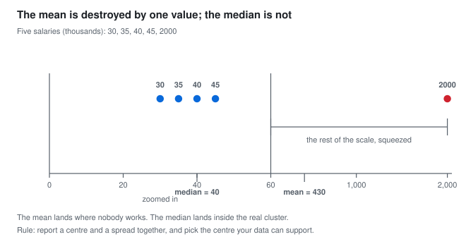
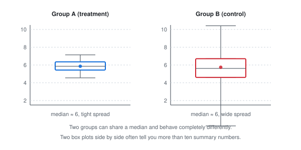
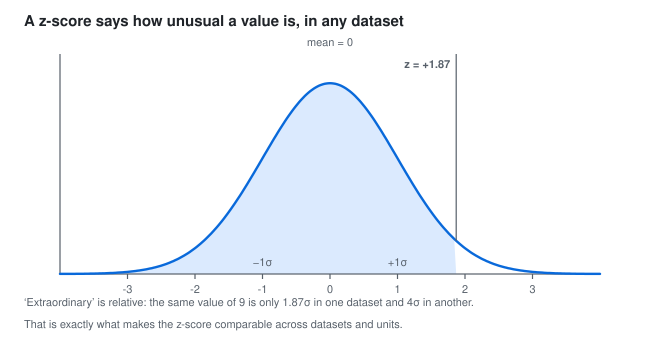
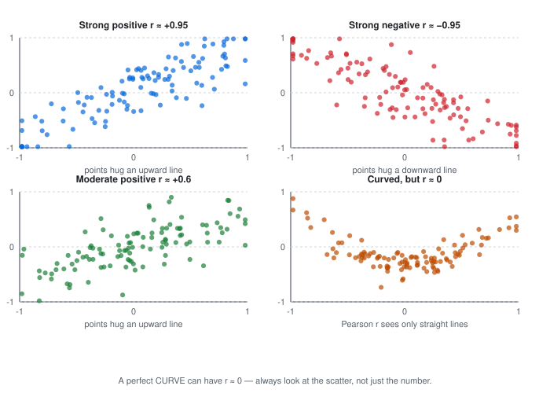

## 📊 PART 1, Descriptive Statistics

*Descriptive statistics answers: what shape is my data?*

### 1.1 What is a typical value?

A teacher collects 5 marks. A company looks at 5 salaries. Both ask the same thing: what is normal here?

Three answers work in different cases: mean, median and mode.

#### Mean

Add everything, divide by how many there are.

```text
marks: 70, 80, 75, 90, 85
sum = 400
mean = 400 / 5 = 80
```

Think of it as the balance point. If the marks sat on a seesaw, 80 is where it balances.

The mean uses every value, so maths built on top of it works well. Regression, t-tests and the average error in machine learning all start from the mean.

The problem is one odd value can pull it far away.

Say 5 people earn (in thousands):

```text
30, 35, 40, 45, 2000
```

Four people earn around 30 to 45 thousand. One person earns 2000 thousand. The mean is 430 thousand. Nobody earns near that.



> **In words:** one extreme value drags the mean to 430, while the median stays at 40 with the group.

In code:

```python
marks = [70, 80, 75, 90, 85]
print(sum(marks) / len(marks))  # 80.0
```

In symbols, for a sample:

```text
x-bar = (1/n) * SUM xi, i = 1 to n
```

Use the mean when the data is roughly symmetric and has no wild outliers.

#### Median

Sort the data, pick the middle.

```text
marks sorted: 70, 75, 80, 85, 90
median = 80
```

If there are 4 values, take the middle two and average them:

```text
data: 10, 12, 15, 20 -> median = (12 + 15) / 2 = 13.5
```

The median only cares about order, so a huge outlier cannot move it much. That is why salary reports, house prices, delivery times and app response times use the median. It is also called the 50th percentile: half the data sits below it.

```python
import statistics
print(statistics.median([30, 35, 40, 45, 2000]))  # 40
```

#### Mode

The value that shows up most.

```text
sizes: S, M, M, L, M, S, M
mode = M
```

It is the only one of the three that works for categories. Example:

| Blood group | A | B | O |
|---|---|---|---|
| Count | 5 | 2 | 1 |

Mode is A.

Sometimes there are two peaks. That usually means two groups got mixed. Put men and women in one height column and you get two peaks. Split them before you analyse further.

#### Which one to use

|  | Mean | Median | Mode |
|---|---|---|---|
| Works on numbers | yes | yes | yes, and on categories |
| Uses every value | yes | no | no |
| Moves a lot with outliers | yes | no | no |
| Good for skewed data | no | yes | yes |
| Always exists | yes | yes | sometimes there is no clear winner |
| Stays inside min to max | yes | yes | yes |

Exam rule that helps: if the shape is symmetric, all three sit together. If the tail stretches right, as with income, mean comes first, then median, then mode. If the tail stretches left, the order flips.

---

### 1.2 How spread out is it?

Mean alone can mislead. These two groups share the same mean:

```text
Group A: 10  10  10  10  10   mean = 10
Group B:  2  10  10  10  18   mean = 10
```

A is identical every time. B jumps around. Always report a centre with a spread.

#### Range

Max minus min.

```text
range = max - min
```

A has range 0. B has range 16. It is a fast check, but it uses only two values, so one odd point can change it fully. Do not rely on it alone.

#### Variance

How far do values sit from the mean, on average?

Steps with data 2, 4, 4, 4, 5, 5, 7, 9. Mean is 5.

```text
take each value minus mean: -3 -1 -1 -1 0 0 2 4
square each: 9 1 1 1 0 0 4 16, sum = 32
divide: 32 / 7 = 4.571
```

We square because minus and plus would cancel to zero otherwise. Squaring also gives large gaps extra weight, which matches how we feel about them.

If you have the full population, divide by n. If you have a sample and want to guess the population, divide by n-1. That small fix is called Bessel's correction. For large n it hardly matters. For n under 40 it does.

```text
population: sigma^2 = (1/n) * SUM (xi - mu)^2
sample: s^2 = (1/(n-1)) * SUM (xi - x-bar)^2
```

#### Standard deviation

Square root of variance. It brings the unit back to normal.

```text
s = sqrt(4.571) = 2.14
```

Read it as: a typical value sits about 2.14 away from the mean. Variance would say 4.57 squared units, which is hard to picture.


In words: same aim, different spread. Standard deviation measures consistency.

One rule that always holds: at least 75% of values sit within 2 standard deviations of the mean, at least 89% within 3. This is the worst case promise. For bell shaped data the real share is higher.

#### Percentiles and quartiles

Sort the data, then cut by position.

```text
Q1 = 25th percentile, a quarter sits below it
Q2 = median
Q3 = 75th percentile
IQR = Q3 - Q1, the middle half lives here
```

Example: marks 50, 60, 65, 70, 75, 80, 90. Q1 = 65, median = 70, Q3 = 80, IQR = 15.

The IQR ignores the ends, so outliers cannot move it. That helps with income, house rent, server latency.

Box plot rule for flagging:

```text
lower fence = Q1 - 1.5 * IQR
upper fence = Q3 + 1.5 * IQR
outside the fences = look closer
```

Saying "90th percentile of delivery is 42 minutes" means 90% arrived within 42, 10% took longer. Teams write service promises in this language.

#### Skew: which way is the tail?


In words: a long right tail pulls the mean toward itself and leaves the median behind.

Right skew means a few very large values. Income, house prices, spend per customer, page load time. Use median and IQR here, or take log of the values.

Left skew means a few very small values. Exam scores when most score near 95 is a common one.

```text
right skew: mean > median > mode
left skew: mean < median < mode
```

Code:

```python
import pandas as pd
s = pd.Series([2, 4, 4, 4, 5, 5, 7, 9, 200])
print(s.skew())  # large positive means right tail
```

---

### 1.3 Box plot in 30 seconds

Take data 2, 4, 4, 4, 5, 5, 7, 9. Five numbers sum it up: min 2, Q1 4, median 4.5, Q3 5.5, max 9.


In words: the box runs Q1 to Q3, the line inside is the median, whiskers reach about 1.5 times IQR.

How to read it: wide box means spread out. Line inside is the middle. Dots past the whiskers deserve a look. Long top whisker often means right tail. Long bottom means left tail.



In words: same median can hide a tight group and a scattered one.

Habit that pays off: plot your target split by main category before any model. Ten seconds of looking beats ten numbers.

---

### 1.4 Z-score: how unusual is this point?

```text
z = (value - mean) / standard deviation
```

190 cm is tall for adults, normal for basketball players. Unusual depends on context. Z-score fixes the context.

Example: data 2, 4, 4, 4, 5, 5, 7, 9. Mean 5, SD 2.14. Value 9 gives z = (9 - 5) / 2.14 = 1.87.



In words: 1.87 standard deviations above the mean sits far in the right tail.

Three uses:

1. Flag outliers. Past 3 in either direction is worth a look, if the data is roughly bell shaped. For skewed data use the IQR fences from 1.2 instead.
2. Compare across units. Z-scores let you say whether a maths score or a height is more unusual.
3. Scale features for models. This is what StandardScaler does. Needed for k-NN, k-means, PCA, logistic regression, neural nets. Trees do not need it.

```python
import pandas as pd
from sklearn.preprocessing import StandardScaler

df = pd.DataFrame({"marks": [70, 80, 75, 90, 85]})
print(df.describe())

x = df["marks"]
z = (x - x.mean()) / x.std(ddof=1)
print(z.round(2).tolist())

print(StandardScaler().fit_transform(x.values.reshape(-1, 1)).ravel().round(2))
```

---

### 1.5 Do two things move together?

Correlation checks for a straight line link between two numbers. If one goes up, does the other tend to go up or down?



In words: the last panel curves like a U, so r sits near zero even though the link is strong. Always plot.

Pearson r runs -1 to 1. Plus 1 is a clean upward line. Minus 1 is a clean downward line. Zero means no straight line link.

```text
study hours vs marks: positive
study hours vs TV hours: negative
```

What r means in practice: square it. r = 0.6 gives r squared = 0.36, so about 36% of the swing in y follows a line with x. Do not read r itself as a percent.

Rough guide:

| r | r squared | read |
|---|---|---|
| 0 to 0.3 | 0 to 9% | weak |
| 0.3 to 0.5 | 9 to 25% | moderate |
| 0.5 to 0.7 | 25 to 49% | strong |
| above 0.7 | above 49% | very strong, check for leakage |

When Pearson struggles (ranks, skew, outliers, curved but steady climb), use Spearman. It works on order, so one wild point cannot break it.

Link is not cause. More ice cream sales and more drownings move together because summer drives both. Full story is in 6.6.

```python
import numpy as np, pandas as pd
from scipy import stats

df = pd.DataFrame({
    "hours": [1, 2, 3, 4, 5, 6, 7, 8],
    "marks": [50, 55, 58, 65, 70, 74, 82, 88]
})
print(df["hours"].corr(df["marks"]))

r, pval = stats.pearsonr(df["hours"], df["marks"])
print(f"r = {r:.3f}, p = {pval:.4f}")

x = np.linspace(-3, 3, 200)
y = x**2 + np.random.normal(0, 1, 200)
print(np.corrcoef(x, y)[0, 1])  # near 0, yet y follows x squared
```

---

### 1.6 Part 1 Cheat Sheet

| Measure | Sensitive to outliers | Robust to outliers | Works on categorical |
| :--- | :---: | :---: | :---: |
| mean / x-bar | YES | no | no |
| median | no | YES | no |
| mode | no | YES | YES |
| range | YES | no | no |
| variance / SD | YES | no | no |
| IQR | no | YES | no |
| z-score | YES | no | no |
| correlation r | YES | no | no |

Report a pair: centre with spread.

> "Mean 50, SD 3" is complete. "Mean 50" alone is half a sentence.

---
