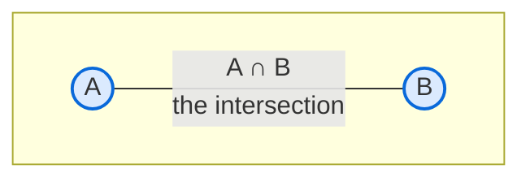
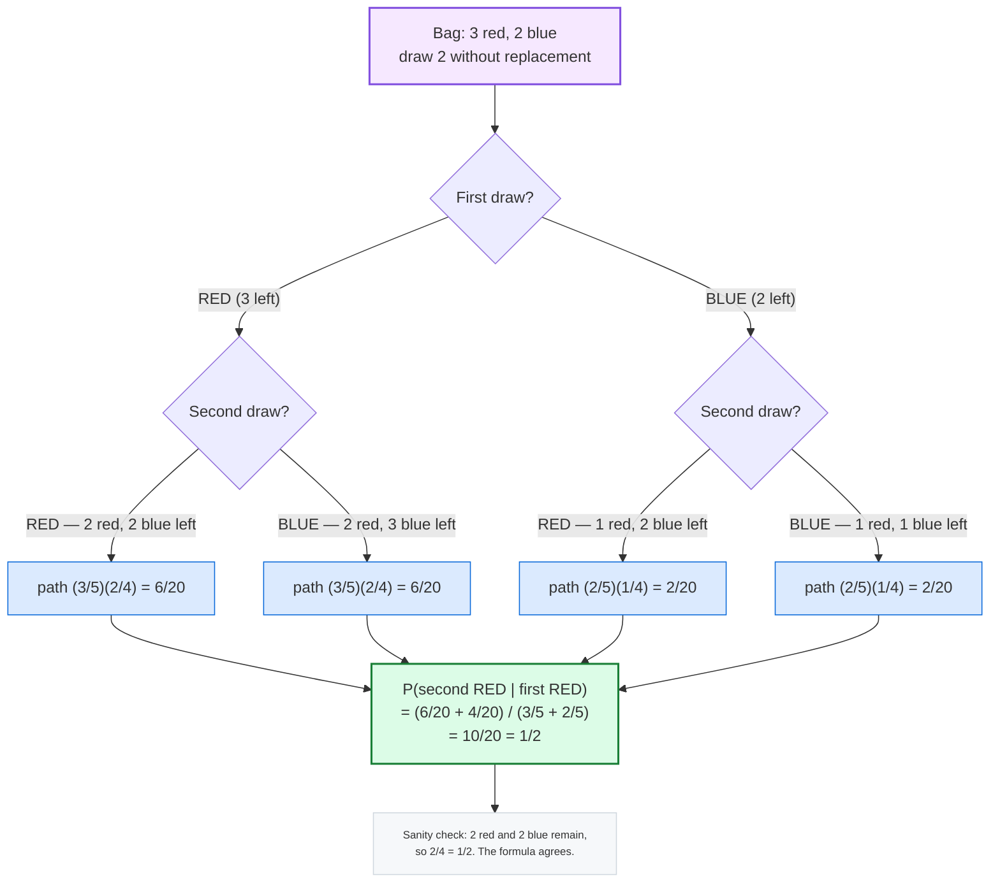
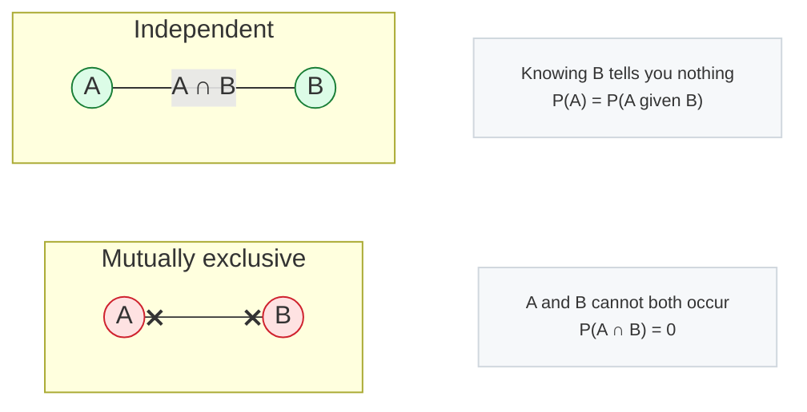

## 🎲 PART 2, Probability

*Probability is how we write down uncertainty.*

### 2.1 The Three Axioms (the rules everything must obey)

Start from a single definition and everything else follows.

What probability means:

```text
             number of times the outcome occurred
P(A)  =  ------------------------------------------
                 total number of trials
```

> *"Heads has probability 0.5"* does not say what this toss will be.
> It says: toss a fair coin a million times and about half land heads.
> It describes the long run, not the next toss.

#### Axiom 1, every probability is between 0 and 1

```text
0  <=  P(A)  <=  1
```

- P(A) = 0 -> impossible (rolling a 7 on a die)
- P(A) = 1 -> certain (the sun will rise tomorrow, practically speaking)
- P(A) = 0.5 -> coin flip

#### Axiom 2, the certain event

```text
P(S) = 1      where S is the whole sample space
```

#### Axiom 3, add mutually exclusive events

Mutually exclusive means the two things can never happen together. Then just add:

```text
P(A or B) = P(A) + P(B)     only if A and B are mutually exclusive
```

```text
  Two dice, roll a 6 on either:
    6 on die 1  -> P = 1/6
    6 on die 2  -> P = 1/6
    (they cannot both be 6 in one roll, so: total = 1/6 + 1/6 = 2/6 = 1/3)
```

#### The subtraction rule (complement)

The most used trick in stats. The complement of A is everything that is not A.

```text
P(not A) = 1 - P(A)     written as  P(A') or  P(A-bar)
```

```text
  P(some customer churns) is awkward to calculate directly.
  P(customer does NOT churn) is often easy.
  So compute the easy one and subtract from 1.
```

To find the chance of winning, analysts often work out the chance of not winning first. The second sum is usually easier.

#### General addition rule (overlapping events)

```text
P(A or B) = P(A) + P(B) - P(A and B)
```

You subtract the overlap because it got counted twice.

```text
  Card is a King or a Heart.
  P(King) = 4/52,  P(Heart) = 13/52,  P(King of Hearts) = 1/52
  P(King or Heart) = 4/52 + 13/52 - 1/52 = 16/52
```

---

### 2.2 Sample Space, Events, and Diagrams

- **Sample space S** = the set of *all* possible outcomes
- **Event** = any *subset* of S

```text
Two fair coins tossed.

S = { HH, HT, TH, TT }      -> 2^2 = 4 outcomes

A = "at least one head" = { HH, HT, TH }
P(A) = 3/4

B = "exactly two heads"  = { HH }
P(B) = 1/4
```

In a Venn diagram the overlap is `P(A and B)`. Add the two circles and you count the overlap twice, so subtract it once.



---

### 2.3 Counting: Permutations and Combinations

You need this for lottery numbers, committees, passwords, any place where you count ways things can happen.

#### Permutations (order MATTERS)

Gold versus silver matters. Giving gold to Amit and silver to Sumit is a different result from the reverse.

```text
        n!
P(n, r) = ----------------   =  n! / (n - r)!
```

```text
  Arrange 3 of 5 runners on a podium (1st, 2nd, 3rd):
  P(5,3) = 5 x 4 x 3 = 60
```

#### Combinations (order does NOT matter)

Picking a 3 person team from 5 students. Nobody is first or second in the team, so order does not count.

```text
           n!
C(n, r) = ----------   =  n! / [ r! * (n - r)! ]
          r!(n - r)!
```

```text
  Choose 3 students from 5:
  C(5,3) = 10
  Compare: P(5,3) = 60 = C(5,3) * 3! = 10 * 6  (order of the 3 chosen matters 6 ways)
```

Memory hook: combination means order does not count, permutation means it does.

#### Real data science uses

| Situation | Tool |
|---|---|
| Password / ID space size | n^r vs permutations & combinations |
| How many possible 10-digit PINs | 10^10 = 10 billion |
| Randomly picking 10 customers from 50,000 | C(50000, 10) |
| Number of features subsets in a model | 2^p |
| Sampling without replacement | hypergeometric (Part 3) |

Note: C(50000, 10) has about 274 digits. Do not run `factorial()` on it. Use `scipy.special.comb` or work with logs.

```python
from math import factorial, comb, perm
from scipy.special import comb as scomb, gammaln
import numpy as np

print(comb(5, 3))            # 10
print(perm(5, 3))            # 60
print(factorial(5))           # 120

# safe way for huge numbers
print(scomb(50000, 10))
logC = gammaln(50001) - gammaln(11) - gammaln(49991)
print(logC)                  # log of the result -- small, easy to handle
```

---

### 2.4 Conditional Probability

 *given that something already happened, how likely is the
other thing?*

```text
             P(A and B)
P(A | B) = --------------
               P(B)
```

Read it as **"A given B"**.

Example:

```text
A bag has: 3 red, 2 blue marbles. Two are drawn (without replacement).

Q1: P(second is red | first was red)?
Q2: P(second is blue | first was red)?
```

A tree makes it easy:



Add the paths that end with second red and first red:

```text
              (3/5 x 2/4) + (2/5 x 2/4)      =  6/20 + 4/20  =  10/20
P(second red | first red) = ------------------------------  =  1/2
                                  (3/5 + 2/5)
```

Check by thinking: after one red is out, 2 red and 2 blue stay in the bag. So red next is 2/4 = 1/2. The formula agrees. Run this kind of check every time.

**Q2** by symmetry = 1/2 as well.

#### Law of Total Probability

When `B` is actually several cases together, split it up:

```text
P(A) = SUM  P(A | Bi) * P(Bi)
```

Example:  60% of a shop's customers are online, 40% in-store. Online buyers
convert at 20%; in-store at 50%. What is the overall conversion rate?

```text
P(buy) = P(buy|online)*P(online) + P(buy|store)*P(store)
       = 0.20 * 0.60          + 0.50 * 0.40
       = 0.12                  + 0.20
       = 0.32                    -> 32%
```

Shop, app and hospital reports use this split all the time.

---

### 2.5 Bayes' Theorem, Thinking Backwards

 I saw an *effect*. What is the probability of the *cause*?

```text
              P(B | A) * P(A)
P(A | B) = --------------------
                 P(B)
```

In words: prior times likelihood, divided by total chance of seeing this evidence.

#### The Medical Test Problem (understand this and you understand Bayes)

```text
A disease affects 1 in 1000 people.              P(D)      = 0.001
A test is 99% accurate:                          P(+|D)    = 0.99
It also flags 5% of healthy people (false alarms) P(+|notD) = 0.05

Q: A person tests positive. What is P(disease | positive)?
```

First guess many people make: 99%, because the test is 99% right. That guess is wrong. It ignores how rare the disease is.

Count it out with 100,000 people:

| 100,000 people | Disease | No disease | Total |
|---|---|---|---|
| **Test positive** | 99 | 4,995 | 5,094 |
| **Test negative** | 1 | 94,905 | 94,906 |
| **Total** | 100 | 99,900 | 100,000 |

> P(disease | positive) = 99 / 5,094 ≈ **1.94%, about 2%**.

```text
P(D | +) = 99 / 5094 = 0.0194 = about 2%
```

Despite a 99%-accurate test, a positive result means only about a **2% chance of
disease**. The disease is so rare that the 5% false-alarm rate generates a *flood*
of false positives next to the few real cases.

A needle in a haystack, with a detector that also beeps on some straw. When straw is huge and needles are few, most beeps are straw.

This is why medical screening of rare diseases requires confirmatory tests, and
why fraud detection needs such careful threshold design.

#### Bayes in machine learning

- The **Naive Bayes classifier** assumes features are conditionally independent
  given the class. Surprisingly strong for text classification and spam
  detection, even though the assumption is almost always false in practice.
- **Bayesian A/B testing** is the correct way to decide between two variants
  *without* repeatedly peeking and stopping when the result looks good.
- **Markov-chain Monte Carlo**, used in Bayesian stats and modern generative
  models, is built entirely on this formula.
- **Posterior distributions** in Bayesian modelling: your belief before seeing
  data (prior), updated by the data, giving your belief after (posterior).

Start with a belief, then let evidence move it. Surprising evidence moves it more.

```python
# Bayes with integers -- the medical test example, no formula confusion
P_disease = 1/1000
P_pos_given_disease = 0.99
P_pos_given_healthy  = 0.05

numerator   = P_pos_given_disease * P_disease
denominator = P_pos_given_disease * P_disease + P_pos_given_healthy * (1 - P_disease)
print(f"P(disease | positive) = {numerator/denominator:.4f}")   # ~0.0196
```

---

### 2.6 Independence

A and B are independent if knowing B tells you nothing new about A:

```text
P(A and B) = P(A) * P(B)
P(A | B)   = P(A)
```

Example:  a person's height and their favourite colour are independent.
Height and weight are *not*.

Why it matters in data science:

1. The whole logic of Naive Bayes is built on assuming feature independence.
2. In regression, if two predictors are highly correlated with each other, the
   model becomes unstable (multicollinearity, Part 6).
3. In A/B testing, randomisation makes treatment and user identity independent,
   which is exactly why the test is unbiased.

Mutually exclusive versus independent, a very common confusion:

```text
Mutually exclusive: the two CANNOT both happen.
Independent:        knowing one tells you NOTHING about the other.

Can two events be both? Only if P(A and B) = 0.
  Mutually exclusive and P(A)>0 and P(B)>0  ->  NOT independent.
```



---

### 2.7 Common Probability Mistakes

| Mistake | Truth |
|---|---|
| "A 1% chance event happens every 100 tries" | No, random events have long gaps. This is the **gambler's fallacy**. |
| "Two 50% events are more likely together than separately" | No. Independence means P(both) = 0.5 x 0.5 = 0.25. |
| "P-value = probability the null hypothesis is true" | **No.** See Part 5. |
| "High correlation proves causation" | **No.** See 6.6. |
| "If the test is 99% accurate, a positive means 99%" | **No.** Base-rate fallacy, see 2.5. |
| "P(A) = 0.5 means this next toss will be heads" | No. It is a long-run statement. |
| "The expected value is the most likely outcome" | No. Expected value is a probability-weighted average and may not even be achievable. |

Gambler's fallacy: after five heads, the next fair toss is still 50% heads. The coin has no memory. Real systems can still show runs, like faulty batches on a line, because some hidden cause drifts slowly. That is a different story from one fair coin.

---
