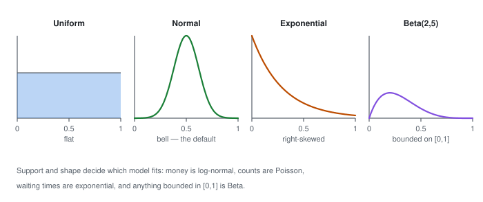
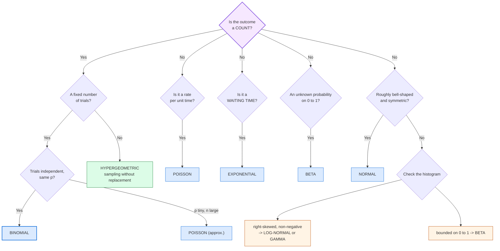

> ⚠️ **Generated file — do not edit here.** Edit `basic-statistics.md` at the
> repo root instead, then run `python3 split.py`.

## 📉 PART 3, Probability Distributions

*A distribution says how likely each outcome is.*

### 3.1 What Is a Distribution?

A distribution answers: *"for each possible value, how likely is it?"*

It gives centre, spread, shape and tails in one picture.


> **In words:** A single exact height has probability zero, but an interval has an
> area under the curve.

The two families:

| | Discrete | Continuous |
|---|---|---|
| What can take | countable values (0, 1, 2, 3) | any value in a range (height) |
| Probabilities | exact, sum to 1 | points have probability 0; **areas** matter |
| Written as | PMF | PDF |
| Drawn as | bars | a curve |

> Note: one exact height like 172.0000 cm has probability zero. An interval like 170 to 175 cm has a real chance, measured as area under the curve.

#### Notation

```text
X   ~  Normal(mu, sigma^2)     "X is distributed as Normal with mean mu and
                                variance sigma-squared"
P(X <= 4)                      "the probability that X is at most 4"
```

---

### 3.2 Discrete Distributions

#### Bernoulli, one trial, success or failure

```text
X ~ Bernoulli(p)
P(X = 1) = p        (success)
P(X = 0) = 1 - p    (failure)
E[X] = p        Var(X) = p(1-p)
```

**Real uses:** a customer clicks (1) or not (0). A user converts (1) or bounces (0).
A cell is defective (1) or fine (0).

This is the building block of yes/no models. Logistic regression predicts `P(Y = 1 | x)`.

---

#### Binomial, n independent Bernoulli trials, count the successes

```text
X ~ Binomial(n, p)

         n    n
P(X = k) = C   p  (1-p)     k = 0, 1, ... n
         k    k

E[X] = np        Var(X) = np(1-p)        SD = sqrt(np(1-p))
```

Toss a coin 10 times, count heads. Trials must be independent and share the same p.

**Real uses:** how many defects in a batch of 100 items; how many clicks out of
1000 impressions; how many people out of 500 will churn.

**Worked example:** what is the probability of exactly 3 heads in 10 fair tosses?

```text
C(10,3) * 0.5^3 * 0.5^7 = 120 * 0.001953125 = 0.2343750   -> about 23.4%
```

Mean np and variance np(1-p) mark out the binomial.

---

#### Poisson, counting rare events in a fixed interval

```text
X ~ Poisson(lambda)

            e^-lambda * lambda^k
P(X = k) = ---------------------        k = 0, 1, 2, ...
                  k!

E[X] = lambda          Var(X) = lambda
```

Calls per hour at a call centre. Cases per year of a rare illness. Typos per page.

Note that the mean equals the variance, both being lambda. The Poisson process
assumes events happen at a constant average rate, independently.

**Real uses:** the number of server errors per minute; the number of customers
arriving per hour; rare insurance claims.

**Worked example:** a website gets on average 3 errors per minute. What is the
probability of exactly 2 errors in the next minute?

```text
e^-3 * 3^2 / 2! = 0.0498 * 9 / 2 = 0.2240   -> about 22.4%
```

Poisson regression predicts counts like calls or arrivals that grow with exposure.

---

#### Geometric, trials until the first success

```text
X ~ Geometric(p)

P(X = k) = (1-p)^(k-1) * p        k = 1, 2, 3, ...

E[X] = 1/p
```

How many rolls until the first six?

**Real use:** number of customers who must be contacted before the first
purchase; the number of retries before success.

---

#### Hypergeometric, sampling without replacement

```text
X ~ Hypergeometric(N, K, n)

P(X = k) = C(K,k) * C(N-K, n-k) / C(N, n)

where N = population size, K = successes in population, n = sample size
```

Draw 5 cards from 52 and keep them out. Compared to
the binomial, the denominator shrinks after each draw, so the probabilities
change. That is the whole difference.

**Real use:** quality control. "Of 1000 chips, 50 are defective. I sample 20
without replacement. How many are defective?"

When to use which:

```text
with replacement    -> binomial        (e.g. tossing a coin, independent users)
without replacement -> hypergeometric  (e.g. sampling real customers from a list)
large N vs small n  -> hypergeometric approximates to binomial
```

---

#### Discrete Cheat Sheet

| Distribution | Counts | Parameters | E[X] | Var(X) | Use it for |
|---|---|---|---|---|---|
| Bernoulli | successes | p | p | p(1-p) | one yes/no trial |
| Binomial | successes in n trials | n, p | np | np(1-p) | n independent yes/no |
| Poisson | events in a fixed interval | lambda | lambda | lambda | rare events, constant rate |
| Geometric | trials to first success | p | 1/p | (1-p)/p^2 | waiting time |
| Hypergeometric | successes in a sample | N, K, n | nK/N | nK/N (1-K/N)(N-n)/(N-1) | sampling w/o replacement |

How to keep the three apart:

- Binomial = "how many successes out of n fixed trials?"
- Poisson = "how many events in a fixed time?" (the count has no fixed limit)
- Hypergeometric = "binomial, but I removed the successes as I went."

---

### 3.3 Continuous Distributions

#### Uniform, everything equally likely (the beginner's friend)

```text
X ~ Uniform(a, b)

              1
f(x) = -------------     for a <= x <= b
            b - a
           0        otherwise

E[X] = (a+b)/2        Var(X) = (b-a)^2 / 12
```



> **In words:** Support and shape decide the model: flat, bell-shaped, right-skewed
> or bounded on [0,1].

**Uses:** random number generation; as a starting point for Monte Carlo
integration; modelling genuinely "no information" data.

---

#### Normal (Gaussian), the king of distributions

```text
X ~ Normal(mu, sigma^2)

               1               (x - mu)^2
f(x) = --------------- * exp( - ------------- )
       sigma*sqrt(2*pi)        2*sigma^2
```

A symmetric bell. Mean, median and mode sit together at the centre.


> **In words:** A symmetric bell centred on the mean; 95% of values lie within mu ± 1.96 sigma.

Careful with notation: `N(mu, sigma^2)` takes variance, not SD. So `Normal(0, 1)` has SD 1.

Why the normal distribution is so important:

1. The Central Limit Theorem (Part 4) says the *sample mean* of almost any
   population is approximately normal, which is why it appears everywhere.
2. It is fully described by just two numbers, mu and sigma.
3. Sum and average of independent normals are normal (a "stable" distribution).
4. It is closed under linear transformations, which is what makes linear
   regression work.

**The Empirical Rule (68-95-99.7):**

| Share of data | Range | Real-world use |
|---|---|---|
| 68% | mu ± 1 sigma | the bulk of a normal distribution |
| 95% | mu ± 2 sigma | a typical 95% confidence interval |
| 99.7% | mu ± 3 sigma | a range you can call 'almost certain' |

Do not assume normality for income, house prices, city sizes, waiting times, most engagement counts. They skew right. Try `np.log1p` first, or a rank method from Part 7.

---

#### Standard Normal and Z-scores

```text
Z = (X - mu) / sigma        ~  Normal(0, 1)
```


> **In words:** About 68% of data lies within 1 sigma, 95% within 2, and 99.7% within 3.

Example: scores follow `N(70, 10^2)`. Chance above 85? Scores of
above 85?

```text
z = (85 - 70)/10 = 1.5
P(Z > 1.5) = 1 - 0.9332 = 0.0668     -> about 6.7%
```

**In code:**

```python
from scipy import stats

mu, sigma = 70, 10
z = (85 - mu) / sigma
print(stats.norm.cdf(z))          # 0.9332  (area to the LEFT)
print(stats.norm.sf(z))           # 0.0668  (the answer) -- survival function
print(stats.norm.ppf(0.95))       # 1.6449  (the 95th percentile / z critical)
```

**Percentiles you should memorise:**

| Percentile | z |
|---|---|
| 90th | 1.28 |
| 95th | 1.645 |
| 97.5th | 1.96 |
| 99th | 2.576 |

> **Two-sided vs one-sided:** a 95% confidence interval uses z = 1.96 (which
> leaves 2.5% in each tail). A 95% *one-sided* threshold uses z = 1.645 (all
> 5% in one tail). This is a very common exam and coding mistake.

---

#### Exponential, "waiting time" distribution

```text
X ~ Exponential(lambda)

f(x) = lambda * exp(-lambda * x)    x >= 0

E[X] = 1/lambda      Var(X) = 1/lambda^2      SD = 1/lambda
```

**Memory hook: the mean and the standard deviation are the same number.**

Think of it this way: the waiting time between buses that arrive at a constant random
rate. The memoryless property:

```text
P(X > t + s | X > t) = P(X > s)
```

Once you have already waited 10 minutes, your expected *additional* wait is the
same as if you had just arrived. Past waiting tells you nothing.

**Real uses:** time to the next customer arrival; time until a machine fails;
time between system failures. The memoryless property is exactly why exponential
distributions drive reliability engineering and queueing theory.

**Weibull** is a generalisation, far more flexible, and the standard choice for
"how long until this component fails".

---

#### Beta, the distribution of a probability (used in A/B tests and optimisation)

```text
X ~ Beta(a, b),  a, b > 0

           x^(a-1) * (1-x)^(b-1)
f(x) = ---------------------------------      0 <= x <= 1
                 B(a, b)

E[X] = a/(a+b)      Var(X) = ab / [ (a+b)^2 (a+b+1) ]
```

**What it models:** an *unknown probability*. a and b encode how much you
believe success is and how confident you are.

Think of it this way: before seeing any data, you might guess a coin is fair, that is,
uniform on [0, 1] = `Beta(1, 1)`. After 7 heads and 3 tails, your updated
belief about the coin's bias is `Beta(8, 4)`, tightly centred near 0.7. This is
exactly the machinery behind **Bayesian A/B testing** and behind the sampling
distributions used in bandits and Bayesian optimisation.

---

#### Poisson vs Exponential, do not confuse them

```text
Poisson:      "how MANY events in an interval?"   (discrete count)
Exponential:  "how LONG until the next event?"      (continuous wait)
They are two views of the same underlying process.
```

---

### 3.4 Continuous Cheat Sheet

| Distribution | Shape | Support | E[X] | Var(X) | Use it for |
|---|---|---|---|---|---|
| Uniform | flat | [a, b] | (a+b)/2 | (b-a)^2/12 | no information; simulation |
| Normal | bell, symmetric | (-inf, inf) | mu | sigma^2 | the default continuous model |
| Exponential | decaying, right-skewed | [0, inf) | 1/lambda | 1/lambda^2 | waiting times |
| Beta | U-shape or bell on [0,1] | [0, 1] | a/(a+b) | ab/[(a+b)^2(a+b+1)] | unknown probabilities |
| (t) Student | bell, fatter tails | (-inf, inf) | mu | sigma^2(n-1)/(n-2) | small samples, unknown sigma |

---

### 3.5 Choosing a Distribution (a decision flow)



```python
from scipy import stats
import numpy as np

# discrete
print(stats.binom.pmf(3, 10, 0.5))     # P(exactly 3 heads in 10 tosses)
print(stats.binom.cdf(3, 10, 0.5))     # P(3 or fewer)
print(stats.binom.mean(10, 0.5), stats.binom.std(10, 0.5))
print(stats.poisson.pmf(2, 3))          # exactly 2, rate 3
print(stats.hypergeom.pmf(k=2, M=1000, n=50, N=20))

# continuous
print(stats.norm.pdf(1.5), stats.norm.cdf(1.5))
print(stats.expon.cdf(3, scale=1/2))    # note: scale = 1/lambda
print(stats.beta.cdf(0.7, 8, 4))
print(stats.t.cdf(2.2, df=19))
```
