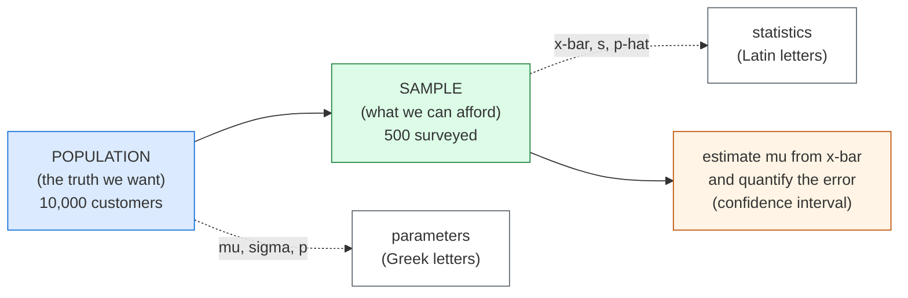
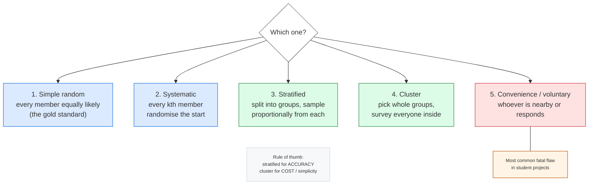
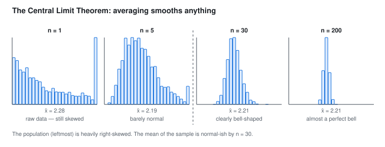

## 🔍 PART 4, Sampling and Estimation

*This is where statistics becomes genuinely powerful: drawing conclusions about
millions from an inspection of a thousand.*

### 4.1 Population vs Sample, The Core Idea

We **never** measure the whole population. We measure a sample and then *guess*
about the population, quantifying how badly we might be wrong.



**The words to get right:**

| About the population | About the sample |
|---|---|
| parameter | statistic |
| mu, sigma, p, N | x-bar, s, p-hat, n |

You cannot weigh every person in India to find the average weight.
You weigh 10,000 of them, a good unbiased sample, and your sample mean is your
*best estimate* of the population mean. The CI tells you how much to trust it.

**Sampling error** = the difference between the sample statistic and the true
population parameter. It is unavoidable, and its size is predictable: it shrinks
as `1/sqrt(n)`.

```text
  To halve the margin of error, you must QUADRUPLE the sample size.
  n = 1,000   -> MOE ~ +/- 3.1 percentage points
  n = 4,000   -> MOE ~ +/- 1.55
  n = 10,000  -> MOE ~ +/- 1.0
```

This is why small polls are noisy and why "we surveyed 30 people" is not enough
for most claims.

---

### 4.2 Sampling Methods

#### 1. Simple Random Sampling (SRS)

Every member has an **equal** chance of being chosen. The gold standard.

**How:** number everyone, then use a random number generator to pick n.

**Weakness:** can be unlucky and get an unrepresentative group by chance.

#### 2. Systematic Sampling

Pick every kth element: `k = N / n`.

```text
Population of 1000, want 100  ->  k = 10  ->  pick 7th, 17th, 27th, ...
```

The trap: if the population has a hidden *period* matching k (e.g. a list
ordered by department, and k = 12), you systematically over-select some groups.
**Randomise the starting point** to avoid this.

#### 3. Stratified Sampling

**First divide the population into meaningful subgroups (strata), then sample
proportionally from each.**



Stratified sampling **guarantees** representation, so it usually gives tighter
estimates than SRS.

**Use when:** you want to compare across groups (city, gender, product type), or
you know some strata are far more variable than others, in which case you can
sample those *more*. That choice is **proportionate vs Neyman allocation**.

#### 4. Cluster Sampling

Divide into natural groups, randomly select some groups, then survey
**everyone** in the selected groups.

```text
Choose 5 schools at random, survey all students in those 5.
```

It is **cheaper than stratified**, since you do not need to reach every subgroup
individually, but **less precise**: you get 5 "points" of information instead of
hundreds.

**Rule of thumb:** stratified for *accuracy* (you already have subgroup info),
cluster for *cost/simplicity* (you cannot easily reach individuals).

#### 5. Convenience and Voluntary Response, the biased ones

- **Convenience:** survey whoever is nearby, your friends, the people who
  responded on social media. Used constantly and dangerously.
- **Voluntary response:** people choose to participate. People with strong
  opinions are far more likely to answer, so the result is systematically
  skewed.

> **In a data science project, the most common fatal error is a convenience
> sample.** A survey of your classmates is not a study of Indian consumers, no
> matter how large it is.

---

### 4.3 Bias, The Silent Killer

**Bias is a systematic error that does not shrink as you collect more data.**
It is far more dangerous than random sampling error.


> **In words:** Random error shrinks with more data. Bias does not, which needs a
> better study design.

*(Axes: horizontal = bias, vertical = variance. The bottom-left is the best,
top-right the worst.)*

#### Types of bias you must know

| Bias | What it is | Real example |
|---|---|---|
| **Selection** | sample differs from population | surveying only gym members about diet |
| **Survivorship** | only "survivors" remain in the data | studying only planes that did *not* crash (Abraham Wald) |
| **Non-response** | non-respondents differ from respondents | income survey where the rich decline to answer -> results skew low |
| **Response** | people answer inaccurately | under-reporting alcohol, income or health |
| **Measurement** | bad instrument or definition | a watch that runs slow |
| **Recall** | memory is imperfect | "how much did you drink last year?" |
| **Voluntary response** | self-selected participants | online polls, customer satisfaction forms |
| **Confirmation** | you look where you expect to find it | only analysing metrics that support your pet theory |
| **Data leakage** | the model sees future/other info | a feature that only exists after the outcome |

**Abraham Wald's survivorship story:** during World War II, Wald examined
returning planes and advised reinforcing the parts with many bullet holes:
engines, wings, and so on. The naive reading is "bullets hit the wings". The
correct reading is that **planes with engines hit and that still flew back were
absent from the data.** You must reinforce where the planes *did not* return. The
insight generalises: **your dataset contains only the cases that survived the
process you are trying to understand.** Always ask: *who or what is missing from
this data, and would they look different?*

#### Missing data matters too

```text
  Missing Completely At Random (MCAR)  -> data vanishes for no reason related
                                          to anything. Rare in practice.
  Missing At Random (MAR)              -> missingness depends on other
                                          OBSERVED variables. Usually fine to
                                          drop or impute carefully.
  Missing Not At Random (MNAR)         -> missingness depends on the value
                                          itself. e.g. rich people do not
                                          report income.  -> BIASED
```

`df.dropna()` silently assumes MCAR. Knowing the difference is a genuine
interview-worthy skill.

---

### 4.4 The Central Limit Theorem (CLT)

 whatever shape your data has, the *distribution of its mean*
becomes approximately normal as the sample grows.

The CLT is an averaging machine. Take a wild, lumpy set of numbers,
average them, and the result smooths out into a nice bell curve. This is why
politicians' approval ratings hover around a stable value: different polls return
similar numbers even though individual opinions are scattered and polarised.

**The formal statement:**

```text
  Let X1, X2, ... Xn be i.i.d. random variables with mean mu and
  finite variance sigma^2. Then:

                 X-bar - mu
  X-bar  ~  N(  --------- ,  sigma^2/n )     for large n
                   sigma/sqrt(n)

  Equivalently:  (X-bar - mu) / (sigma/sqrt(n))  ~  N(0, 1)
```

Three things to remember:

1. The CLT works for *any* population (skewed, bimodal, uniform). It needs only
   finite variance and independence, which is what makes it so powerful.
2. The centre stays at mu (unbiased).
3. The spread shrinks as `1/sqrt(n)`. Your estimate gets more precise with more
   data, and you can predict exactly how much.



> **In words:** The population is right-skewed, but the distribution of its mean
> approaches a bell curve as n grows.

Two caveats (say these in any interview):

1. You need a reasonably large n. Rule of thumb: n >= 30 for a decent
   approximation, and **more** if the population is very skewed or has outliers.
2. It applies to the *mean* (and sum), not to the raw data. Your original data
   will never become normal by increasing n. Only the distribution of the average
   does.

**What CLT buys you:**

```text
  standard error of the mean   =  sigma / sqrt(n)
  confidence interval for mu    =  x-bar  +/-  z * (s / sqrt(n))
  test statistic (large n)      =  (x-bar - mu) / (s / sqrt(n))   ~ z
```

Notice that **the only difference from the naive version is the `sqrt(n)` in the
denominator.** That single fact is the engine behind most of Part 5.

```python
import numpy as np
import matplotlib.pyplot as plt
rng = np.random.default_rng(42)

# a horribly skewed population
pop = rng.exponential(scale=2, size=1_000_000)
print(f"population mean = {pop.mean():.3f}, sd = {pop.std():.3f}")

for n in [1, 5, 30, 100]:
    means = [rng.choice(pop, n, replace=True).mean() for _ in range(5000)]
    print(f"n={n:4d}  mean of means = {np.mean(means):.3f}  "
          f"sd of means = {np.std(means):.3f}  (theory: {pop.std()/np.sqrt(n):.3f})")

# visual: the CLT in action
fig, axes = plt.subplots(1, 4, figsize=(16, 3.5), sharey=True)
for ax, n in zip(axes, [1, 5, 30, 200]):
    m = [rng.choice(pop, n, replace=True).mean() for _ in range(4000)]
    ax.hist(m, bins=40, density=True)
    ax.set_title(f"n = {n}")
plt.suptitle("Sampling distribution of the mean (exponential population)")
plt.tight_layout(); plt.show()
```

---

### 4.5 Point Estimate vs Interval Estimate

- **Point estimate:** a single number. `x-bar = 52.3 kg`. Precise-sounding, but it
  gives no idea of the error, so a point estimate on its own is misleading.
- **Interval estimate:** a range. `52.3 kg, plus or minus 1.8 kg`. Honest about
  the uncertainty.

> An A/B test reported as "variant B gave 12.4% conversion" is useless. With a
> standard error of 1.5 points, you cannot tell whether B beat A. You need the
> interval.

#### Finding point estimates: maximum likelihood in five minutes

Where do estimates like x-bar come from? One idea covers most cases: pick the
parameter value that makes the data you saw most probable.

Flipping a coin 100 times with 63 heads. For a guess p, the chance of exactly
that outcome is `L(p) = p^63 * (1-p)^37`. Which p makes 63 heads least
surprising? Take the log (turns powers into sums), differentiate, set to zero:

```text
log L = 63*log(p) + 37*log(1-p)
d/dp  = 63/p - 37/(1-p) = 0   ->   p-hat = 63/100 = 0.63
```

The estimate is just the sample share. Same recipe gives more:

```text
Bernoulli (k wins in n tries)  ->  p-hat = k/n
Poisson counts                 ->  lambda-hat = x-bar
Normal mean (sigma known)      ->  mu-hat = x-bar
Normal variance                ->  sigma^2-hat = (1/n)*SUM(xi - x-bar)^2
```

Note the last line divides by n, not n-1. Maximum likelihood is slightly
biased here, and Bessel's n-1 correction from Part 1 fixes exactly that.

A cousin called the method of moments sets sample moments equal to theory
moments (x-bar = mu) and solves. Same answers in these cases, less general
otherwise. Most model fitting in machine learning, including logistic
regression in Part 7, is maximum likelihood under the hood.

```python
import numpy as np
rng = np.random.default_rng(11)

tosses = rng.binomial(1, 0.63, size=100)
print("MLE p-hat:", round(float(tosses.mean()), 3))   # ~0.63, matches k/n

counts = rng.poisson(4.2, size=2000)
print("MLE lambda-hat:", round(float(counts.mean()), 3))  # ~4.2, matches x-bar

x = rng.normal(68, 12, size=500)
print("MLE mu-hat:", round(float(x.mean()), 2))       # ~68
print("MLE sigma2 (n):", round(float(((x - x.mean())**2).mean()), 2))
print("sample var (n-1):", round(float(x.var(ddof=1)), 2))  # a touch larger
```

---

### 4.6 Confidence Intervals

**A confidence interval is a range of plausible values for the true parameter.**

**The 95% confidence interval, three equivalent forms:**

```text
  (1)  x-bar  +/-  1.96 * (s / sqrt(n))                  (large n, z)
  (2)  x-bar  +/-  t(alpha/2, n-1) * (s / sqrt(n))       (small n, t)
  (3)  Any range containing 95% of the probability of the
       statistic under the null hypothesis
```

**Step by step:**

```text
  Step 1:  Compute x-bar and s
  Step 2:  Standard error = s / sqrt(n)
  Step 3:  Critical value (z for 95% two-sided = 1.96)
  Step 4:  Margin of error = critical value * standard error
  Step 5:  CI = (x-bar - MoE,  x-bar + MoE)
```

**Worked example:** 100 students, mean marks = 68, SD = 12.

```text
  SE        = 12 / sqrt(100) = 1.2
  MoE       = 1.96 * 1.2      = 2.352
  95% CI    = (68 - 2.35, 68 + 2.35) = (65.65, 70.35)
```

How to interpret it, which is the part everyone gets wrong:

**Correct:**
> *"We are 95% confident that the true mean mark of all students lies between
> 65.65 and 70.35."*

**Incorrect:**
> *"There is a 95% chance the true mean is between 65.65 and 70.35."*

The difference matters because the parameter is a **fixed but unknown** number.
It is either in the interval or it is not, and there is no randomness about it.
What is random is **the interval itself**. Before you collect the data, the
method will produce a range that covers the truth 95% of the time. Once you have
the data, the range is just a number.

Correct mental image: imagine repeating the whole study 20,000 times with fresh
samples. About 19,000 of the resulting intervals would contain the true mean.
Your particular interval is one draw from that family.


> **In words:** Repeat the study and about 95% of intervals will cover the truth. The
> other 5% are meant to miss.

**Confidence levels:**

| Level | Critical value (z) | Wider or narrower? |
|---|---|---|
| 90% | 1.645 | narrower, less confident |
| **95%** | **1.96** | **the standard choice** |
| 99% | 2.576 | wider, more confident |

**Choosing a level:** 95% is a fine default. Use 99% when a wrong decision is
very costly (drug safety, aviation, nuclear). Being "more confident" always means
a **wider, less precise** interval, and you cannot have both.

Why 95% and not 99%? Because 95% gives a *useful* precision at a *reasonable*
error rate. There is nothing magic about 0.95; it is a convention that balances
precision against the risk of a false conclusion.

#### Confident intervals for other quantities

```text
  Proportion (p-hat):   p-hat  +/-  z * sqrt( p-hat(1-p-hat)/n )
  Difference in means:  (x1-bar - x2-bar)  +/-  z * sqrt(s1^2/n1 + s2^2/n2)
  Ratio of variances:   F-distribution
  Correlation:          Fisher z-transformation
```

**Proportion CI note:** a **Wald interval** (`p +/- 1.96*SE`) performs badly for
small n or p near 0 or 1. Use the **Wilson score interval** instead
(`statsmodels.proportion_confint(..., method="wilson")`). This is a real,
practical gotcha: for a dataset with 3 successes out of 20, the Wald interval
can even extend below 0, which is impossible.

**Choosing your sample size (planning ahead):**

```text
  For estimating a mean with margin of error E (95% confidence):
  n = (1.96 * sigma / E)^2

  For estimating a proportion within margin E:
  n = 1.96^2 * p(1-p) / E^2      (worst case p = 0.5 gives n = 0.9604 / E^2)
```

```text
  n for 95% CI, +/- 3% :  n = 0.9604 / 0.03^2 = 1068
  n for 95% CI, +/- 2% :  n = 0.9604 / 0.02^2 = 2401
  n for 95% CI, +/- 1% :  n = 0.9604 / 0.01^2 = 9604
```

```python
import numpy as np
from scipy import stats

x = np.random.default_rng(1).normal(68, 12, size=100)
n = len(x); mean = x.mean(); s = x.std(ddof=1)
se = s / np.sqrt(n)

print(f"mean={mean:.3f}  sd={s:.3f}  se={se:.3f}")

# 95% CI, two ways -- both should agree closely
print(f"z-based : ({mean - 1.96*se:.3f}, {mean + 1.96*se:.3f})")
tcrit = stats.t.ppf(0.975, df=n-1)          # n-1 because sigma is unknown
print(f"t-based : ({mean - tcrit*se:.3f}, {mean + tcrit*se:.3f})")

# proportion CI (Wilson is the reliable one)
from statsmodels.stats.proportion import proportion_confint
successes, total = 47, 100
print("wilson:", proportion_confint(successes, total, method="wilson"))
print("wald  :", proportion_confint(successes, total, method="normal"))
print(stats.binom.ppf(0.025, total, successes/total),
      stats.binom.ppf(0.975, total, successes/total))   # exact (Clopper-Pearson)
```

---
