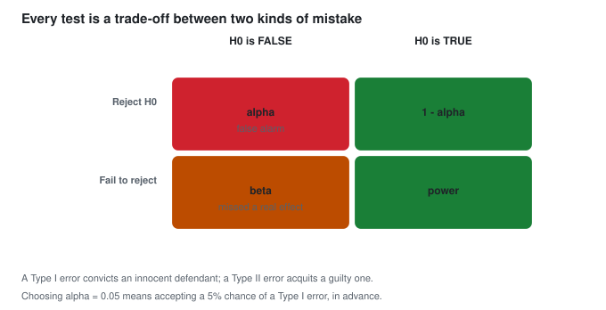

## 🧪 PART 5, Hypothesis Testing

*How to make a defensible decision with real-world data.*

### 5.1 The Core Logic

Suppose a shop claims their new packaging gets a 60% click rate. You run an
experiment and observe 65%.

Two explanations:

1. The new packaging **really is** better.
2. You got **unlucky**, and a random fluctuation produced 65% even though the true
   rate is still 60%.

A test picks between the two while keeping mistakes in check.

> The trick: assume the opposite of your hope (the null), then ask "if the null were true, how surprising is my data?" Very surprising means reject the null.

This is proof by contradiction. You never prove the new claim, you only reject the old default or fail to.

---

### 5.2 The Hypotheses

```text
   H0 (null hypothesis)      the default, "no effect", "no difference"
                             usually states mu = some value, or a difference = 0
                             ** you must be able to survive being wrong about H0 **

   H1 / HA (alternative)      what you suspect / hope for
                             mu > value,  mu < value,  or  mu != value
```

| Alternative | Name | Question it answers |
|---|---|---|
| `H1: mu != mu0` | two-tailed | "is it different?" (either direction) |
| `H1: mu > mu0` | right-tailed | "is it larger?" |
| `H1: mu < mu0` | left-tailed | "is it smaller?" |

Write the null first. It is the boring default. The new claim must earn its place.

Common slip: writing `H0: mu != 5`. The null carries the equals sign, the alternative carries the inequality.

#### Significance level and the two errors

Pick `alpha` first (usually 0.05). No test is perfect.



> **In words:** Rejecting a true null is a Type I error (alpha); failing to reject a false one is Type II (beta). Power = 1 - beta.

A trial in court works like a test.
A guilty person walks free (Type II, missed a real problem). An innocent person is convicted (Type I, false alarm).
Judges accept some risk of a wrongful verdict. So must you.

**Key relationships:**

```text
  alpha = significance level, usually 0.05
  beta  = probability of missing a real effect, usually 0.05 to 0.20
  power = 1 - beta, usually >= 0.80
```

"Alpha = 0.05" means: if the null is true, you accept a 5% chance of rejecting it by mistake.

Note the direction: it is the probability of the **error given the null**, i.e.
`P(reject H0 | H0 true) = alpha`. It is **not** the probability that the null is
true, and **not** the probability your result is a fluke (that is
approximately the p-value, with subtle differences).

Power analysis (choosing n):

- Power rises with a **larger effect size**, a **larger alpha**, a **larger n**,
  or a **lower sigma**.
- To reach 80% power for a medium effect you typically need roughly **n = 100**
  per group (very rough, and it depends entirely on the effect size).
- If your experiment is underpowered, a non-significant result tells you almost
  nothing. It does not prove "no effect".

---

### 5.3 The p-value, Explained Properly

The p-value is the chance of data this extreme or more, assuming the null is true.

```text
  p-value = P(data this extreme or more | H0 is true)
```

#### A concrete example

```text
  H0: the coin is fair (p = 0.5)
  H1: the coin is biased (p != 0.5)
  Observed: 40 heads in 50 tosses
```

```text
  Under H0, the probability of getting 40 or more heads, or 10 or fewer:
  P(X >= 40) + P(X <= 10) = 0.0004 + 0.0004 = 0.0008 approx  (two-tailed)
```

That is very unlikely if the coin were fair. So we reject fairness.

#### The four biggest p-value misconceptions

| Wrong statement | Why it is wrong |
|---|---|
| "p = 0.05 means there is a 5% chance H0 is true" | It is `P(data \| H0)`, **not** `P(H0 \| data)`. See Bayes. |
| "p = 0.05 means a 5% chance this result is a fluke" | Too crude. It is a tail probability under a specific model, not a "chance of fluke". |
| "p < 0.05 means the result is important" | A tiny lift can be "significant" with huge n and still worthless. Always report size and interval with the p-value. |
| "p >= 0.05 means H0 is true" | Failing to reject is not accepting. It often means the study lacked power. |

**The right way to talk about a p-value:**

> *"Assuming the null is true and the model assumptions hold, data this
> extreme would occur 3% of the time. This is evidence against the null."*

**Report the p-value honestly:** `p < 0.001` is better than `p = 0.000`, which
is better than `p < 0.05`. Rounding a p-value to 0 or 1 is bad practice.

**A nice analogy for significance thresholds:** p-values relate to significance
levels the way they do in a *reproducibility crisis*. With 20 comparisons at the
0.05 level you expect **1 false positive by pure chance**, even when nothing is
really happening.

---

### 5.4 The 5-Step Procedure (any hypothesis test)

```text
  1. State the hypotheses       H0 and H1
  2. Choose alpha               usually 0.05
  3. Choose the test statistic   t, F, chi-square, z
  4. Compute p-value / critical value
  5. Decide and interpret
        p <= alpha  -> REJECT H0   ("statistically significant")
        p >  alpha  -> FAIL to reject H0
```

> **Verb discipline matters.** "Reject H0", not "accept H1". "Fail to reject
> H0", not "accept H0". The distinction reflects that your data genuinely cannot
> separate "no effect" from "an effect too small for me to detect".

---

### 5.5 t-Tests

The t-test is used when you are comparing **means** and the population SD is
**unknown** (so you use `s`), especially with small samples.

**The Student's t-distribution:** bell-shaped like the normal, but with **fatter
tails** (more probability out in the extremes). This is deliberate, and it
compensates for the extra uncertainty of estimating sigma from a small sample.


> **In words:** The t-distribution has fatter tails than the normal, which is why small samples need it.

```text
  As n grows,  t -> normal.
  n = 30+  ->  use z, t is nearly identical
  n < 30    ->  must use t
```

#### The general form of a t-statistic

```text
                     x-bar  -  mu0
  t  =  -------------------------- ,    df = n - 1
               s / sqrt(n)
```

**Read it as: "how many standard errors is my observed mean away from the value
the null predicts?"**

#### 5.5.1 One-sample t-test

*"Is the mean of this one sample different from a known value?"*

```text
  H0: mu = mu0
  t  = (x-bar - mu0) / (s / sqrt(n)),   df = n - 1
```

**Worked example:** 25 students score a mean of 78 on a test, SD = 10. Is this
different from 75?

```text
  t = (78 - 75) / (10 / sqrt(25)) = 3 / 2 = 1.5,   df = 24
  p = 0.1464  (two-tailed)   ->  fail to reject H0
```

```text
  78 is not significantly different from 75.
  (With n = 25 the test is not very sensitive. Notice the CI approach in Part 4
   gives the same answer and is often easier to interpret.)
```

```python
from scipy import stats
x = [78]
# real one-sample test:
import numpy as np
rng = np.random.default_rng(0)
x = rng.normal(78, 10, 25)
t, p = stats.ttest_1samp(x, 75)
print(t, p)
```

#### 5.5.2 Two-sample (independent) t-test

*"Are two unrelated groups different?"* e.g. customers who saw the ad vs those
who did not.

```text
  H0: mu1 = mu2      (i.e. mu1 - mu2 = 0)

                        x1-bar - x2-bar
  t = ------------------------------------
        sqrt( s1^2/n1 + s2^2/n2 )        df = n1 + n2 - 2
```

**Two variants you must know:**

| Test | When to use | Equal variances? |
|---|---|---|
| **Student's** (pooled) | variances are similar | yes, assumed |
| **Welch's** | variances differ or sample sizes differ | no (the safe default) |

**Always use Welch's in practice.** It is barely less powerful and it removes an
assumption you usually cannot verify. (`stats.ttest_ind(a, b, equal_var=False)`
in modern `scipy` is the default.)

The important warning: this test is sensitive to **skewness and outliers**.
If the data is strongly skewed or has extreme outliers, use the Mann-Whitney
test (Part 7) or a log transformation instead.

```python
import numpy as np
from scipy import stats

rng = np.random.default_rng(7)
a = rng.normal(100, 15, 200)     # group A
b = rng.normal(104, 25, 200)     # group B (different SD on purpose)

t, p = stats.ttest_ind(a, b, equal_var=False)    # Welch's
print(t, p)

# do it manually to check your understanding
na, nb = len(a), len(b)
se = np.sqrt(a.var(ddof=1)/na + b.var(ddof=1)/nb)
t_manual = (a.mean() - b.mean()) / se
print(t_manual)

# confidence interval for the difference -- usually MORE useful than the p-value
diff = a.mean() - b.mean()
crit = stats.t.ppf(0.975, df=na+nb-2)
print(f"difference = {diff:.2f}  95% CI = ({diff-crit*se:.2f}, {diff+crit*se:.2f})")
```

**Paired t-test** is for **matched/repeated** measurements, where the two
samples are not independent:

```text
  t = mean(d) / (s_d / sqrt(n)),  where d_i = x_i - y_i
```

**Examples:** before-and-after weight loss; the same users' scores before and
after training; matched pairs (twins, same city, same day of week).

Pairing is powerful because the paired design removes all the between-subject
variation, so the test becomes far more sensitive. Use a paired design whenever
you possibly can.

```python
import numpy as np
from scipy import stats

before = np.array([200, 210, 190, 220, 205, 198])
after  = np.array([190, 195, 180, 200, 195, 185])
t, p = stats.ttest_rel(after, before)   # paired
print(t, p)                              # likely very significant
```

---

### 5.6 Chi-Square Test of Independence

For **categorical** data in a contingency table.

**Question:** *"Are these two categorical variables associated?"*

|          | Clicked | Not clicked | Total |
|----------|---------|-------------|-------|
| Variant A | 120 | 380 | 500 |
| Variant B | 95 | 405 | 500 |
| **Total** | 215 | 785 | 1000 |

Expected counts under independence are all well above 5, so the chi-square test applies.

```text
                Observed
  chi^2 = SUM  ---------^2
                Expected
```

where `Expected = (row total * column total) / grand total`.

- **H0:** the two variables are **independent** (no association)
- **H1:** they are associated
- `df = (rows - 1)(cols - 1)`
- Assumption: expected counts should be **at least 5** per cell. Below that,
  use **Fisher's exact test** instead, which is why `scipy` and
  `statsmodels` may warn you.

```python
import numpy as np
from scipy import stats

obs = np.array([[120, 380], [95, 405]])
chi2, p, dof, expected = stats.chi2_contingency(obs, correction=False)
print(f"chi2={chi2:.3f}  p={p:.4f}  dof={dof}")
print("expected counts:\n", expected)

# 2x2 convenience: the chi-square is equivalent to a proportion z-test
count, n1, n2 = 120, 500, 500
from statsmodels.stats.proportion import proportions_ztest
print(proportions_ztest([count, 95], [n1, n2]))
```

**A/B test takeaway:** when you compare two proportions in an A/B test, the
chi-square test on a 2x2 table is the standard approach. Report the p-value
**and** the lift with a confidence interval, rather than the word "significant".

---

### 5.7 ANOVA (Comparing More Than Two Groups)

t-tests compare two groups. What if you have five?

The logic of ANOVA: if all the group means were really equal, how spread out
would the group means be, purely by luck? If the observed spread is much larger,
at least one group must genuinely differ.

```text
  Between-group variation: differences AMONG the group means
  Within-group variation:  differences WITHIN each group

                 SS_between
  F  =  ------------------------ ,  df_between = k-1,  df_within = N-k
              SS_within
```

- **H0:** all group means are equal
- **Rejection:** F is large / p is small
- `k` = number of groups, `N` = total sample size

ANOVA only tells you "at least one is different". It does not tell you *which*.
For that you use **post-hoc tests** (Tukey's HSD, Bonferroni, Scheffe), which
control the family-wise error rate. Software usually reports them automatically
(`statsmodels.stats.anova_lm` with `typ=2`, or
`statsmodels.stats.multicomp.pairwise_tukeyhsd`).

ANOVA also assumes the residuals are normally distributed and the variances are
similar across groups. With wildly unequal variances or strong skewness, use
Welch's ANOVA (`stats.f_oneway(..., equal_var=False)`) or the Kruskal-Wallis
test (Part 7).

**The visual intuition, and why ANOVA exists:**


> **In words:** Same spread within groups in both panels; only the spread between
> the means differs, which is what F measures.

```python
import numpy as np
from scipy import stats
import pandas as pd

rng = np.random.default_rng(3)
df = pd.DataFrame({
    "value": np.concatenate([rng.normal(10, 1, 30),
                             rng.normal(10, 1, 30),
                             rng.normal(14, 1, 30)]),
    "group": ["A"]*30 + ["B"]*30 + ["C"]*30
})
print(stats.f_oneway(*[g["value"] for _, g in df.groupby("group")]))

import statsmodels.formula.api as smf
import statsmodels.api as sm

# effect size (eta-squared) and post-hoc comparisons -- no extra library needed
model = smf.ols("value ~ C(group)", data=df).fit()
print(sm.stats.anova_lm(model))     # the ANOVA table + PR(>F) p-value

from statsmodels.stats.multicomp import pairwise_tukeyhsd
res = pairwise_tukeyhsd(df["value"], df["group"])
print(res)                         # "which pairs actually differ?"

# eta-squared: between-group SS / total SS
ss_within = sum(g["value"].var(ddof=1) * (len(g) - 1) for _, g in df.groupby("group"))
ss_total = ((df["value"] - df["value"].mean())**2).sum()
ss_between = ss_total - ss_within
print(f"eta^2 = {ss_between / ss_total:.3f}")

# Welch's ANOVA (needs scipy 1.11+; else use Kruskal-Wallis below)
try:
    print(stats.f_oneway(*[g["value"] for _, g in df.groupby("group")], equal_var=False))
except TypeError:
    print("old scipy: skip Welch, use Kruskal-Wallis in 7.2")
```

---

### 5.8 Testing a Correlation

```text
  H0: rho = 0   (no linear relationship in the population)
  H1: rho != 0

  t = r * sqrt( (n-2) / (1 - r^2) ),   df = n - 2
```

**Read the formula's logic:** as `r` moves away from 0 the numerator grows; as `r`
approaches 1 the denominator shrinks, so `t` explodes. The closer `r` is to 1
or -1, the smaller the p-value, **for a given n**.

**Caution:** significance grows with n even when the relationship is
meaningless. With n = 1,000,000, an `r` of 0.01 is "highly significant" and
still useless for prediction. Always report the r value alongside the p-value.

```python
import numpy as np
from scipy import stats
x1 = np.array([1, 2, 3, 4, 5, 6, 7, 8])
x2 = np.array([50, 55, 58, 65, 70, 74, 82, 88])
r, p = stats.pearsonr(x1, x2)
t = r * np.sqrt((len(x1)-2)/(1-r**2))
print(r, p, t)
# or the confidence interval for r:
print(stats.pearsonr.__doc__.split("confidence_interval")[0][:0] or "")
z = np.arctanh(r); se = 1/np.sqrt(len(x1)-3)
print(np.tanh([z-1.96*se, z+1.96*se]))
```

---

### 5.9 Multiple Testing and p-hacking

If you run 20 independent tests at alpha = 0.05, the chance of **at least one**
false positive is:

```text
  1 - (1 - 0.05)^20 = 1 - 0.95^20 = 1 - 0.358 = 0.642   -> 64%!
```

Trying hundreds of features and variants, then keeping the best p-value, fills your results with false hits.

**The fixes:**

| Method | Idea | When used |
|---|---|---|
| **Bonferroni** | compare against `alpha / m` | few tests, simple, conservative |
| **Holm-Bonferroni** | step-down, more powerful than Bonferroni | default choice in most software |
| **Benjamini-Hochberg (FDR)** | control the *expected proportion* of false discoveries | many tests (thousands of features, gene studies) |
| **Holdout / validation set** | test on data never used to choose | ML model selection |

Other ways people fool themselves:

- **p-hacking**: trying many analyses until one crosses 0.05.
- **HARKing** (Hypothesizing After Results are Known): presenting a
  post-hoc exploratory pattern as a pre-planned hypothesis. Exploratory results
  are still useful; just label them as exploratory and confirm
  on fresh data.
- **Optional stopping**: peeking at results daily and stopping the moment
  p < 0.05. This inflates the false-positive rate far above alpha. Use a
  pre-planned sample size, or sequential methods (always-valid inference,
  Bayesian A/B testing).
- **Garden of forking paths**: every analytic choice (bin boundaries, outlier
  rules, variable transformations) is a fork. Even one "wrong" choice invalidates
  the pre-registration.

```python
from statsmodels.stats.multitest import multipletests
import numpy as np
pvals = np.array([0.001, 0.008, 0.039, 0.041, 0.042, 0.06, 0.074, 0.205, 0.212, 0.216])
rej, p_adj, _, _ = multipletests(pvals, alpha=0.05, method="fdr_bh")
print("raw     ", np.round(pvals, 3))
print("BH adj  ", np.round(p_adj, 3))
print("reject? ", rej)
```

---

### 5.10 Part 5 Cheat Sheet

| Situation | Test | Statistic | df | Assumes |
|---|---|---|---|---|
| 1 mean vs a value | one-sample t | t | n-1 | ~normal or n>=30 |
| 2 independent means | independent t (Welch) | t | n1+n2-2 | similar variances |
| 2 matched measurements | paired t | t | n-1 | differences ~normal |
| 3+ group means | one-way ANOVA | F | k-1, N-k | normal residuals, equal var |
| 2 categorical variables | chi-square | chi^2 | (r-1)(c-1) | expected counts >= 5 |
| 2 proportions | 2x2 chi-square / z | z | 1 | counts large enough |
| Correlation is real? | t on r | t | n-2 | bivariate normal |
| Non-normal / ordinal | Mann-Whitney, Kruskal-Wallis | U, H | -- | none (rank-based) |

Always report: test statistic, df, p-value, effect size, and a confidence interval. A bare p-value is not enough.
