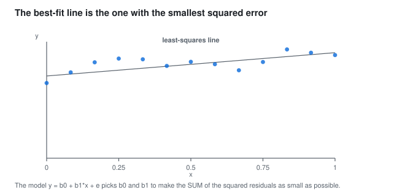
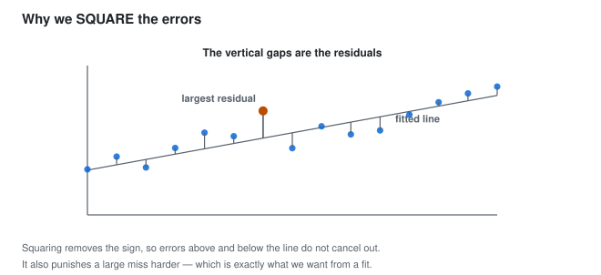
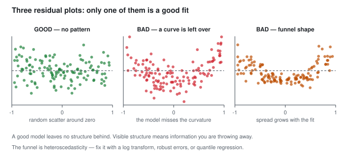
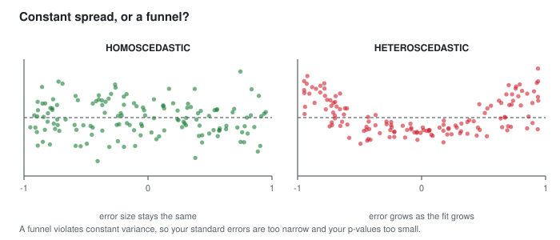
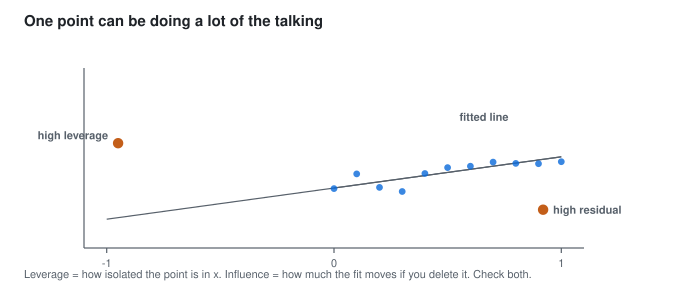
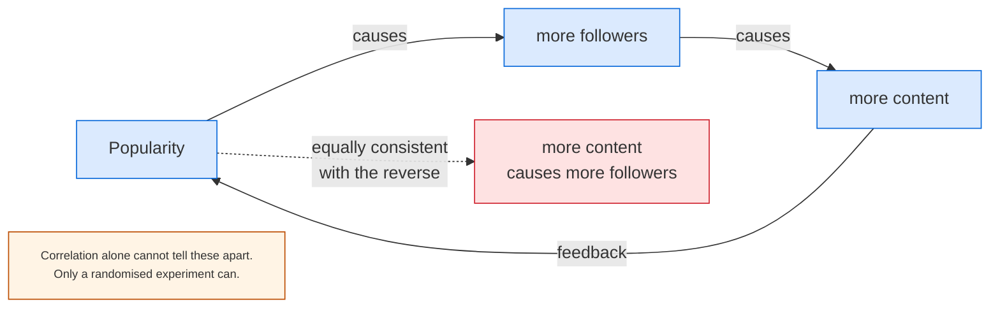
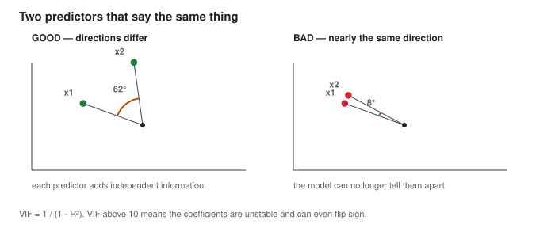
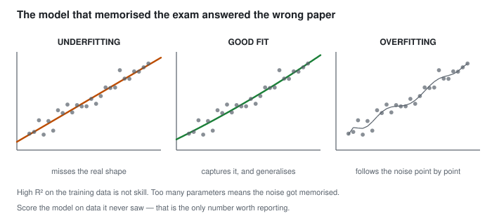
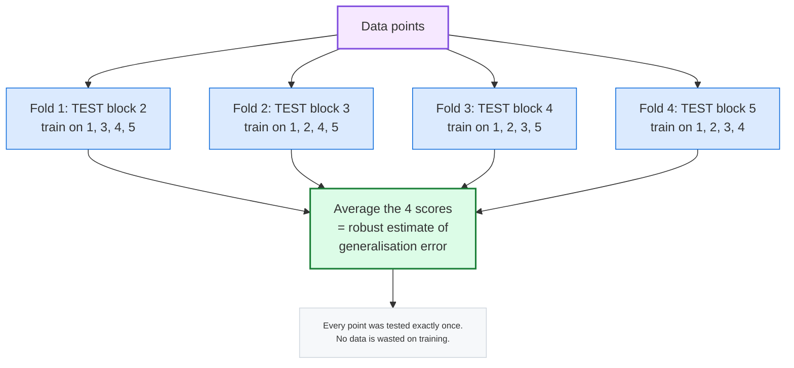

> ⚠️ **Generated file — do not edit here.** Edit `basic-statistics.md` at the
> repo root instead, then run `python3 split.py`.

## 🧮 PART 6, Regression Analysis

*Regression turns description into prediction.*

### 6.1 The Idea

We want to predict a number like price, marks, sales or temperature from other variables.

Simple linear regression fits the best straight line through a cloud of points.



> **In words:** The line is chosen to make the sum of the squared residuals as small as possible.

You step on a scale each morning while dieting. You
know that on average every extra kilo you carry costs about 0.5 extra
kilograms per month of dieting. That is a regression line.

**The model:**

```text
  y = b0 + b1 * x  +  e

  y  = the value you want to predict        (the response / dependent variable)
  x  = the variable you know               (the predictor / independent variable)
  b0 = the intercept  ("what happens when x = 0")
  b1 = the slope      ("how much y changes per unit of x")
  e  = the error / residual (what the model could not explain)
```

Two unknowns, two meanings:

- **b1 (slope):** *the rate of change.* "For each extra hour of study, marks
  rise by 1.8 points."
- **b0 (intercept):** *the baseline.* "With zero study hours, a student scores
  about 52."

Reporting the slope is a "per unit" statement, so it is only meaningful if you
also say *per what unit*, and in what units.

Careful with the intercept. "Marks at zero study hours" may sit outside your data, since most students study something. The intercept only means something when x = 0 is a real case.

---

### 6.2 Least Squares, Why "Best Fit" Means What It Does

The line must keep the squared vertical gaps to the points as small as possible. Each gap is a residual, e = y - y-hat.



> **In words:** Squaring the errors stops them cancelling and punishes large misses harder.

Why square the errors?

1. Squaring removes the sign. Without it, errors above and below the line cancel, and every line looks equally good.
2. Squaring punishes large errors more. One wild miss ruins the fit, which is what you want.

Aiming at a dartboard: mean absolute error is your average distance from the bullseye. Mean squared error punishes one dart far from the centre more than a few darts slightly off. It is the standard choice because it is smooth and easy to optimise.

> In machine learning, MSE and RMSE are the loss functions of linear regression. The best fit line and the minimum loss model are the same thing.

The formulas:

```text
              n
       SUM (xi - x-bar)(yi - y-bar)
b1  =  ------------------------------          (this is cov(x,y)/var(x))
              n
       SUM (xi - x-bar)^2

b0  =  y-bar  -  b1 * x-bar
```

Note that b1 is literally the correlation scaled by the ratio of the standard
deviations:

```text
       cov(x, y)          r * s_y
b1  =  ---------  =   --------------
       var(x)                s_x
```

Worth noting:

```text
  - If b1 = 0  then  r = 0.    Slope and correlation are the same thing here.
  - If s_x = s_y  then  b1 = r.  With standardised X and Y, slope = correlation.
  - The SIGN of b1 is always the sign of r.
```

Standardising X and Y is like converting kilometres and miles to metres. Once both share a unit, slope equals correlation.

```python
import numpy as np
from scipy import stats

x = np.array([1, 2, 3, 4, 5, 6, 7, 8])
y = np.array([50, 55, 58, 65, 70, 74, 82, 88])

b1 = np.cov(x, y, ddof=0)[0, 1] / np.var(x)
b0 = y.mean() - b1 * x.mean()
print(f"b1 = {b1:.4f}, b0 = {b0:.4f}")

res = stats.linregress(x, y)
print(res)    # slope, intercept, r, r^2, p, stderr
```

---

### 6.3 Understanding R-Squared

```text
                SSR          sum of squares of the regression (explained)
  R^2  =  -------------  =  1  -  --------------
                SST            sum of squares total (unexplained + explained)
```

It is the share of the swing in y that the model explains.

Saying study explains 40% of the swing in marks leaves 60% to other factors like prior ability, sleep, luck and teaching quality.

Reading R^2:

| R^2 | Interpretation |
|---|---|
| 0.9 | the model explains 90% of the variation, excellent for most purposes |
| 0.5 | half, moderate and typical in social science |
| 0.1 | very little, but might still beat a naive baseline |
| 0.0 | the model explains nothing |

> Warning: a high R^2 does not mean cause, and does not promise good predictions on new data. R^2 is measured on the data you fitted. On new data it usually drops.

In simple linear regression, `R^2 = r^2`. This fails for multiple regression, where R^2 can climb just because you added predictors.

Adjusted R^2 penalises extra predictors:

```text
  R^2_adj = 1 - (1 - R^2)(n - 1)/(n - p - 1)
```

where p counts predictors. Use adjusted R^2 to compare models with different counts, since it rises only when a predictor earns its place.

Honesty check: predicting house prices from the current sale price gives R^2 = 0.99. That is leakage, not skill. A feature known only after prediction time must stay out of the model.

---

### 6.4 Residuals: did the model miss a pattern?

A residual is the mistake on one row: `e_i = y_i - y-hat_i`.

```text
   perfect fit: all residuals ~ 0
   underfitting: a clear pattern (a curve) is left over
   overfitting:  residuals are ~0 on training data but bad on new data
```

A good model leaves no pattern in its residuals. A pattern means the shape is wrong and you waste information.



> **In words:** A good fit leaves no pattern. A curve means the model form is wrong,
> a funnel means the variance is not constant.

Plots worth checking:

| Plot | x-axis | What a bad look means |
|---|---|---|
| **Residuals vs fitted** | y-hat | curvature -> wrong functional form |
| **Q-Q plot** | theoretical quantiles | points off the diagonal -> non-normal errors |
| **Scale-Location** | y-hat | funnel shape -> **heteroscedasticity** |
| **Residuals vs a predictor** | that predictor | curve -> a transformation is needed |

**Heteroscedasticity** (the most common assumption violation):



> **In words:** A funnel breaks the constant-variance assumption, so standard errors are too narrow and p-values too small.

A $20 error on a $20 purchase is not the same as a $20 error on a
$20,000 house. Predicting a large number is naturally less precise in absolute
terms.

The fix: use a **log transformation** on y, or use **heteroscedasticity-robust
standard errors** (`statsmodels` `cov_type="HC3"`), or switch to quantile
regression. Never ignore it if your residual-vs-fitted plot shows a funnel,
because your confidence intervals will be too narrow.

**Use and influential points:**

- Use = how *unusual* a point is in x (does it sit alone at the edge?).
- Influence = how much the point *changes* the fitted line if removed.
  (There is a technical definition based on hat values and residuals; the
  practical test is simple: **delete it, refit, and see if the coefficients
  change much.**)



> **In words:** Use is how isolated a point is in x; influence is how much the
> fit moves if you delete it.

Outliers and influential points differ. An odd y with normal x is often noise. A point far out in x can drag the whole slope.

---

### 6.5 The Four Regression Assumptions

For confidence intervals and p-values on the coefficients to be valid:

```text
  1. LINEARITY
     The relationship between x and y is a straight line.
     Check: residuals vs fitted shows no curve.

  2. INDEPENDENCE
     Observations are independent of each other.
     Check: think about the data collection.
     *** This is the assumption most often violated in real datasets ***
     Time-series data (one row per day) is ALWAYS dependent.
     Fix: time-series models, GEE / mixed models, clustered standard errors.

  3. HOMOSCEDASTICITY
     The residual variance is constant across x.
     Check: Scale-Location plot -- no funnel.
     Fix: log transform, robust standard errors, quantile regression.

  4. NORMALITY of residuals (for small n)
     The residuals are approximately normal.
     Check: Q-Q plot.
     IMPORTANT: this assumption is about the RESIDUALS, not about y itself!
     For large n, regression is robust to this. It matters mainly for
     small-sample t-tests and CIs.
```

Easy to miss:

> These rules cover the errors, not X or Y. X and Y need not be normal. The residuals should behave. Without that, small sample p-values suffer first.

Linearity and independence matter most. The other two mainly shape your error bars and small sample tests.

---

### 6.6 Correlation Is Not Causation (and Why Not)

Four ways a correlation can mislead:

1. A lurking third variable


> **In words:** A lurking third variable can manufacture a perfect fake correlation.

Ice cream sales and drownings both rise in summer. The temperature causes both,
and there is no link between ice cream and drowning.

2. Reverse cause



"Blogs with more links get more traffic" and "more traffic gets you more links"
both look identical in the data. A/B tests or careful design are the only way to
tell them apart.

3. Selection bias (Part 4.3, the returning airplanes).

4. Pure chance. Test 20 variables at p < 0.05 and one will look "significant" by luck (Part 5.9).

#### Simpson's paradox: the winner flips when you split

A real kidney-stone study compared two treatments:

| Patients | Treatment A | Treatment B |
|---|---|---|
| All | 273/350 = 78% | 289/350 = 83%, B wins |
| Small stones | 81/87 = 93% | 234/270 = 87%, A wins |
| Large stones | 192/263 = 73% | 55/80 = 69%, A wins |

A wins in both groups but loses overall. How? Doctors gave B mostly to easy
small-stone cases and A to the hard large-stone ones. Stone size drives both
the treatment choice and recovery, so it is a confounder (item 1 above), and
the pooled rate hides it because the group sizes differ so much.

Rule: split by the big background variable before comparing rates. Pooled
rates lie whenever the groups are mixed unevenly. This bites in A/B tests
(split by device or country), hiring funnels (split by role), and medicine
(split by severity).

Correlation screens, it never concludes. For cause you need one of:

- a randomised experiment (A/B test), the best case
- a natural experiment (difference-in-differences, instruments, discontinuity)
- clear causal assumptions in observational data, stated openly

---

### 6.7 Multiple Linear Regression

Real problems have many causes, so the model generalises:

```text
  y = b0 + b1*x1 + b2*x2 + b3*x3 + ... + bn*xn + e
```

House price:

```text
  price = b0
        + b1 * area
        + b2 * bedrooms
        + b3 * distance_to_c metro
        + ...
```

The challenge is that each coefficient means something only if the others are
held constant. "Holding bedrooms and age constant, each extra square metre adds
b1." Coefficient interpretation in multiple regression is therefore harder and
always conditional.

The risk is multicollinearity:

If two predictors are nearly duplicates of each other, the model becomes
unstable. The coefficients can swing wildly, flip sign, and become huge, while
the overall fit barely changes.



> **In words:** When two predictors point the same way, the model cannot separate
> them and the coefficients become unstable.

Detection:

```text
                 r                1
  VIF_i  =  ----------------  = --------
              1 - r_i^2         (1 - R^2_i)
```

- VIF < 5 -> fine
- VIF 5-10 -> moderate concern
- VIF > 10 -> serious problem

Fixes: drop one of the pair, combine them with PCA, or use ridge or Lasso.

> Lasso can shrink coefficients to exactly zero, so it selects features. Ridge shrinks toward zero without removing. Both express doubt about large coefficients.

```python
import numpy as np, pandas as pd
import statsmodels.api as sm
from statsmodels.stats.outliers_influence import variance_inflation_factor

rng = np.random.default_rng(11)
n = 200
x1 = rng.normal(0, 1, n)                 # area
x2 = 0.9 * x1 + rng.normal(0, 0.4, n)    # bedrooms -- highly correlated with x1
x3 = rng.normal(0, 1, n)                 # age, independent
y = 5 + 3*x1 + 1.5*x2 - 2*x3 + rng.normal(0, 2, n)

df = pd.DataFrame({"area": x1, "bedrooms": x2, "age": x3, "price": y})

# add a constant explicitly -- statsmodels does NOT do this for you
X = sm.add_constant(df[["area", "bedrooms", "age"]])
model = sm.OLS(df["price"], X).fit()
print(model.summary())

# multicollinearity check
print("VIF:", [round(variance_inflation_factor(X.values, i), 2) for i in range(1, X.shape[1])])

# heteroscedasticity-robust standard errors
print(sm.OLS(df["price"], X).fit(cov_type="HC3").summary())

# regularisation fixes it
from sklearn.linear_model import Ridge, Lasso
print(Lasso(alpha=0.1).fit(df[["area","bedrooms","age"]], y).coef_)
```

---

### 6.8 Overfitting and Underfitting

This idea carries straight into machine learning.



> **In words:** More parameters fit the training data better while generalising
> worse. Score on held-out data, not training data.

| | Underfitting | Overfitting |
|---|---|---|
| Meaning | misses the real pattern | memorises noise |
| Train error | high | very low |
| Test error | high | high |
| Bias | high bias | low bias |
| Variance | low variance | high variance |
| Model | too simple | too complex |
| Fix | more features, a better form | more data, regularisation, simpler model |

A story that makes it stick:

A friend memorises last year's paper with the answer key and scores 100% on it. Hand them this year's paper and the score drops. Nothing was learned, only memorised.

Overfitting works the same way. Too many parameters memorise training rows plus their noise, and fail on new rows.

Learning the noise looks like this:

```text
   y = 3.1 x + 0.23 + random noise

   Fit 1:  y = 3.0 x + 0.2      R^2 = 0.90   -> good, generalises
   Fit 2:  y = 7.5 x - 2.1      R^2 = 0.92   -> better on THIS data, WORSE on new data
```

The remedies:

| Technique | Effect |
|---|---|
| **More data** | the most reliable cure, since noise cannot be memorised if it varies |
| **Simpler model** | fewer parameters, less to overfit |
| **Regularisation** (L1/L2, ridge/lasso) | penalises large coefficients |
| **Cross-validation** | estimate generalisation *before* touching the test set |
| **Early stopping** | stop training when validation error starts rising |
| **Dropout / batch norm** (deep learning) | the neural-network equivalents |
| **Pruning / depth limits** (trees) | stop splitting too early |
| **Feature selection** | remove useless predictors |

**Cross-validation in one picture:**



Honest workflow:

```text
  1. SPLIT: train (70%) / validation (15%) / test (15%)
        -- the test set is touched EXACTLY ONCE, at the very end
  2. TRAIN on the training set
  3. TUNE using the validation set (or cross-validation within the training set)
  4. REPORT metrics on the test set, once
  5. If you iterate on the test set, it has silently become a validation set
     and your reported number is optimistic.
```

Scores on training data show memory. Scores on held-out data show learning. Only the second counts.

---
