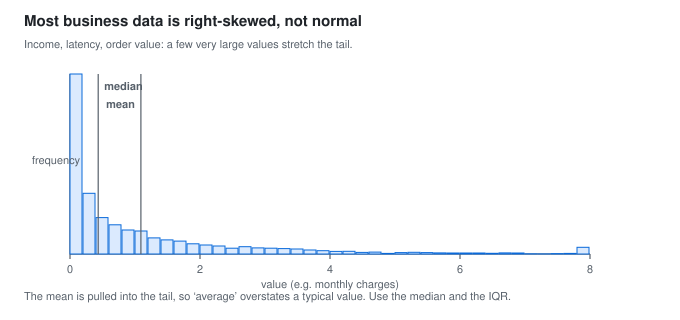
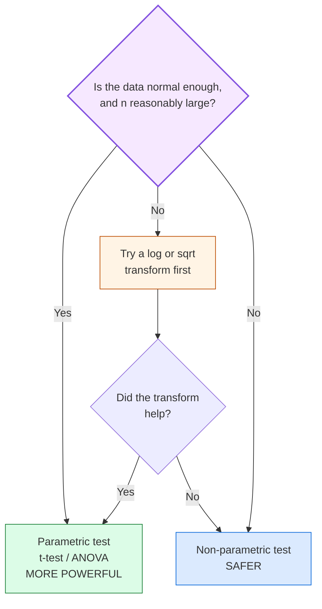
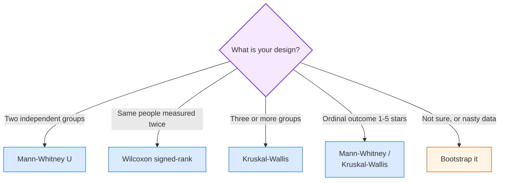
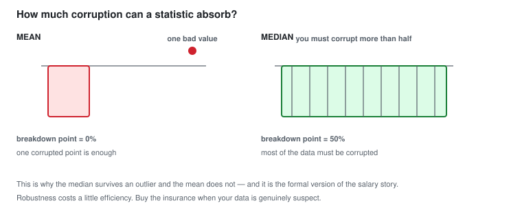
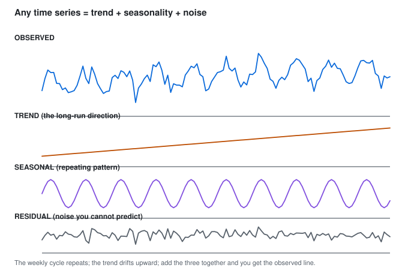
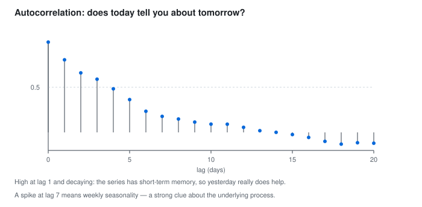
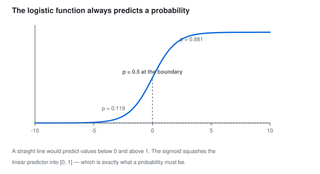

## 🛠️ PART 7, Non-Parametric Methods and Practical Data Science Topics

*Real data breaks rules. This part covers what to do then.*

### 7.1 When the Normal Assumption Fails

The t-test wants roughly normal residuals. Real data often refuses.



> **In words:** A few very large values stretch the tail right, dragging the mean past the median.

Signs a t-test may fail:

- The Q-Q plot's points curve away from the straight line
- The histogram has a long tail on one side
- The box plot has a long whisker
- You have a handful of extreme values
- The sample is small (n < 30) *and* the data looks skewed

Options, best first:

| Option | When to use it |
|---|---|
| **Transform** the data (`log`, `sqrt`, `box-cox`) | Right-skewed positive data; almost always works, and keeps the parametric test's higher power |
| **Use a non-parametric test** | Ordinal data, heavy outliers, or a transformation that does not help |
| **Use a robust method** (median/MAD) | Describing the data rather than testing it |
| **Bootstrap** (resampling) | When nothing else is valid, see 7.6 |

The log transform fixes right skew most days:

```text
  x  ->  log(x)
```


> **In words:** A log compresses the long right tail, so one normal model now
> covers the bulk of the data.

It works because the log squeezes large values and stretches small ones. Growth that multiplies becomes growth that adds. A 10% rise then means the same at any scale.

```text
  log transforms "a value doubled" into "a value added a constant":
      log(2x) - log(x) = log(2)   -- the same, whatever x is
```

```python
import numpy as np, pandas as pd
from scipy import stats

rng = np.random.default_rng(4)
income = rng.lognormal(mean=10, sigma=1.0, size=5000)   # right-skewed

print(f"raw    : skew={pd.Series(income).skew():.2f}")
log_inc = np.log(income)
print(f"logged : skew={pd.Series(log_inc).skew():.2f}")   # much closer to 0

# does a t-test survive the transform?
a = rng.exponential(scale=2, size=60)
b = rng.exponential(scale=2.5, size=60)
print("raw t-test   p =", stats.ttest_ind(a, b, equal_var=False).pvalue)
print("log t-test   p =", stats.ttest_ind(np.log(a), np.log(b), equal_var=False).pvalue)

# and a non-parametric one, which needs no transformation at all
print("Mann-Whitney p =", stats.mannwhitneyu(a, b, alternative="two-sided").pvalue)
```

---

### 7.2 Non-Parametric (Rank-Based) Tests

Core idea: drop the values, keep only their ranks, test the ranks.

Instead of exact salaries, compare how many people earn
more than you. If Bob outranks Alice, Paula, and everyone else, that is powerful
information even if you do not know the exact amounts.

Why ranking helps: ranks have no outliers, no skew and no units. A
billionaire's salary and a student's salary become merely the 500th and 12th
places. The test is therefore immune to exactly the problems that broke your
parametric assumption.

The cost: you throw away real information, namely the actual magnitudes.
Non-parametric tests are typically a little **less powerful** when the parametric
assumptions *do* hold. That is the trade-off, robustness for power.

```text
  Values:            12   5000   15    9000   13
  Their ranks:        3      4    2      5    1
  ---------------------- the whole test works on this row only
```

#### The main tests

| Test | Question | Replaces | Assumes |
|---|---|---|---|
| **Wilcoxon signed-rank** | are paired differences centred on 0? | paired t-test | differences symmetric |
| **Mann-Whitney U** | do two independent groups differ? | independent t-test | similar shapes |
| **Kruskal-Wallis H** | do 3+ groups differ? | one-way ANOVA | similar shapes |
| **Friedman** | do 3+ *matched* groups differ? | repeated-measures ANOVA | none |
| **Sign test** | is the median difference > 0? | anything, ultra-safe | none at all |

**How the Mann-Whitney U actually works:**

```text
  Combine both groups, sort all values, and assign ranks 1, 2, 3, ...
  Then ask: does group A sit systematically higher in the ranking than group B?

  If the ranks are randomly mixed -> U is near n1*n2/2 -> p is large.
  If group A occupies all the top ranks -> U is small -> p is small.
```

The honest caveat, which is worth knowing before you use it: the Mann-Whitney test
strictly tests whether one distribution is *stochastically larger* than the other.
It is equivalent to "the means differ" only when both groups have the **same
shape** (in particular, both normal or both skewed the same way). If group A is
normal and group B is heavily skewed, a significant Mann-Whitney result does
**not** cleanly mean "B's median is higher". Always plot the two box plots
before interpreting.

A rule of thumb for choosing:



```python
import numpy as np
from scipy import stats
rng = np.random.default_rng(7)

# heavy-tailed data -- where parametric tests break
a = np.array([12, 15, 14, 13, 900, 14, 12, 13, 15, 14])
b = np.array([20, 22, 21, 19, 23, 21, 20, 22, 21, 23])

# --- parametric (misleading here: two "outliers" dominate the means) ---
print("t-test   :", stats.ttest_ind(a, b, equal_var=False))

# --- non-parametric (only ranks matter) ---
u, p = stats.mannwhitneyu(a, b, alternative="two-sided")
print(f"Mann-Whitney U={u}, p={p:.5f}")

# Wilcoxon signed-rank for PAIRED data
before = np.array([200, 210, 190, 220, 205, 198, 500])
after  = np.array([190, 195, 180, 200, 195, 185, 470])
print("Wilcoxon :", stats.wilcoxon(after, before))

# Kruskal-Wallis for 3+ groups
g1 = rng.normal(10, 1, 30); g2 = rng.normal(10, 1, 30); g3 = rng.normal(13, 1, 30)
print("Kruskal  :", stats.kruskal(g1, g2, g3))

# Friedman for matched groups (e.g. 3 treatments, same 20 patients)
f1 = rng.normal(10, 1, 20); f2 = rng.normal(11, 1, 20); f3 = rng.normal(12, 1, 20)
print("Friedman :", stats.friedmanchisquare(f1, f2, f3))

# the ultra-safe sign test -- assumes literally nothing
d = after - before
print("sign test:", stats.binomtest((d > 0).sum(), len(d), 0.5, alternative="greater").pvalue)
```

**Which one to reach for, quickly:**



---

#### The permutation test: what would chance do?

If the group labels mean nothing, shuffling them should not change the gap.
So shuffle 10,000 times, recompute the gap each time, and count how often the
shuffled gap beats yours. That share is the p-value. No bell curve, no ranks,
and it works for any stat you like: means, medians, even ratios.

Reach for it with small samples, odd shapes, or a custom stat no textbook test
covers. The price is compute, which is pocket change today. It sits between
the rank tests above (fixed stats, fast) and the bootstrap in 7.6 (resample
with replacement to get intervals).

```python
import numpy as np
from scipy import stats
rng = np.random.default_rng(9)

a = np.array([12, 15, 14, 13, 16, 14, 12, 13])
b = np.array([20, 22, 21, 19, 23, 21, 20, 22])
obs = b.mean() - a.mean()

pool = np.concatenate([a, b])
n = len(a)
sims = np.array([(lambda q: q[:n].mean() - q[n:].mean())(rng.permutation(pool))
                 for _ in range(10000)])
p_perm = (np.abs(sims) >= abs(obs)).mean()
print(f"observed gap = {obs:.2f}, permutation p = {p_perm:.4f}")
print("t-test p     =", round(float(stats.ttest_ind(a, b, equal_var=False).pvalue), 4))
print("Mann-Whitney =", round(float(stats.mannwhitneyu(a, b, alternative='two-sided').pvalue), 4))
```

---
### 7.3 Robust Statistics, Describing Data That Misbehaves

A **robust** statistic is one that is not unduly influenced by a few extreme
values. Robustness is exactly what Part 1 taught us to want, and here is the
formal vocabulary for it.

#### The breakdown point, the key idea

**The breakdown point is the fraction of your data that can be corrupted to
"infinity" before the statistic itself becomes infinity.**



> **In words:** The mean has a breakdown point of 0%; the median has 50%. That is the formal reason the median survives outliers.

**The intuition is exactly the "mean vs the CEO salary" story from Part 1,
now written down as a number.** A 50% breakdown point means the median can
absorb an astonishing amount of corruption.

#### The robust toolkit

| Instead of | Use | Breakdown point | Notes |
|---|---|---|---|
| mean | **median** | 50% | the champion |
| mean | **trimmed mean** (10% trimmed) | ~10% | a compromise: keeps some efficiency, gains robustness |
| SD | **MAD** (median absolute deviation) | 50% | like the SD, but for the median |
| SD | **IQR / IQRN** | 50% | Q3 - Q1, scaled by 1.349 for normality |
| min/max | **5th and 95th percentile** |, | for display |
| straight least squares | **robust regression** (Huber, RANSAC) |, | for modelling, see 7.6 |

**MAD, Median Absolute Deviation:**

```text
MAD = median( | x_i - median(x) | )
```

Analogy: if the median is the "centre" of your data, the MAD is the "typical
distance from the centre". That is the SD's job, but computed robustly.

Getting a normal-consistent scale estimate from the MAD:

```text
                        MAD
  sigma_hat  =  1.4826 x ----
                        median(|x|)

  (because for normal data, median(|x - mean|) = 0.6745 * sigma,
   so dividing by 0.6745 -- i.e. multiplying by 1.4826 -- recovers sigma)
```

So `1.4826 * MAD` gives you a quantity directly comparable with the ordinary SD,
but it is not destroyed by outliers. This is the standard "robust z-score":

```text
  robust z_i  =  (x_i - median(x)) / (1.4826 * MAD)
```

**Rule of thumb for a robust z:** flag `|robust z| > 3.5` as an outlier. Compare
with the classic `|z| > 3` rule, which is fragile precisely because it is built
from the mean and SD, the very things outliers corrupt. Note the logical loop:
**using mean/SD to detect outliers means the outliers have already corrupted
your detector.**

```python
import numpy as np, pandas as pd

x = np.array([12, 14, 13, 15, 14, 12, 16, 13, 14, 15, 500])  # one bad row
s = pd.Series(x)

print("mean   :", s.mean().round(2), " median:", s.median())      # 58 vs 14
print("std    :", round(s.std(ddof=1), 2))
mad = np.median(np.abs(x - np.median(x)))
print("MAD    :", mad, " -> robust sigma =", round(1.4826*mad, 3))

# outlier detection: the fragile way vs the robust way
z_naive   = (s - s.mean()) / s.std(ddof=1)
z_robust  = (s - s.median()) / (1.4826 * mad)
out = pd.DataFrame({"value": s, "z_naive": z_naive.round(2),
                    "z_robust": z_robust.round(2)})
print(out)
print("flagged (|z|>3) naive  :", out.index[out.z_naive.abs()  > 3].tolist())
print("flagged (|z|>3.5) robust:", out.index[out.z_robust.abs() > 3.5].tolist())

# 20% trimmed mean: drop the bottom and top 20% first
from scipy.stats import trim_mean
print("20% trimmed mean:", round(trim_mean(x, 0.2), 3))
```

Robust statistics are not the universal answer, because they throw away
information. If your data is clean and normal, the mean and SD are *more*
efficient: they use the actual magnitudes, not just the order. Robust methods
are insurance you pay for with a small efficiency loss, and you should buy that
insurance when your data is genuinely suspect.

---
### 7.4 Categorical Data: Proportions, Odds and Ratios

Part 5.6 handled categorical data with a chi-square test. Now the **effect
size** side, since "is it significant?" and "is it important?" are different
questions, and only the effect size answers the second.

#### Proportion

```text
                number of successes
  p_hat  =  -------------------------
                 total observations
```

#### The three risk measures

**Relative risk (risk ratio), for COHORT studies / A/B tests:**

```text
                    risk in exposed group
  RR  =  -----------------------------
                   risk in unexposed group
```

Think of it this way: a fire safety campaign is run in 10 towns. The fire rate falls from
5 per 1,000 to 4 per 1,000. The RR is 0.8, so "the rate was 20% lower".

**Relative risk reduction** = `1 - RR` = 20%. This is exactly the "uplift" or
"lift" that A/B tests report.

**Odds ratio (OR), for CASE-CONTROL studies:**

```text
                      p1 / (1 - p1)
  OR  =  -------------------------------
                      p0 / (1 - p0)
```

The difference between RR and OR, which is the single most important thing here:

```text
  RR and OR tell you DIFFERENT stories whenever the outcome is not rare.

  risk:      1%  ->  2%        RR = 2.0   "risk DOUBLED"
             odds: 1%  ->  2.02%     OR = 2.05   "odds roughly doubled"

  risk:     50%  ->  60%       RR = 1.2   "risk rose 20%"
             odds: 50%  ->  60%     OR = 1.5   "odds rose 50% !"

             ^ the 50% case is why "odds" and "risk" are not
               interchangeable, and why oversampling can distort ORs.
```

**Rule of thumb:** if you can compute the risk directly (a cohort or randomised
design, that is an A/B test), **report the relative risk**. Odds ratios are needed
only when you cannot follow people over time, which is what a case-control
design forces on you.

**Absolute risk, the number to actually tell a decision-maker:**

```text
  ARR (absolute risk reduction) = p0 - p1
  NNT (number needed to treat)   = 1 / ARR
```

```text
  Suppose a treatment reduces the risk of a complication from 10% to 9%.
    RR   = 0.9          -> "a 10% relative reduction"
    ARR  = 0.01         -> "an absolute reduction of 1 percentage point"
    NNT  = 1/0.01 = 100 -> "you must treat 100 patients to save ONE life"

  The NNT is the number a hospital, a manager or a government actually cares
  about. It is honest, absolute, and free of framing tricks.
```

Relative measures alone are dangerous: a treatment that cuts risk from
2% to 1% sounds like a big "50% relative reduction", but that is only
1 percentage point absolute (NNT = 100). It sounds impressive precisely because the baseline
was tiny. Always report the baseline alongside the relative
number. This is the single best lesson in effect-size reporting.

#### What a chi-square test cannot tell you

```text
  A 2x2 chi-square gives you a p-value. It does NOT tell you:
    - how big the difference is
    - which direction
    - whether the effect matters commercially

  Pair it with a risk ratio + confidence interval, always.
```

**A standard A/B test result, done properly:**

```text
  Variant A: 1,204 / 10,000 = 12.04%
  Variant B: 1,351 / 10,000 = 13.51%

  Absolute lift = +1.47 percentage points
  Relative lift = 13.51/12.04 - 1 = +12.2%     <- the number marketers quote
  95% CI for the difference: (+0.31pp, +2.63pp)
  p = 0.012                                       <- significant
  NNT-equivalent: to gain 1 extra conversion you need ~68 extra visitors

  Verdict: ship it. The effect is small but real, and the CI excludes zero.
```

```python
import numpy as np
from scipy import stats
import statsmodels.api as sm
from statsmodels.stats.contingency_tables import Table2x2

# --- A/B test on two proportions -------------------------------------------
conv = np.array([1351, 1204])       # conversions
visits = np.array([10000, 10000])    # visitors per variant
p1, p2 = conv[0]/visits[0], conv[1]/visits[1]

print(f"A: {p1:.4f}   B: {p2:.4f}")
print(f"absolute lift = {(p2-p1)*100:.2f} percentage points")
print(f"relative lift = {(p2/p1-1)*100:.1f} %")

# difference in proportions + CI, via the standard 2x2 table
table = np.array([[conv[0], visits[0]-conv[0]],
                  [conv[1], visits[1]-conv[1]]])
chi2, p, dof, expected = stats.chi2_contingency(table)
print(f"chi2={chi2:.3f} p={p:.4f}  expected={expected.ravel()}")

ci = sm.stats.proportion_confint(conv[0], visits[0], method="wilson")
print("B conversion 95% CI:", (round(ci[0],4), round(ci[1],4)))

# relative risk, odds ratio, and their CIs
t2x2 = Table2x2(np.array([[1351, 8649], [1204, 8796]]))
print("risk ratio :", t2x2.riskratio, " CI:", t2x2.riskratio_confint())
print("odds ratio :", t2x2.oddsratio, " CI:", t2x2.oddsratio_confint())

# effect size for a chi-square: Cramer's V  (sqrt(chi2 / (n * min(r-1, c-1))))
n = table.sum()
print(f"Cramer's V = {np.sqrt(chi2 / (n * 1)):.4f}")
```

**Interpreting effect sizes for categorical data (Cramer's V):**

| V | Strength |
|---|---|
| 0.1 | small |
| 0.3 | medium |
| 0.5+ | large |

---

### 7.5 Time Series, A Brief, Honest Introduction

**A time series is data where the *order* of observation carries information.**
That single fact changes the rules.



> **In words:** Observed = trend + seasonal + residual; the three panels add back up
> to the original line.

#### The three ingredients of any time series

```text
  1. TREND       the long-run direction        sales are growing over the years
  2. SEASONALITY  a pattern that repeats        every December sales spike
  3. NOISE       everything you cannot explain   random day-to-day wobble
```

**Decomposition** splits the series into those three parts. Plotting them
separately is often the fastest way to understand a business metric.

```text
  observed = trend + seasonal + residual
```

#### Why time series break ordinary statistics

> **The rows of a time series are almost never independent.**

This violates the independence assumption of the t-test, the regression standard
errors, and the confidence interval. Consequences:

- **Standard errors are too small** -> p-values are too small -> you find
  "significance" that is really just one long trend.
- **The model will look far more accurate than it is**, because it has seen the
  same trends in the past and can cheat.

Think of it this way: you are trying to see whether a student is genuinely improving by
examining their test scores. If you take ten tests in a row on the same day and
the student happens to be well-rested, the scores will look correlated, but that
is not learning, it is just one good day measured repeatedly. The observations
are the same event, counted ten times.

The consequences in practice:

```text
  a time series model trained on Jan-Aug and tested on Sep-Oct
  is NOT the same problem as random train/test split, because
  training on the future and testing on the past is impossible in production.

  NEVER use a random split on time-ordered data. ALWAYS split by time:
      train = oldest, test = newest.
  This is called a "walk-forward" or "rolling-origin" evaluation.
```

#### Stationarity, in plain words

A series is **stationary** if its statistical properties (mean, variance,
autocorrelation) stay roughly constant over time.


> **In words:** Stationary means the wiggles look the same everywhere; a trend means
> they grow.

Why it matters: many classical forecasting methods (ARIMA, and the assumptions
behind confidence intervals) require stationarity. The standard fix is to
**difference** the series, taking the change instead of the level:

```text
  level:   100, 103, 101, 108, 112
  diff:      ,  +3,  -2,  +7,  +4      <- the trend is gone
```

#### Autocorrelation (ACF), "does today predict tomorrow?"

```text
  lag 0 (today with itself)   = +1.00   (trivially)
  lag 1 (today vs yesterday)  = high    if the series is sticky
  lag 2                       = ...
```



> **In words:** High at lag 1 and decaying means the series has short-term memory.
> Yesterday helps predict today.

**How to read it:** if the ACF is high at lag 1 and fades away, your series has
short-term memory and yesterday helps predict today. If there is a spike at, say,
lag 7, there is a **weekly** pattern, a strong clue about your business.

```text
  spike at lag 7   -> weekly seasonality
  spike at lag 12  -> monthly
  spike at lag 24  -> hourly, or a 2-year cycle
  slow decay       -> trend / non-stationary
  oscillating      -> seasonality
  all near zero    -> white noise (unpredictable)
```

Key practical points for a data scientist:

- Always plot the series before modelling anything.
- Check for missing values: a "gap" that is really `NaN` breaks every
  time-based method.
- Beware of leakage through time (Part 6.3). "Average of the last 7 days" is fine; "the final value" is not.
- Compare against a naive baseline ("tomorrow equals today"). If a clever model cannot beat it, ship the naive one.
- Log-transform highly trending or multiplicative-growth series.

```python
import numpy as np, pandas as pd
import matplotlib.pyplot as plt
import statsmodels.api as sm
from statsmodels.tsa.stattools import adfuller

# a synthetic series: trend + weekly seasonality + noise
rng = np.random.default_rng(20)
n = 200
dates = pd.date_range("2023-01-01", periods=n, freq="D")
trend = np.linspace(0, 20, n)
weekly = 3 * np.sin(2 * np.pi * np.arange(n) / 7)
noise = rng.normal(0, 1.5, n)
s = pd.Series(trend + weekly + noise, index=dates, name="y")

print(s.describe())
print("rolling mean (7d):\n", s.rolling(7).mean().head(8).round(2))

# ADF test for stationarity  (H0: the series has a unit root, i.e. is NOT stationary)
adf = adfuller(s, autolag="AIC")
print(f"ADF statistic={adf[0]:.3f}  p-value={adf[1]:.4f}   "
      f"{'stationary (reject unit root)' if adf[1] < 0.05 else 'non-stationary (keep unit root)'}")

# differencing removes the trend
d = s.diff().dropna()
print("ADF after 1st difference p =", round(adfuller(d)[1], 4))

# autocorrelation
acf = sm.tsa.acf(s.dropna(), nlags=21, fft=True)
print("ACF lags 0-7:", np.round(acf[:8], 2))    # spike at lag 7 = weekly

# decomposition
from statsmodels.tsa.seasonal import seasonal_decompose
comp = seasonal_decompose(s, model="additive", period=7, extrapolate_trend="freq")
comp.plot(); plt.show()

# honest evaluation: train on the PAST, test on the FUTURE
train, test = s[:160], s[160:]

# naive baseline: "tomorrow equals today"
naive_pred = pd.Series([train.iloc[-1]] * len(test), index=test.index)

# ARIMA (stationary model on the differenced series)
fit = sm.tsa.ARIMA(train, order=(1, 1, 1)).fit()
fc = fit.get_forecast(steps=len(test))
arima_pred = pd.Series(fc.predicted_mean, index=test.index)

print("naive  MAE:", round((test - naive_pred).abs().mean(), 3))
print("ARIMA  MAE:", round((test - arima_pred).abs().mean(), 3))
# ^ if ARIMA barely wins, the naive baseline may be the right production choice
```

---
### 7.6 A Complete Worked Example: Customer Churn

**This section is the one to re-read before any project or interview.** It ties
every part of the book into a single realistic workflow.

#### The business question

> "Churn is 32% this quarter. Should we launch a retention campaign, and if so,
> for which customers?"

#### The bootstrap, the universal escape hatch

Before the full example, one technique that solves "I do not know the
distribution" problems. Learn it and you can analyse almost anything.

**The idea:** you cannot compute the sampling distribution analytically, so
**simulate** it by resampling.

```text
  The population
  |  o o o o o o o o o o o o o o o o o o o o o o o o o o o o o |
  |  ^ ^  ^   ^  ^   ^ ^  ^  ^  ^   ^ ^  ^   ^  ^  ^  ^  ^  ^   |
  +----------------------------------------------------------------->

  Step 1: DRAW a sample of n items WITH replacement
  Step 2: compute the statistic (e.g. the mean)
  Step 3: put the items back, and REPEAT B times

  Step 4: the distribution of those B means IS the bootstrap
          sampling distribution. Its spread is your standard error.
```

Think of it this way: you cannot read every card in the deck, so you shuffle, deal
`n` cards, note the total, put them back, shuffle again, deal again, a thousand
times. The pattern of totals tells you how uncertain your first estimate was.

Why it works: the empirical distribution of your data is your best estimate
of the population, so resampling from it approximates drawing from the
population. It makes no normality assumption at all.

```python
import numpy as np
import pandas as pd

rng = np.random.default_rng(30)
x = rng.lognormal(mean=10, sigma=1.0, size=500)   # badly skewed

# --- bootstrap a confidence interval for the mean -------------------------
B = 10_000
boot_means = [rng.choice(x, size=len(x), replace=True).mean() for _ in range(B)]
boot_means = np.array(boot_means)

lo, hi = np.percentile(boot_means, [2.5, 97.5])
print(f"mean          = {x.mean():.3f}")
print(f"bootstrap 95% CI = ({lo:.3f}, {hi:.3f})")

# the naive approach assumes normality -- badly biased here
from scipy import stats
se_naive = x.std(ddof=1) / np.sqrt(len(x))
print(f"naive (normal) CI = ({x.mean()-1.96*se_naive:.3f}, {x.mean()+1.96*se_naive:.3f})")

# --- bootstrap the DIFFERENCE between two groups (the A/B test) -----------
a = rng.lognormal(10, 1.0, 300)
b = rng.lognormal(10.2, 1.0, 300)      # b is genuinely ~2% higher

obs_diff = b.mean() - a.mean()
boot_diff = np.array([rng.choice(b, len(b), replace=True).mean()
                      - rng.choice(a, len(a), replace=True).mean()
                      for _ in range(B)])
lo, hi = np.percentile(boot_diff, [2.5, 97.5])
print(f"\nobserved difference = {obs_diff:.3f}")
print(f"bootstrap 95% CI      = ({lo:.3f}, {hi:.3f})")
print("significant?" , "YES" if lo > 0 else "NO -- CI includes zero")
```

**Bootstrap rule of thumb:** you need roughly `B >= 1000` to `10000` resamples
for a stable 95% interval. The bootstrap is a **computational** method, so it is
slow for big data, but it requires no assumptions, which is a very good trade.

#### Step 1, Load and inspect

```python
import numpy as np, pandas as pd
import matplotlib.pyplot as plt
import seaborn as sns

# Simulate a realistic churn dataset
rng = np.random.default_rng(42)
n = 5000
tenure   = rng.integers(1, 72, n)
monthly  = np.round(rng.lognormal(3.6, 0.6, n), 2)
plan     = rng.choice(["Basic", "Standard", "Premium"], n, p=[0.5, 0.3, 0.2])
support  = rng.poisson(1.5, n)
contract = rng.choice(["Month-to-month", "One year", "Two year"], n, p=[0.55, 0.3, 0.15])
# churn depends on tenure, contract and support -- so a real signal exists
logit = (-0.03 * tenure + 0.8 * (contract == "Month-to-month")
         - 0.25 * support + 0.5 * (plan == "Basic"))
churn = (rng.random(n) < 1 / (1 + np.exp(-logit))).astype(int)

df = pd.DataFrame({"tenure": tenure, "monthly": monthly, "plan": plan,
                   "support": support, "contract": contract, "churn": churn})
print(df.shape)
print(df.head())
```

#### Step 2, Descriptive statistics FIRST (Part 1)

```python
# Step 2 -- runs after the Step 1 block above, which builds df
import matplotlib.pyplot as plt
import seaborn as sns

# the overall picture
print(df[["tenure", "monthly", "support"]].describe().round(2))

# churn rate
print(f"\noverall churn rate = {df['churn'].mean():.1%}")     # ~30-35%

# is monthly_charges skewed?  (decide mean vs median here)
print("skew:", df["monthly"].skew().round(2))                # > 0 -> use median

# churn by category -- box plot + grouped mean
print(df.groupby("contract")["churn"].agg(["count", "mean"]).round(3))
print(df.groupby("plan")["churn"].mean().round(3))

fig, axes = plt.subplots(1, 3, figsize=(15, 4))
sns.histplot(df["monthly"], kde=True, ax=axes[0], bins=40)
axes[0].set_title("monthly_charges (right-skewed)")
sns.boxplot(x="contract", y="churn", data=df, ax=axes[1])
axes[1].set_title("churn by contract")
sns.scatterplot(x="tenure", y="churn", data=df, alpha=0.1, ax=axes[2])
axes[2].set_title("churn vs tenure")
plt.tight_layout(); plt.show()
```

#### Step 3, Is the difference real? (Part 5)

```python
# Step 3 -- runs after Steps 1-2 above, which build df
import numpy as np
import pandas as pd
from scipy import stats
import statsmodels.api as sm
from statsmodels.stats.proportion import proportion_confint

# categorical -> chi-square
ct = pd.crosstab(df["contract"], df["churn"])
chi2, p, dof, expected = stats.chi2_contingency(ct)
print(f"chi2 = {chi2:.2f}, p = {p:.3g}  (expected counts all >= 5? "
      f"{(expected >= 5).all()})")

# effect size, not just significance
n_tot = ct.values.sum()
print(f"Cramer's V = {np.sqrt(chi2 / n_tot):.3f}")

# numeric -> compare medians (skewed!), so Mann-Whitney is the right call
churned   = df.loc[df.churn == 1, "monthly"]
retained  = df.loc[df.churn == 0, "monthly"]
u, p = stats.mannwhitneyu(churned, retained, alternative="two-sided")
print(f"Mann-Whitney p = {p:.3g}  "
      f"medians: churned {churned.median():.2f} vs retained {retained.median():.2f}")

# tenure is roughly normal-ish -> t-test is fine, and we report the CI
t, p = stats.ttest_ind(df.loc[df.churn==1,"tenure"], df.loc[df.churn==0,"tenure"],
                       equal_var=False)
d = df.loc[df.churn==1,"tenure"].mean() - df.loc[df.churn==0,"tenure"].mean()
se = np.sqrt(df.loc[df.churn==1,"tenure"].var(ddof=1)/ (df.churn==1).sum()
             + df.loc[df.churn==0,"tenure"].var(ddof=1)/(df.churn==0).sum())
crit = stats.t.ppf(0.975, df=len(df)-2)
print(f"tenure difference = {d:.2f} months  95% CI = ({d-crit*se:.2f}, {d+crit*se:.2f})  p = {p:.3g}")
```

The honest summary of Step 3: churners differ significantly in tenure, plan,
contract and support calls. We have shown **association**. To say contract type
*causes* churn you would need a randomised experiment, and you cannot randomly
assign contract terms.

#### Step 4, Logistic regression (Part 6 logic, for a binary outcome)

```python
# Step 4 -- runs after Steps 1-3 above, which build df
import numpy as np
import pandas as pd
import statsmodels.formula.api as smf

model = smf.logit("churn ~ tenure + np.log(monthly) + support + C(contract) + C(plan)",
                  data=df).fit()
print(model.summary())

# interpret as odds ratios
params = pd.DataFrame({"coef": model.params, "odds_ratio": np.exp(model.params),
                       "p_value": model.pvalues})
print(params.round(4))

# predicted probabilities for a business decision
new = pd.DataFrame({"tenure": [2, 2, 60, 60],
                    "monthly": [85.0]*4,
                    "support": [0, 0, 0, 0],
                    "contract": ["Month-to-month", "One year",
                                 "Month-to-month", "Two year"],
                    "plan": ["Basic"]*4})
pred = model.predict(new)
print(new.assign(p_churn=pred.round(4)))
```

**Why log-odds?** The outcome is binary, so the model predicts a **probability**,
which must sit between 0 and 1. A straight line has no such guarantee; the
logistic (sigmoid) function guarantees it:



> **In words:** The sigmoid keeps every predicted probability inside [0, 1], which a
> straight line cannot.

**Reading an odds ratio:**

```text
  OR = 2.0  ->  double the ODDS of churning (not "double the probability")
  OR = 0.6  ->  40% lower odds
  A logistic coefficient of 0.7 -> exp(0.7) = 2.01, so ~2x the odds
```

The classic confusion: odds and probability differ (Part 7.4). An OR of 2
does **not** mean "chance doubled" unless the baseline risk is small.

**Tree models are usually better for this task.** Churn is tabular, and
random forests / gradient boosting handle non-linearity and interactions
automatically. The logistic model's real value is that its **coefficients are
interpretable**, which is valuable when you must justify a decision to a
non-technical stakeholder.

#### Step 5, Decision, with uncertainty attached

```text
  A month-to-month, 2-month-tenure, Basic-plan customer
      -> predicted churn probability ~ 79%
  A two-year, 60-month-tenure, Basic-plan customer
      -> predicted churn probability ~ 24%

  ACTION: target retention offers at the high-risk segment.

  BUT ALSO REPORT:
    - the model's performance on held-out data (AUC, and the AUC curve)
    - the confidence interval on each estimate
    - the expected VALUE of the campaign:
          (customers saved) x (their value) - (cost of the offer)
    - that the model finds ASSOCIATION, not necessarily causation
```

**Refinement: uplift modelling.** Churn probability is not the same as
*sensitivity to treatment*. Some high-risk customers would churn no matter what
you offer them. The customers who benefit from a retention call are those with
high probability **and** high treatment sensitivity. Chasing the wrong group
wastes the entire campaign budget. This is an important distinction in applied
data science.

#### How to defend this analysis in an interview

1. "I checked the **data quality** first: missing values, duplicates, ranges,
   the units, the class balance, and whether rows are independent."
2. "I looked at the **distributions** before choosing a summary, and used the
   median and IQR because charges are skewed."
3. "I used an appropriate **test for each variable type**: chi-square for
   categorical, a t-test where normality was plausible, Mann-Whitney where it
   was not. I checked the assumptions rather than assuming them."
4. "I reported **effect sizes and confidence intervals**, alongside p-values."
5. "I reported the **baseline rate** next to every relative measure."
6. "I fit a model, then **checked its assumptions** (residuals, VIF, influence)
   and validated it on **held-out data** with a **time-ordered split**.
7. "I compared it to a **naive baseline**. If the model cannot beat 'most
   customers do not churn', it is not worth shipping."
8. "I am careful about **causal claims**: this is observational data, so I
   would propose an **A/B test** to confirm the campaign actually reduces churn."
9. "I know the **limitations**: selection bias in who was surveyed, no
   information on unobserved confounders such as income or competitor offers,
   and drift over time."

Every item in that list is a concept from this book.

---


---
